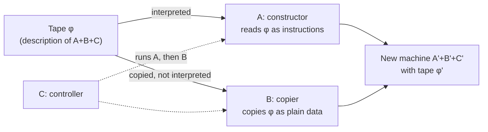
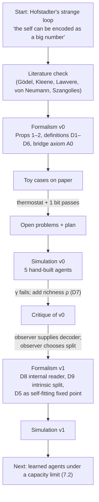
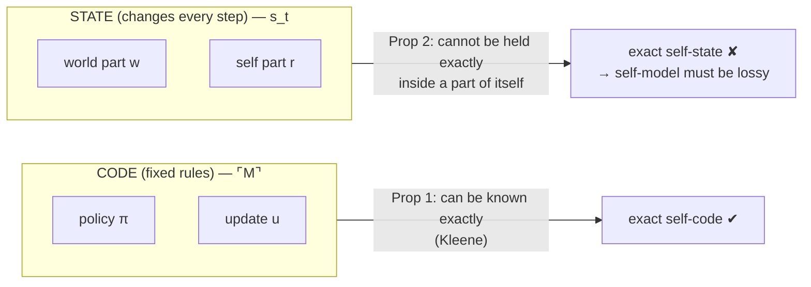
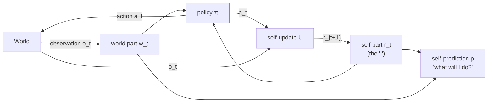
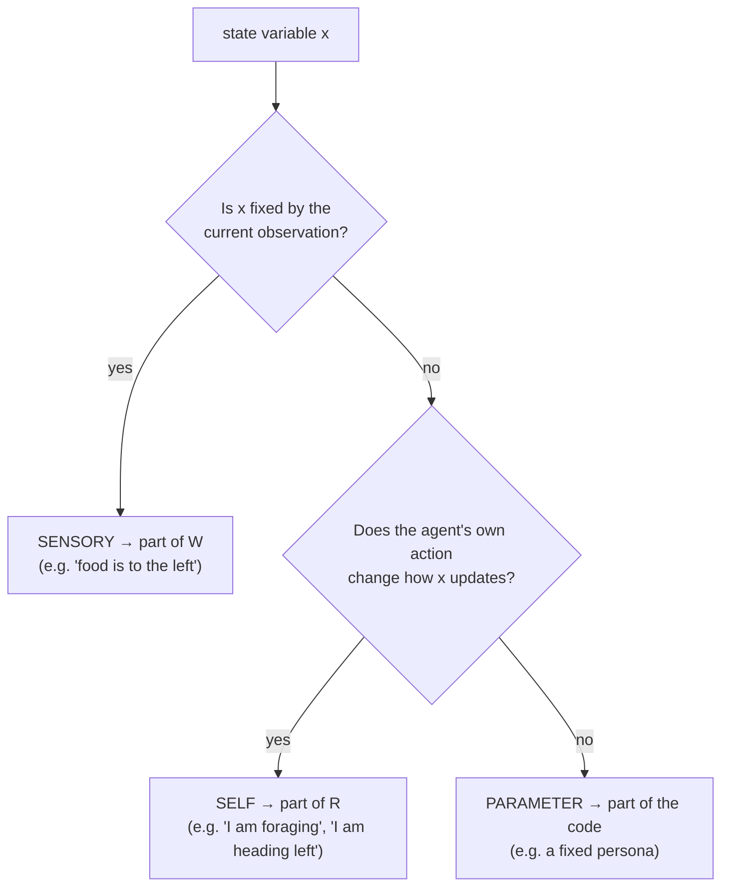
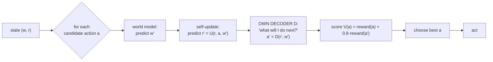
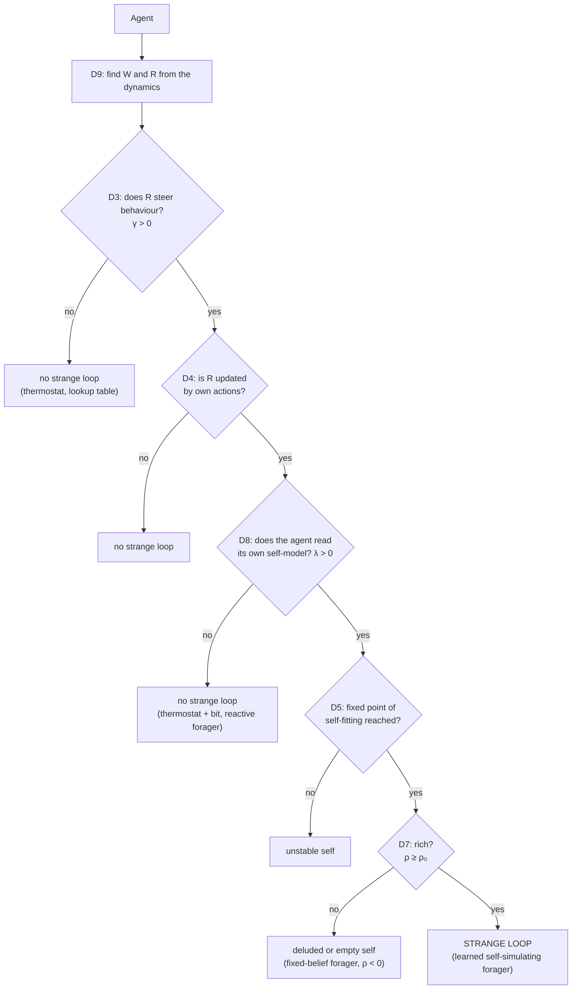

# A Minimal Formal Theory of the Hofstadter Self

**Report on work so far — version 1, 23 November 2026**
Project: **"I"** — review the literature on consciousness, build thought experiments that narrow down what it is, and answer the question *"Is AI conscious?"*

---

## How to read this report

This report has two layers. You can read either one.

- **The formal layer** gives exact definitions, propositions and proofs. It is for readers who are comfortable with basic set theory, probability and information theory.
- **The plain layer** is in boxes like the one below. It explains the same idea in simple words, often with an example or a metaphor. You can skip all the mathematics and read only these boxes.

> **In plain words:** Every important idea appears twice: once in mathematics, once in a box like this one. If the mathematics is not for you, read the boxes and look at the diagrams.

Diagrams use Mermaid. GitHub and most Markdown viewers draw them automatically.

### Contents

1. Summary
2. Aim and starting point
3. Literature that shaped the work
4. Approach
5. Formalism v0: the minimal theory
6. Toy cases and the first problem
7. Open problems and the plan
8. Simulation v0
9. Critique of v0: three serious problems
10. Formalism v1: fixing the observer problems
11. Simulation v1
12. The current definition of a strange loop
13. What we have deduced (list of results)
14. Limits and open questions
15. Next steps
16. Glossary
17. References
Appendix A. The code
Appendix B. Raw outputs

---

## 1. Summary

We started from Douglas Hofstadter's idea that the "I" is a *strange loop*: a pattern in a system that models itself, and that this self could in principle be written down as one (very large) number. We set out to make this idea exact enough to test.

We built a minimal formal theory in three steps, with a test at each step:

1. **Formalism v0.** A finite agent with a world part and a self part. We proved two simple results. An agent *can* use its own full rulebook (from Kleene's recursion theorem). An agent *cannot* hold an exact copy of its own current state inside a part of itself (a counting argument). So a self-model of the current state must be **lossy**. This turns one of Hofstadter's claims into a theorem.
2. **Simulation v0.** We measured five toy agents. The measures showed that the first definitions accept trivial cases (a thermostat with one memory bit passes). We added a **richness** measure ρ, which asks whether the self-model predicts how the agent would act in *other* situations. This excludes the thermostat.
3. **Formalism and simulation v1.** We found that v0 depended on the observer in two ways: the observer supplied the decoder of the self-model, and the observer chose which variables count as "self". We fixed both. The self-model must now be **read by the agent itself** (tested by intervention), and the **"self" variables are found from the dynamics**, not chosen. We also showed that a self-model that the agent fits to its own behaviour reaches a **fixed point** quickly.

The theory describes the **structure** of a self. It does **not** explain why that structure would feel like anything. We keep that claim separate, as an explicit bridge axiom (A0) that can be tested or rejected on its own.

> **In plain words:** We tried to turn "the self is a loop in which a system models itself" into mathematics. We found that a system can know its own rules exactly, but it can only ever have a simplified sketch of its own current state. We wrote small computer programs to test our definitions. The tests showed where the definitions were too generous (a thermostat counted as having a self) and where they secretly depended on us, the observers. We fixed those problems. We did not solve the question of why a self would *feel* like something. We wrote that down as a separate assumption that others can test.

---

## 2. Aim and starting point

### 2.1 The question

The project asks: *Is AI conscious?* To answer that, we need some exact idea of what would count as consciousness, or at least as one of its parts. This report works on one candidate part: **the self**, as Hofstadter describes it.

### 2.2 Hofstadter's idea

In *Gödel, Escher, Bach* (1979) and *I Am a Strange Loop* (2007), Hofstadter argues:

- A brain (or any suitable system) builds symbols for things in the world.
- Some of these symbols come to stand for the system itself. Together they form the **"I"**.
- The "I" is a **strange loop**: as you move through levels (neurons → symbols → meanings), you come back to where you started. The system's model of itself also controls the system.
- This mirrors Gödel's proof. Gödel coded statements about arithmetic as numbers, so arithmetic could make statements about itself. In the same way, a system that codes itself can refer to itself.
- So the self is a **pattern**, not a substance. In principle it could be written as a (huge) number, like a Gödel number.

An earlier project document (`claude/hofstadter-strange-loop-argument.md`) sets out Hofstadter's argument as ten premises. In short: a system that acts must model itself (P1); that self-model is lossy (P2); the cheapest summary is one unified agent, the "I" (P3); it is not literally true, a kind of useful illusion (P4); the system that uses it is the same pattern (P5, the loop); the rest covers why consciousness seems mysterious, why no extra ingredient is needed, and why the pattern can exist in any medium and comes in degrees. That document also recorded the main criticisms: the argument explains *reports* about experience, not experience itself; experience seems possible without a self (deep meditation, infants); and behavioural tests can be gamed.

### 2.3 Our aim

Our aim was **not** to defend Hofstadter. It was to make his idea exact enough that:

1. its claims can be **proved or disproved** (where they are mathematical);
2. its measures can be **computed** on real systems, including AI systems;
3. its weak points become **visible**, so we can fix them or reject them.

> **In plain words:** Hofstadter says the "I" is a pattern in which a system describes itself, and that this description steers the system. It is a bit like a company that writes a short profile of itself, and then uses that profile to make decisions, which then changes the profile. We wanted to write this idea down so precisely that a computer could check it.

---

## 3. Literature that shaped the work

This section lists the ideas we used and how each one shaped the theory. Section 17 gives full references.

### 3.1 Self-reference in logic

**Gödel numbering (Gödel, 1931).** Gödel gave each formula of arithmetic a unique natural number. Arithmetic could then talk about its own formulas, and he built a sentence that says, in effect, "I am not provable". *Use here:* every agent M gets a **description number** ⌜M⌝ ∈ ℕ. This is Hofstadter's "big number".

**Kleene's recursion theorem (Kleene, 1938).** For any computable transformation f of programs, there is a program e that behaves exactly like f(e). So programs that use their own code always exist (a "quine" is the simplest example: a program that prints itself). *Use here:* Proposition 1 — exact self-knowledge of one's **code** is possible.

**Lawvere's fixed-point theorem (Lawvere, 1969) and Yanofsky (2003).** Lawvere showed that Cantor's diagonal argument, Gödel's theorem, Turing's halting problem and Kleene's theorem are all one result about fixed points. Yanofsky gives a readable account, and shows that von Neumann's self-reproduction fits the same scheme. *Use here:* we treat a stable self as a **fixed point** (definitions D5 and its operational form in section 10).

> **In plain words:** Gödel found a way to make arithmetic talk about itself by turning sentences into numbers. Kleene showed that a computer program can always be written so that it uses its own text. Lawvere showed that many famous "self-reference" results are really one result about *fixed points* — things that stay the same when you apply a process to them. We borrowed all three ideas.

### 3.2 Self-reproduction: von Neumann

**von Neumann (1966), *Theory of Self-Reproducing Automata*.** A naive self-copying machine would have to contain a small copy of itself, which contains a smaller copy, and so on without end. Von Neumann avoided this regress. His machine has a universal constructor A, a copier B, a controller C, and a tape φ that describes A + B + C. The tape is used twice: A **reads** it as instructions to build a new machine, and B **copies** it without reading it, then puts the copy in the new machine.



> **In plain words:** Think of DNA. A cell *reads* DNA to build proteins, and it also *copies* DNA, without reading it, when it divides. Using the same description in these two ways lets a machine copy itself without needing a tiny copy of itself inside. This is a clean way to have a self-description without an endless regress.

### 3.3 Szangolies: von Neumann minds

Jochen Szangolies applies von Neumann's construction to the mind ("Self-Reference, Self-Representation, and the Logic of Intentionality", *Erkenntnis* 88(6), 2561–2590, 2023; online 2021; earlier papers 2015, 2018, 2020). We found this to be the **closest existing work** to our idea. We read the abstract, an indexed summary, his own blog explanation and forum discussion. We found the free preprint (academia.edu/50989457) but did **not** yet read the full text, so the details below are not checked against it.

His argument, in steps:

1. **The homunculus problem.** If the mind uses an internal map, something inside must read the map. That reader needs its own map, and so on. His way out: collapse the representation and its user into one, so that a mental state represents itself.
2. **Von Neumann minds.** A mental state is like a von Neumann replicator. To produce the next state, it reads its own description. Its own properties are represented to itself.
3. **From self-reference to reference to the world.** He uses Gödel–Löb provability logic (GL). Its fixed-point theorem says: for any formula ψ(p) in which p appears only inside the provability operator □, there is a sentence σ, with no p in it, such that GL ⊢ σ ↔ ψ(σ). So a self-referential sentence can be rewritten as one without self-reference. He uses this to turn "I may change into my next state" into a statement about the world (for example, a goal such as biting an apple).
4. **The Löb obstacle.** Löb's theorem (if T ⊢ □P → P then T ⊢ P) means a system cannot prove that its successor reasons soundly. His answer: the system does not need to *derive* its properties; it simply *has* them ("numbers thinking about themselves").
5. **The hard problem.** He takes a Russellian monist view: theory reaches only structure; experience is the system's direct access to its own intrinsic, non-structural properties. On his view this makes the hard problem unsolvable by any theory, in principle.

*How this shaped our work:*
- His tape φ corresponds to our Proposition 1 (exact self-**code**).
- His fixed point is **logical** (in GL). Ours is **dynamical** (a self-model that predicts the behaviour it causes).
- He has no idea of **compression**. In his model, self-access is exact because the system *is* the object. Our self-model of the current state is lossy by necessity (Proposition 2). This is the main difference.
- His homunculus problem came back in our own work (section 9, problem 1) and led to definition D8.

### 3.4 Other work on strange loops and fixed points

A literature search found:

- **"Strange Loop Model"** (*Frontiers in Ecology and Evolution*, 2021, doi 10.3389/fevo.2021.802300): a model with causal feedback between two brain modules that avoids the paradoxes of self-reference by unfolding the loop over time, and that links inconsistencies in the loop to causal structure in Integrated Information Theory.
- **Kim (2025)**, conference abstract at CNS 2025 (Florence): a mathematical formalisation of qualia as recursive stability, with fixed-point states of neural circuits that refer to their own outputs, and tests on attention mechanisms in large language models.
- Several **unreviewed preprints** that claim a "formal theory of consciousness" based on self-model fixed points. We did not use them. Their number shows that reviewers will be sceptical of new claims in this area.

### 3.5 Theories of consciousness close to this idea

| Theory | Core claim | Relation to this work |
|---|---|---|
| Self-model theory (Metzinger, 2003) | The self is a transparent model that the system cannot recognise as a model | Closest informal theory; our "lossy self-model" is a formal version |
| Attention schema theory (Graziano, 2013) | Awareness is the brain's simplified model of its own attention | A specific lossy self-model; fits our D1–D7 |
| Integrated Information Theory (Tononi, 2004; Oizumi et al., 2014) | Consciousness is integrated information Φ | A rival formal theory; has the same "where does the system end" problem as our D9 |
| Global Workspace Theory (Baars, 1988; Dehaene) | Consciousness is global broadcast of information | A rival; makes different predictions |
| Higher-order theories (Rosenthal) | A state is conscious if there is a representation of it | Related; our self-model is a kind of higher-order representation |
| Free energy principle (Friston, 2010, 2013) | Systems that persist minimise surprise; Markov blankets separate inside from outside | Our D9 split uses the same sensor/internal distinction |
| Information bottleneck (Tishby et al., 1999); rate–distortion theory (Shannon) | The best lossy summary keeps only what predicts a target | Our planned route to "why one I" (section 7.2) |
| Hard problem and meta-problem (Chalmers, 1995, 2018) | Why is there experience at all? Why do we *think* there is a hard problem? | We address structure only; the meta-problem is where Hofstadter is strongest |

### 3.6 What is new in this work

The general idea "the self is a self-referential loop or fixed point" is **not new**. What we have not found elsewhere, in this form:

1. The split between **exact self-code** (possible) and **exact self-state** (impossible), with a short proof.
2. The **richness** measure ρ, based on counterfactual self-prediction.
3. The **internal-reader** test λ (intervention on the agent's own decoder).
4. The **intrinsic split** D9 of variables into sensory, self and parameter.
5. A **working test harness** that computes all measures on concrete agents, and shows where each definition fails.

> **In plain words:** Other people have had the idea that the self is a loop. The closest is Szangolies, who uses the trick from self-copying machines. What we add is a set of exact measures, a proof that a self can only be a *simplified* sketch of the system, and a computer test bench that shows which definitions work and which do not.

---

## 4. Approach

We used a simple cycle: **define → test → find the failure → fix → test again.**



Three working rules guided all choices.

1. **Keep structure and experience apart.** The definitions describe the structure of a self. The claim that this structure *is* consciousness is a separate axiom (A0). A critic can reject A0 and still use everything else.
2. **Make every quantity computable.** Each definition comes with a measure that a program can compute on a finite agent.
3. **Remove the observer.** A theory of consciousness must describe the system itself, not one observer's description of it. When a definition depended on a choice made by us, we treated that as a defect.

> **In plain words:** We worked like engineers. We wrote a definition, built small test machines, and looked for the case where the definition gave a silly answer. Then we fixed the definition and tested again. We also kept one rule: the answer must not depend on who is looking at the machine.

---

## 5. Formalism v0: the minimal theory

### 5.1 Setting

A **finite agent** in a finite world:

- O: a finite set of observations; A: a finite set of actions;
- S: a finite set of internal states;
- π : S → A, the **policy** (what the agent does in each state);
- u : S × O × A → S, the **update** (how the state changes after it acts and observes).

The agent is the tuple **M = (S, π, u)**. Fix any standard encoding of finite tuples as natural numbers. Then **⌜M⌝ ∈ ℕ** is the **description number** of M.

> **In plain words:** Imagine a very simple robot. At each moment it is in one of a fixed list of states. A rulebook says what it does in each state, and another rulebook says how its state changes after it acts and sees something new. Write both rulebooks out and turn the text into one long number. That number is the robot's "big number" — its complete recipe, like a Gödel number or a genome.

### 5.2 Two kinds of self-knowledge

The word "self-knowledge" hides two very different things.

- **Code**: ⌜M⌝, the fixed rules.
- **State**: s_t ∈ S, the current state at time t.



**Proposition 1 (exact self-code is possible).** In any acceptable programming system, for every computable f there is a program e with φ_e = φ_{f(e)} (Kleene's recursion theorem). In particular, there are agents whose program uses its own full description ⌜M⌝.

*Proof.* This is Kleene's second recursion theorem. ∎

**Proposition 2 (exact self-state is impossible).** Split the state into a world part and a self part, S = W × R, with |W| ≥ 2, and let every state in S be reachable. Then there is no map g : R → S with g(r) = (w, r) for every state (w, r). That is, the self part cannot contain an exact record of the current full state.

*Proof.* Such a g would make the projection (w, r) ↦ r injective on S. Then |W| · |R| = |S| ≤ |R|, so |W| ≤ 1. This contradicts |W| ≥ 2. ∎

**Corollary (sharper form).** On the set of reachable states, the self part R records the full state exactly **if and only if** the world part is a function of the self part. In that case the "world part" adds no information, so R is not a part in any useful sense; it is the whole.

**Meaning.** An agent can carry its whole rulebook, but it cannot hold an exact, live copy of its own current state in a part of itself. **Any self-model of the current state is lossy.** This proves Hofstadter's premise P2 ("the self-model is lossy") for finite agents.

> **In plain words:** You can carry your complete cookbook in your pocket — the recipes do not change. But you cannot carry a perfect, live photograph of your whole body *in your pocket*, because the photograph would have to include the pocket, which includes the photograph, and so on. The philosopher Josiah Royce described the same problem: a perfect map of England drawn on the ground of England would have to contain a map of itself, which contains a map of itself… A part can never hold an exact copy of the whole. So whatever "self" a system has, it must be a **simplified sketch**.

### 5.3 Definitions D1–D6

Write each state as s = (w, r), with w ∈ W (the agent's model of the world) and r ∈ R (the agent's model of itself).

**D1 Self-prediction.** A map p : W × R → A that predicts the agent's own next action. Its error along typical trajectories is
  **ε = Pr[ p(w_t, r_t) ≠ π(s_t) ]**.

**D2 Compression.** **κ = log|R| / log|S|**. By Proposition 2, κ < 1 when W is non-trivial.

**D3 Causal use ("downward causation").** The self part changes behaviour: there exist w and r ≠ r′ with π(w, r) ≠ π(w, r′). Graded version: the conditional mutual information
  **γ = I(R ; A | W)**,
the information (in bits) that the self part carries about the action, beyond what the world part already gives.

**D4 Loop.** The self part is updated from the agent's own actions: r_{t+1} = U(r_t, a_t, o_t), and U depends non-trivially on a_t.

**D5 Stable self.** A set R* ⊆ R that is invariant under U along typical trajectories, with ε ≤ δ on R*. This is the **fixed point of the loop**: the self-model predicts the behaviour that it causes.

**D6 Strange loop (v0).** M has a strange loop of grade (ε, κ, γ) if D1–D5 hold with ε ≤ δ, κ < 1 and γ > 0.



> **In plain words:** Split the robot's memory into two drawers. One drawer holds what it knows about the world. The other holds what it "thinks about itself" — the "I". We ask five questions:
> 1. Can the "I" drawer predict what the robot will do? (ε, the error rate.)
> 2. Is the "I" drawer smaller than the whole memory? (κ, the compression.)
> 3. Does the "I" drawer actually change what the robot does? (γ, the causal use.)
> 4. Is the "I" drawer updated by what the robot does? (the loop.)
> 5. Does it settle into a stable pattern that keeps predicting correctly? (the fixed point.)
> If all five answers are "yes", the robot has a *strange loop* in this first, simple sense.

### 5.4 Bridge axiom A0 (kept separate)

**A0 (to be tested, not assumed).** M is conscious if and only if M has a stable strange loop, with a degree of consciousness that increases as ε falls and γ rises.

The definitions do not depend on A0. Everything in sections 5–13 holds whether A0 is true or false.

> **In plain words:** The definitions tell us whether a machine has a certain *structure*. Whether that structure *is* consciousness is a separate bet. We wrote the bet down on its own, so that people can argue about the bet without arguing about the mathematics.

---

## 6. Toy cases and the first problem

We first checked the definitions on paper.

| Agent | D1 predicts self | D3 uses self | D4 loop | Strange loop (v0)? |
|---|---|---|---|---|
| Thermostat | no | no | no | no |
| Thermostat + a "heater was on" bit used in its rule | trivially | yes | yes | **yes, trivially** |
| Lookup table (any size) | no | no | no | no |
| Large language model, one forward pass | no | no | no | no |
| LLM agent with persistent self-notes that steer its actions | yes | yes | yes | yes (grade unknown) |

**Problem.** The second row passes. A thermostat with a single memory bit has a "strange loop". The minimal definition admits **trivial loops**. This is the critique "autoregression is only trivial feedback" in formal form.

> **In plain words:** A thermostat that remembers "I switched the heater on" and uses that note to decide what to do next technically passes all five questions. But nobody thinks a thermostat has a self. So the first definitions are far too generous.

---

## 7. Open problems and the plan

### 7.1 Open problems after v0

1. **Richness.** Find a condition that excludes the one-bit thermostat.
2. **Unity.** Hofstadter's "one I". Define one dominant self, not many (relevant for language models that can play many personas).
3. **Proposition 3 (wanted).** Show that, under resource limits, the best lossy self-model is a single "agent" summary. This would turn premise P3 into a theorem.
4. **Separate the self from experience.** Use the formalism to build cases where the structure is present but experience seems absent, or the reverse.
5. **Compare with Szangolies.** State the exact difference between his exact self-description with logical fixed points and our lossy self-state with dynamical fixed points.

### 7.2 The plan

**Plan 1 — Richness.** Require that the self-model predicts the agent's **policy** over *counterfactual* situations, not only its next action (became D7). Second-order version: the self-model must also predict how its own self part updates (a model of U) — "the self modelling the self".

**Plan 2 — Proposition 3 via rate–distortion.** Treat the self-model as a channel S → R with limited capacity, I(S; R) ≤ C. The loss is the error in predicting one's own actions. This is the **information bottleneck** problem. *Conjecture:* if the actions come from a shared, low-dimensional goal, the optimal R is one latent "agent" variable. Prove this for a simple case (for example linear-Gaussian), then check it numerically.

**Plan 3 — Unity.** Define the selves as the **attractors** of the self-update U (terminal strongly connected components of its transition graph). Count them with an effective number **N_eff = exp(H)**, where H is the entropy of which attractor each trajectory ends in. Humans: N_eff ≈ 1. Language models: ≈ 1 inside one context, > 1 across contexts. Decide explicitly whether consciousness is scored per trajectory or per system.

**Plan 4 — Self versus experience.** Under A0, if γ → 0 (the self part stops steering behaviour), experience should fade. **Test case:** ego dissolution (deep meditation, psychedelics), where people report that the sense of self collapses but experience stays vivid. If the neuroscience of self-model networks (for example the default mode network) shows R collapsing while experience remains, **A0 in its present form is falsified.**

**Plan 5 — Szangolies.** His tape φ ↔ our Proposition 1. His fixed point is logical; ours is dynamical. Make a two-column table, then check it against his preprint.

**Order:** 1 → toy simulation → 2 → 3 → 4. Plan 5 at any time.

> **In plain words:** We listed what was still wrong and how to attack each problem. The most important idea is in Plan 4: our theory makes a prediction that could prove it wrong. If people whose sense of "I" disappears still have vivid experience, then "consciousness = having an I-loop" cannot be the whole story.

---

## 8. Simulation v0

Code: `code/sim_v0.py`. Output: `results/sim_v0_output.md`. 200 episodes × 200 steps per agent, plus exhaustive checks over all states.

### 8.1 Worlds

- **Thermostat world.** Temperature T ∈ {0, …, 9}. Heater on: T + 1; off: T − 1; with probability 0.2 a random ±1. The agent sees three bins: cold (T < 4), ok (4–6), hot (T > 6).
- **Ring world.** A ring of 8 cells and one food item. The agent sees the food direction (L, R, here, or none if more than 2 cells away) and its own energy level (low ≤ 2, mid ≤ 6, high). Energy falls by 1 every 2 steps. Eating food adds 5 (maximum 9), and new food appears at a random cell. Actions: L, R, stay, eat.

### 8.2 Agents

1. **Thermostat.** Heater on if cold, else off. No self part (|R| = 1).
2. **Thermostat + bit.** Hysteresis. A bit r = "heater was on". If ok, it keeps doing what it did. Its "self-model" reads the bit as "I will keep doing what I am doing".
3. **Lookup table.** A random fixed table from ring observations to actions. No self part.
4. **Forager + self-model.** Self part r = (mode, heading), mode ∈ {forage, explore, rest}. It believes it follows a "core rule" (rest → stay; food here → eat; forage and food seen → go to food; else keep heading). Its *true* policy has a **hidden hunger override** (when energy is low, it always goes for visible food). The self-model leaves this out, so it is lossy.
5. **Multi-persona forager.** As 4, plus a persona (bold or cautious) set at the start of each episode and never changed — like a system prompt. A cautious forager waits when it sees no food and is not full.

### 8.3 New measures used in v0

**D7 Richness.** Each self state r decodes to a predicted policy π̂_r : W → A. With μ uniform over W:
- counterfactual error: **ε_cf = E_r E_{w∼μ} 1[ π̂_r(w) ≠ π(w, r) ]**, with r weighted by how often it occurs;
- baseline: **ε_cf⁰ = E_r [ 1 − max_a μ{ w : π(w, r) = a } ]**, the error of the best prediction that ignores w;
- richness: **ρ = 1 − ε_cf / ε_cf⁰**.

ρ > 0 only if the self-model captures how the agent's action **depends on the world**. A self-model that says "I will do X, whatever happens" gets ρ ≤ 0.

**Unity N_eff.** Build the directed graph of observed transitions r → r′. Find its terminal strongly connected components (attractors). Label each episode by the attractor that its last 50 self states fall in. **N_eff = 2^{H(label)}**, with H in bits.

> **In plain words:** Think of two weather forecasters. One always says "tomorrow will be like today". The other knows that falling pressure brings rain. Both are often right, but only the second one understands the weather. ρ measures which kind of forecaster the robot is *about itself*. A robot whose "I" only says "I'll keep doing what I'm doing" scores zero. A robot whose "I" knows "if I see food on the left, I go left" scores high.
>
> N_eff counts how many different "selves" a system settles into. One stable personality gives 1. A system that becomes a different character depending on how it is started gives more than 1.

### 8.4 Results

| Agent | \|W\| | \|R\| | κ | γ (bits) | D3 | D4 | ε | ε_cf | ε_cf⁰ | ρ | N_eff |
|---|---|---|---|---|---|---|---|---|---|---|---|
| Thermostat | 3 | 1 | 0.00 | 0.00 | no | no | – | – | – | – | 1 |
| Thermostat + bit | 3 | 2 | 0.39 | 0.71 | yes | yes | 0.24 | 0.33 | 0.33 | **0.00** | 1 |
| Lookup table | 12 | 1 | 0.00 | 0.00 | no | no | – | – | – | – | 1 |
| Forager + self-model | 12 | 6 | 0.42 | 0.16 | yes | yes | 0.00 | 0.15 | 0.34 | **0.55** | 1 |
| Multi-persona forager | 12 | 12 | 0.50 | 0.17 | yes | yes | 0.00 | 0.12 | 0.42 | **0.71** | **2** |

### 8.5 Findings

1. **Causal use alone does not separate the cases.** The thermostat bit has the *highest* γ (0.71 bits). γ > 0 is necessary, but it says nothing about richness.
2. **Richness ρ works on this set.** The thermostat bit gets ρ = 0; the foragers get 0.55 and 0.71.
3. **On-trajectory accuracy hides a lossy self-model.** The forager predicts itself perfectly on what it actually does (ε ≈ 0), but is wrong in 15% of other situations (ε_cf = 0.15), because it does not know about its own hunger override. ε_cf exposes this; ε does not.
4. **N_eff detects multiple personas**: 2 across episodes, 1 within each episode.

> **In plain words:** The forager is like a person who says "I always stay calm". In daily life it is true. But in a situation they have never met — real hunger, say — they behave differently, and their self-image does not know it. You only find this out by asking "what *would* you do if…?", not by watching an ordinary day.

---

## 9. Critique of v0: three serious problems

After v0 we listed what was still wrong. Three problems were serious.

**Problem 1 — Who reads the self-model?** In v0 *we* supplied the decoder r ↦ π̂_r. The agent never used it. So the "self-model" was a self-model only for the observer. This is the **homunculus problem** again — the same problem Szangolies tries to solve.

**Problem 2 — Who decides what counts as the "self"?** We chose the split S = W × R by hand. The same state can be split in many ways, and the scores change with the split. A theory of consciousness cannot depend on the observer's choice. (Integrated Information Theory has the same problem, known there as *exclusion*.)

**Problem 3 — Definitions tuned to intuitions.** We added ρ *because* it excludes the thermostat. That is curve-fitting, not explanation. Also, a chess engine that simulates its own search would probably have high ρ, and few people would call it conscious. So either A0 is wrong, or we must accept some surprising cases. The fix is an independent reason for ρ, for example from the rate–distortion result (Plan 2).

Smaller problems: the agents are hand-built; the thresholds δ and ρ₀ and the distribution μ are arbitrary; the hard problem is untouched.

> **In plain words:** We found that our test bench was cheating in two ways. First, *we* were the ones reading the robot's "I" drawer — the robot itself never looked at it. A diary that nobody reads is not self-knowledge. Second, *we* decided which drawer was the "I" drawer. If you can choose, you can make almost anything look like it has a self. Problems 1 and 2 had to be fixed first, because they decide whether the theory is about the machine or only about our description of the machine.

---

## 10. Formalism v1: fixing the observer problems

### 10.1 A state made of variables

From now on, the agent's state is a set of named **variables** X = {x₁, …, x_n}, each with a finite domain. The agent has three program parts:

- **sense**: writes the current observation into some variables;
- **act** π: chooses an action from the full state;
- **update** U: changes variables after the action and the next observation.

This is the same agent as before. We only make the internal structure visible, so that the split into world and self can be *derived* instead of chosen.

### 10.2 D9 — the intrinsic split (fix for Problem 2)

Each variable x is classified from the dynamics alone.

- x is **sensory** if its value is a function of the current observation: there is f with x_t = f(o_t) for all t, and x is not constant.
- x is **self** if it is not sensory and its update depends on the agent's own action: there exist a reachable (s, o′) and actions a ≠ a′ with U(s, a, o′)_x ≠ U(s, a′, o′)_x.
- x is a **parameter** otherwise (fixed traits; they belong to the code ⌜M⌝, not to the state).

Then **W := the sensory variables** and **R := the self variables.**



The only thing still given is the **sensor boundary**: which variables the observation writes into. This is the same as a Markov blanket in Friston's sense. D9 removes the choice of R; it does not yet remove the choice of where the agent ends.

> **In plain words:** We no longer *choose* which drawer is the "I". We look at how each piece of memory behaves. If the outside world sets it directly — "I see food on the left" — it is a sensation. If *your own actions* change it — "I am heading left", "I am in foraging mode" — it belongs to the self. If nothing changes it at all, it is part of your fixed make-up, like your genes. The machine's behaviour decides, not the observer.

### 10.3 D8 — the internal reader (fix for Problem 1)

The decoder **D : R × W → A** ("what will I do?") must be part of the agent's own program, and the policy must use its output: π(s) = G(s, D).

**Test by intervention.** Replace D with a scrambled decoder D′ (a uniformly random table from decoder inputs to actions) and measure
  **λ = E_{s ∼ trajectories} E_{D′} 1[ π_D(s) ≠ π_{D′}(s) ]**.
**λ > 0 ⟺ the agent reads its own self-model.**

All accuracy measures (ε, ε_cf, ρ) are now computed with the **agent's own decoder D**, never one chosen by the observer.

> **In plain words:** To check whether a robot really *uses* its picture of itself, we secretly swap that picture for nonsense and see whether its behaviour changes. If nothing changes, the picture was decoration — a diary nobody reads, or a mirror in an empty room. If behaviour changes, the robot was really consulting its picture of itself. And we now judge the accuracy of the robot's *own* picture, not one that we drew for it.

### 10.4 D5 made operational — the self-fitting fixed point

Let the decoder be a table T. The agent fits T to its own behaviour:
  **T_{k+1}(key) = majority { π_{T_k}(s) : key(s) = key }**,
where key(s) is the part of the state the decoder can see, and the majority is taken uniformly over all states with that key. A **fixed point T* = F(T*)** is a self-model that predicts exactly the behaviour that it causes.

> **In plain words:** Picture someone who writes "here is what I will do in each situation", then lives by consulting that note, then rewrites the note to match what they actually did, and repeats. If the note stops changing, it has become a *self-fulfilling description*: it predicts the behaviour, and the behaviour comes partly from the note. That is the fixed point of the strange loop.

### 10.5 The self-simulating forager

To test D8 we need an agent that actually consults its own self-model. The **self-simulating forager** lives in the ring world, with the same self variables (mode, heading). It chooses each action by a one-step lookahead in which it **simulates itself**:

For each candidate action a:
1. predict the next world w′ = WM(w, a) with a crude internal world model;
2. predict its next self r′ = U(r, a, w′);
3. ask **its own decoder** what it will then do: a′ = D(r′, w′);
4. score: V(a) = reward(a; w) + 0.8 · reward(a′; w′).

It picks the action with the highest V (ties go to its habit D(r, w)). Rewards: eat when food is here +5; eat otherwise −1; move towards visible food +1; stay +0.3 if energy is high, else −0.3; anything else 0. The world model: after eating, food is gone and energy rises one level; moving towards food reaches it; moving away from food under you puts it on the other side; otherwise nothing changes.



Three versions were tested:

- **Fixed belief:** D is the "core rule" from v0 — what the agent *believes* it does.
- **Learned:** D is a table fitted to its own behaviour by the fixed-point iteration (sees all variables).
- **Learned, low capacity:** the table can see only mode and food direction (not heading, not energy).

> **In plain words:** This robot thinks before it acts: "If I go left, I'll probably end up next to the food, and then — knowing myself — I'll eat it. Good, go left." To answer "what would I do then?" it consults its own picture of itself. So this robot really does read its own "I".

---

## 11. Simulation v1

Code: `code/sim_v1.py`. Output: `results/sim_v1_output.md`. Same worlds and episode lengths as v0. λ uses 20 random scrambles on every 7th logged state (up to 4000 states).

### 11.1 Results

| Agent | Split found by D9 | Decoder reads | γ (bits) | λ (D8) | ε | ε_cf | ρ |
|---|---|---|---|---|---|---|---|
| Thermostat + bit | W = {temp}, R = {bit} | — (none) | 0.71 | – | – | – | – |
| Reactive forager (v0) | W = {food dir, energy}, R = {mode, heading} | — (none) | 0.17 | – | – | – | – |
| Self-simulating forager, fixed belief | same | mode, heading, food dir, energy | 0.15 | 0.16 | 0.28 | 0.63 | −0.08 |
| Same, learned self-model | same | mode, heading, food dir, energy | 0.15 | 0.16 | 0.00 | 0.00 | 1.00 |
| Same, learned, low capacity | same | mode, food dir | 0.002 | 0.16 | 0.33 | 0.08 | 0.86 |

The fixed-point iteration converged in **2 iterations** in both learned cases (32 then 0 table entries changed; 5 then 0 in the low-capacity case).

### 11.2 Findings

1. **D9 recovers the intended split in every case, from the dynamics alone.** For the self-simulating forager, the derived R is exactly the set of self variables its own decoder reads. Two independent routes give the same "self".
2. **D8 removes the thermostat bit and the v0 forager.** Both have a self variable that steers behaviour (γ > 0), but nothing in them reads a self-model.
3. **Reading a self-model is not enough; it must also be accurate.** The fixed-belief agent reads its own self-model (λ = 0.16), but the model is wrong (ρ < 0, ε = 0.28). This is a formal **"deluded self"**.
4. **The fixed point exists and is found quickly.** Fitting the self-model to its own behaviour converges in two rounds and gives a perfect self-model (ε = ε_cf = 0, ρ = 1). D5 is not empty.
5. **Learning corrected the belief without changing the behaviour.** The fixed-belief and learned agents choose the *same* action in all 72 states. The planner's choices were robust to the error in its self-model; learning made the self-model true without changing the self. (This is also why their λ values are identical: same behaviour, same scrambles.)
6. **An exact self-model here does not contradict Proposition 2.** The fitted table models the agent's **rules** (its policy — part of the code, which Proposition 1 allows). R itself only *points to* the current state. So a self-model has two parts: a stored model of the rules, which can be exact, and a pointer to the current state, which must be lossy.
7. **D3 and D8 are independent.** The low-capacity agent reads its self-model (λ = 0.16), but its self state hardly steers its behaviour (γ ≈ 0.002). Its self-model works as a generic habit, not as a model of *this* state. Both conditions are needed.
8. **Side effect (a bug in the fitting rule).** The low-capacity table is fitted uniformly over all states, so it is better in unvisited situations (ε_cf = 0.08) than on its own trajectories (ε = 0.33). The fit should weight states by how often they occur.

> **In plain words:**
> - The behaviour-based sorting found the "I" drawer correctly every time, without help.
> - The swap test threw out the thermostat and the simple forager: they *have* a note about themselves, but they never *read* it.
> - A robot can read a picture of itself that is wrong — like someone who believes they are patient, but is not.
> - When the robot updated its self-picture to match what it actually did, the picture became exactly right after two rounds, and then stayed the same.
> - A robot with a very small self-picture still consults it, but the picture is like a horoscope: it sounds personal, but it says nothing about the robot's actual current state.

---

## 12. The current definition of a strange loop

**Definition (strange loop, v1).** Let M be a finite agent with state variables X. Let W and R be fixed by D9. M has a **strange loop** if:

| Condition | Name | Measure | Requirement |
|---|---|---|---|
| D3 | the self part steers behaviour | γ = I(R; A \| W) | γ > 0 |
| D4 | the self part is updated by own actions | exhaustive test on U | true |
| D8 | the agent reads its own self-model | λ (decoder intervention) | λ > 0 |
| D5 | the self-model is a fixed point of self-fitting | T* = F(T*) | reached |
| D7 | the self-model is rich | ρ = 1 − ε_cf / ε_cf⁰ | ρ ≥ ρ₀ > 0 |

The **grade** of the loop is the vector (γ, λ, ε, ε_cf, ρ, κ, N_eff).



Note: the low-capacity learned agent reads its self-model and is rich, but fails D3 in practice (γ ≈ 0.002).

> **In plain words:** To have a strange loop, a machine must pass five checks: (1) its "I" changes what it does; (2) what it does changes its "I"; (3) it actually consults its "I"; (4) its "I" has settled into a stable, self-confirming picture; (5) that picture is rich — it knows how the machine would act in different situations. The thermostat fails at check 3. The best robot in our tests passes all five.

---

## 13. What we have deduced

The table lists each result. The box below gives the main points in plain words. "Proved" means a mathematical proof. "Shown" means shown in the simulations, for the agents we built.

| # | Result | Status |
|---|---|---|
| R1 | An agent can use its own full code ⌜M⌝ exactly (Prop 1, from Kleene). | Proved (known result) |
| R2 | A part of an agent cannot hold an exact record of the agent's full current state, unless the rest of the state is redundant (Prop 2 and corollary). Any self-model of the current state is lossy. | Proved |
| R3 | The minimal definitions D1–D6 accept trivial loops (thermostat + 1 bit). | Shown |
| R4 | Causal use γ alone cannot separate rich from trivial selves; the trivial bit has the highest γ. | Shown |
| R5 | Counterfactual richness ρ separates them (bit ρ = 0; foragers ρ = 0.55–0.71). | Shown |
| R6 | On-trajectory accuracy ε can be perfect while the self-model is wrong in other situations (ε = 0, ε_cf = 0.15). | Shown |
| R7 | N_eff detects a system with several fixed personas (N_eff = 2). | Shown |
| R8 | v0 depended on the observer twice: the decoder and the split. | Argued |
| R9 | The intrinsic split D9 recovers the intended W and R from the dynamics, and agrees with the variables the agent's own decoder reads. | Shown |
| R10 | The internal-reader test D8 excludes agents that have a self variable but never consult a self-model. | Shown |
| R11 | An agent can read a self-model that is wrong ("deluded self": λ > 0, ρ < 0). | Shown |
| R12 | Self-fitting reaches a fixed point quickly (2 iterations) and gives an exact model of the agent's rules. | Shown |
| R13 | Learning can make a self-model true without changing behaviour (72/72 states unchanged). | Shown |
| R14 | A self-model has two parts: a model of the rules (can be exact, R1) and a pointer to the current state (must be lossy, R2). | Argued from R1, R2, R12 |
| R15 | Reading a self-model (D8) and being steered by the self state (D3) are independent conditions. | Shown |

> **In plain words — the five most important points:**
> 1. A system can know its own rules perfectly, but its picture of its own current state is always a simplification. A "self" is therefore always a kind of sketch or caricature, never a photograph.
> 2. "My self-note changes what I do" is not enough to count as a self: a thermostat can do that.
> 3. What matters is whether the self-picture knows how you *would* act in other situations, and whether you actually *consult* it.
> 4. A self-picture can be consulted and still be wrong. It can also be made right without changing behaviour.
> 5. The theory can now be applied without the observer choosing what counts as the self — except for where the system's boundary is.

---

## 14. Limits and open questions

**Limits of the formalism**
- **The hard problem is untouched.** All definitions are structural. A0 is a bet, not a result.
- **The sensor boundary is given.** D9 removes the choice of R, not the choice of where the agent ends and the world begins.
- **Thresholds are arbitrary**: δ (accuracy), ρ₀ (richness), the distribution μ over situations (uniform here), the scramble distribution for λ.
- **ρ still needs an independent justification.** It was introduced because it excludes the thermostat (Problem 3 in section 9).
- **Finite, discrete agents only.** Continuous systems (brains, neural networks) need measure-theoretic versions of every definition.

**Limits of the simulations**
- The agents are small and partly hand-designed: the planner, the world model and the rewards are ours.
- The learned self-model is a lookup table fitted to an exact copy of the agent's own policy. Real systems learn from noisy experience.
- The fitting rule weights all states equally (finding 8 in section 11.2).

**Open questions from earlier sections, not yet addressed**
- Unity beyond N_eff (one "I" versus many), and whether consciousness should be scored per trajectory or per system (Plan 3).
- Proposition 3: why the optimal lossy self-model is a single agent (Plan 2).
- Separating the self from experience (Plan 4).
- The full comparison with Szangolies (Plan 5).
- Surprising positives: a chess engine that simulates its own search might pass every check.

---

## 15. Next steps

In order of priority:

1. **Learned agents under a capacity limit (Plan 2).** Train an agent that learns its policy and its self-model *together*, with an information bottleneck on R. Measure whether a single latent "agent" variable emerges. This tests Proposition 3 and gives an independent reason for ρ.
2. **Weight the self-fitting by visit frequency** (fixes finding 8) and add noise to the agent's self-observation.
3. **Derive the sensor boundary** (for example by searching for a Markov blanket in the joint dynamics).
4. **Second-order self-model**: require D to predict the update U of its own self part, not only actions.
5. **Unity experiments**: multi-persona agents with shared and separate self-models; decide the scoring unit.
6. **Thought experiments for Plan 4** (self without experience, experience without self) for the project's thought-experiment catalogue.
7. **Read the Szangolies preprint** and complete the comparison table.
8. **Apply the measures to a real LLM agent** with persistent self-notes (for example the project owner's own agent in Rust).

---

## 16. Glossary

| Term | Meaning |
|---|---|
| Agent | A system with internal states, a policy and an update rule |
| Attractor | A set of states that a process enters and does not leave |
| Bridge axiom (A0) | The separate claim that a strange loop *is* consciousness |
| Code ⌜M⌝ | The agent's fixed rules, written as one number |
| Counterfactual | "What would happen if…" — a situation that is not the actual one |
| Decoder D | The part of the agent that turns its self state into a prediction of its own action |
| Fixed point | Something that stays the same when a process is applied to it |
| Homunculus problem | The regress "who reads the inner map?" |
| Information bottleneck | Finding the smallest summary that keeps the information needed for a task |
| Lossy | Simplified; some information is lost |
| Markov blanket | The boundary variables (senses and actions) that separate a system from its world |
| Mutual information I | How many bits one variable tells you about another |
| Policy π | The rule that says what the agent does in each state |
| Quine | A program that outputs its own code |
| Self part R | The variables that form the agent's model of itself |
| State | Everything the agent holds at one moment |
| Strange loop | Hofstadter's term: a self-model that also steers the system it models |
| World part W | The variables that form the agent's model of the world |

Symbols: ε self-prediction error; ε_cf counterfactual error; ρ richness; κ compression; γ causal use; λ internal-reader score; N_eff effective number of selves.

---

## 17. References

- Baars, B. J. (1988). *A Cognitive Theory of Consciousness*. Cambridge University Press.
- Boolos, G. (1993). *The Logic of Provability*. Cambridge University Press.
- Chalmers, D. J. (1995). Facing up to the problem of consciousness. *Journal of Consciousness Studies*, 2(3), 200–219.
- Chalmers, D. J. (2018). The meta-problem of consciousness. *Journal of Consciousness Studies*, 25(9–10), 6–61.
- Friston, K. (2010). The free-energy principle: a unified brain theory? *Nature Reviews Neuroscience*, 11, 127–138.
- Friston, K. (2013). Life as we know it. *Journal of the Royal Society Interface*, 10, 20130475.
- Gödel, K. (1931). Über formal unentscheidbare Sätze der Principia Mathematica und verwandter Systeme I. *Monatshefte für Mathematik und Physik*, 38, 173–198.
- Graziano, M. S. A. (2013). *Consciousness and the Social Brain*. Oxford University Press.
- Hofstadter, D. R. (1979). *Gödel, Escher, Bach: An Eternal Golden Braid*. Basic Books.
- Hofstadter, D. R. (2007). *I Am a Strange Loop*. Basic Books.
- Hofstadter, D. R. (2026). Is there an "I" in AI? *Philosophical Transactions of the Royal Society A*, 384(2320). doi:10.1098/rsta.2024.0527 (summarised in the project doc `claude/hofstadter-strange-loop-argument.md`).
- Kim, C.-E. (2025). A recursive stability model of qualia: philosophical self-reference, neural attractor structures, and experimental exploration in LLMs. Poster P133, CNS 2025, Florence.
- Kleene, S. C. (1938). On notation for ordinal numbers. *Journal of Symbolic Logic*, 3(4), 150–155.
- Lawvere, F. W. (1969). Diagonal arguments and cartesian closed categories. *Lecture Notes in Mathematics*, 92, 134–145. Springer.
- Löb, M. H. (1955). Solution of a problem of Leon Henkin. *Journal of Symbolic Logic*, 20(2), 115–118.
- Metzinger, T. (2003). *Being No One: The Self-Model Theory of Subjectivity*. MIT Press.
- Oizumi, M., Albantakis, L., & Tononi, G. (2014). From the phenomenology to the mechanisms of consciousness: Integrated Information Theory 3.0. *PLoS Computational Biology*, 10(5), e1003588.
- Rosenthal, D. M. (2005). *Consciousness and Mind*. Oxford University Press.
- Shannon, C. E. (1959). Coding theorems for a discrete source with a fidelity criterion. *IRE National Convention Record*, 7(4), 142–163.
- "Strange Loop Model" (2021). *Frontiers in Ecology and Evolution*, doi:10.3389/fevo.2021.802300 (title and authors not checked in this session).
- Szangolies, J. (2018). Von Neumann minds: A toy model of meaning in a natural world. In A. Aguirre, B. Foster & Z. Merali (Eds.), *Wandering Towards a Goal* (pp. 29–39). Springer.
- Szangolies, J. (2023). Self-reference, self-representation, and the logic of intentionality. *Erkenntnis*, 88(6), 2561–2590. doi:10.1007/s10670-021-00467-w. Preprint: https://www.academia.edu/50989457/Self_Reference_Self_Representation_and_the_Logic_of_Intentionality
- Szangolies, J. (n.d., c. 2021–22). Mind the matter: consciousness as self-representational access. *3 Quarks Daily* (date not checked). https://3quarksdaily.com/?p=205459
- Tishby, N., Pereira, F. C., & Bialek, W. (1999). The information bottleneck method. *Proc. 37th Allerton Conference*, 368–377.
- Tononi, G. (2004). An information integration theory of consciousness. *BMC Neuroscience*, 5, 42.
- von Neumann, J. (1966). *Theory of Self-Reproducing Automata* (A. W. Burks, Ed.). University of Illinois Press.
- Yanofsky, N. S. (2003). A universal approach to self-referential paradoxes, incompleteness and fixed points. *Bulletin of Symbolic Logic*, 9(3), 362–386.

---

## Appendix A. The code

All code is plain Python 3 with no dependencies.

| File | Content |
|---|---|
| `code/sim_v0.py` | Formalism v0: worlds, five agents, measures κ, γ, D3, D4, ε, ε_cf, ρ, N_eff |
| `code/sim_v1.py` | Formalism v1: variable-based agents, D9 intrinsic split, D8 decoder intervention λ, self-simulating forager, D5 self-fitting fixed point |
| `tests/test_results.py` | Checks that the main results (R4, R5, R7, R9–R12, R15) still hold |

Run from the repository root:

```bash
python3 code/sim_v0.py        # prints the table in section 8.4
python3 code/sim_v1.py        # prints the tables in section 11.1
python3 tests/test_results.py # prints "ok" for each check
```

### Map from formalism to code

| Formalism | `sim_v0.py` | `sim_v1.py` |
|---|---|---|
| Agent M = (S, π, u) | class `Agent` (`pi`, `U`) | class `Agent` (`sense`, `act`, `update`) |
| Self-model / decoder | `Agent.dec` (supplied by observer) | `Agent.decoder`, used inside `act` (D8) |
| γ = I(R; A \| W) | `cond_mi` | `cond_mi` |
| D3, D4 | exhaustive loops in `evaluate` | — |
| ε, ε_cf, ε_cf⁰, ρ (D7) | `evaluate` | `evaluate` (with the agent's own decoder) |
| N_eff, attractors | `terminal_sccs`, `evaluate` | — |
| D9 intrinsic split | — | `classify_variables` |
| D8 λ | — | decoder scrambles in `evaluate` |
| D5 self-fitting fixed point | — | `LearnedSelfSimForager.fit` |

## Appendix B. Raw outputs

The exact outputs of both scripts are stored in `results/sim_v0_output.md` and `results/sim_v1_output.md`. All numbers in sections 8 and 11 come from these files (seed 0).
