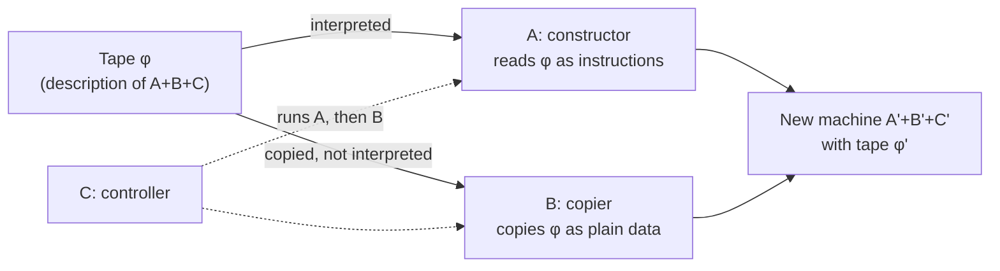
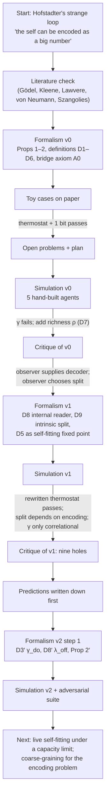
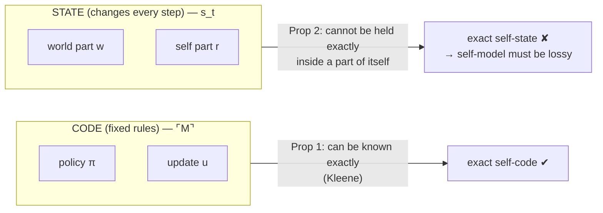
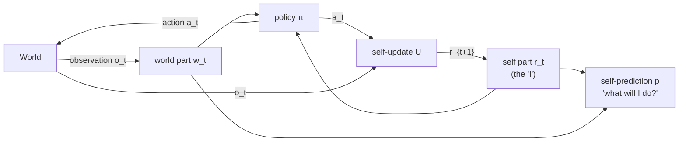
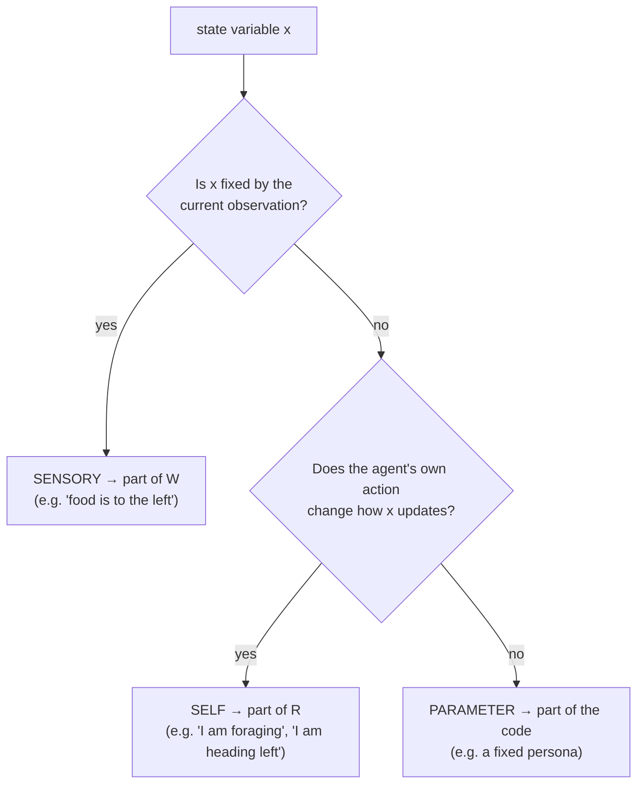
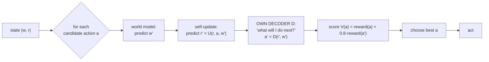
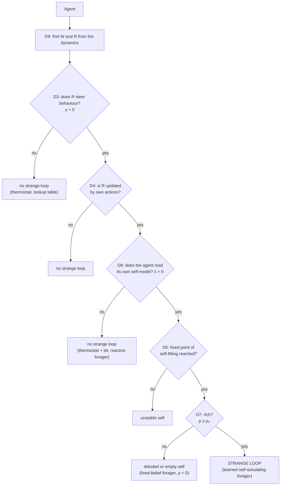
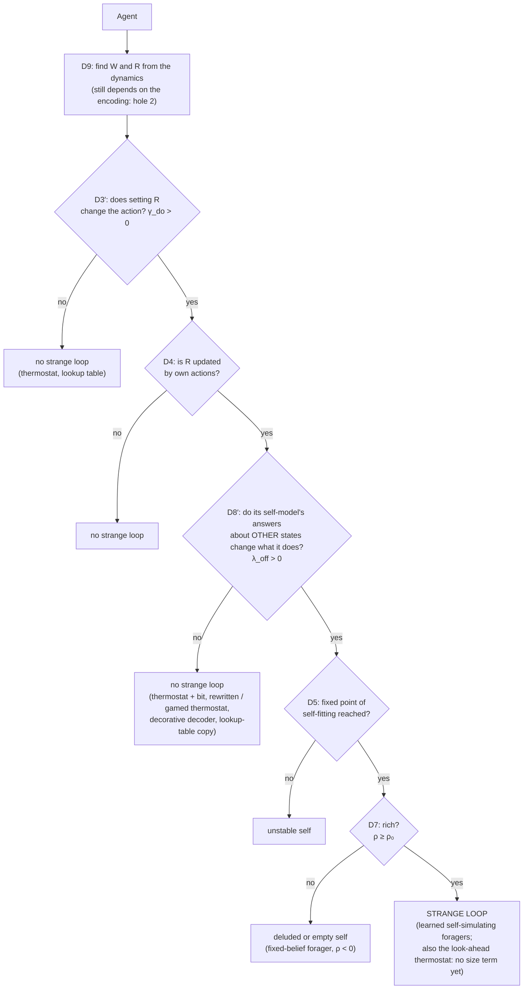

# A Minimal Formal Theory of the Hofstadter Self

**Report on work so far — version 2, 25 November 2026** (version 1: 23 November 2026)
Project: **"I"** — review the literature on consciousness, build thought experiments that narrow down what it is, and answer the question *"Is AI conscious?"*

---

## How to read this report

This report has two layers. You can read either one.

- **The formal layer** gives exact definitions, propositions and proofs. It is for readers who are comfortable with basic set theory, probability and information theory.
- **The plain layer** is in boxes like the one below. It explains the same idea in simple words, often with an example or a metaphor. You can skip all the mathematics and read only these boxes.

> **In plain words:** Every important idea appears twice: once in mathematics, once in a box like this one. If the mathematics is not for you, read the boxes and look at the diagrams.

Diagrams use Mermaid. GitHub and most Markdown viewers draw them automatically.

### Contents

1. Summary
2. Aim and starting point
3. Literature that shaped the work
4. Approach
5. Formalism v0: the minimal theory
6. Toy cases and the first problem
7. Open problems and the plan
8. Simulation v0
9. Critique of v0: three serious problems
10. Formalism v1: fixing the observer problems
11. Simulation v1
12. The definition of a strange loop (v1)
13. Critique of v1: nine holes
14. Formalism v2 (step 1)
15. Simulation v2
16. The current definition of a strange loop (v2)
17. What we have deduced (list of results)
18. Limits and open questions
19. Next steps
20. Glossary
21. References
Appendix A. The code
Appendix B. Raw outputs

---

## 1. Summary

We started from Douglas Hofstadter's idea that the "I" is a *strange loop*: a pattern in a system that models itself, and that this self could in principle be written down as one (very large) number. We set out to make this idea exact enough to test.

We built a minimal formal theory in four steps, with a test at each step:

1. **Formalism v0.** A finite agent with a world part and a self part. We proved two simple results. An agent *can* use its own full rulebook (from Kleene's recursion theorem). An agent *cannot* hold an exact copy of its own current state inside a part of itself (a counting argument). So a self-model of the current state must be **lossy**. This turns one of Hofstadter's claims into a theorem.
2. **Simulation v0.** We measured five toy agents. The measures showed that the first definitions accept trivial cases (a thermostat with one memory bit passes). We added a **richness** measure ρ, which asks whether the self-model predicts how the agent would act in *other* situations. This excludes the thermostat.
3. **Formalism and simulation v1.** We found that v0 depended on the observer in two ways: the observer supplied the decoder of the self-model, and the observer chose which variables count as "self". We fixed both. The self-model must now be **read by the agent itself** (tested by intervention), and the **"self" variables are found from the dynamics**, not chosen. We also showed that a self-model that the agent fits to its own behaviour reaches a **fixed point** quickly.
4. **Critique of v1 and formalism v2 (step 1).** We attacked v1 and found nine holes. The most serious: v1 did not remove the observer; it moved the observer's choices into how the code is written. A thermostat, only rewritten, passed every v1 check. We fixed three holes and partly fixed a fourth. Causal use is now tested by **intervention** (γ_do). The self-model must be used **as a model**: its answers about *other* states must change what the agent does (D8′, λ_off). A new result, **Proposition 2′**, shows that an agent that answers "what would I do?" by running its own full decision procedure never halts if its questions can loop; it needs a separate, simpler self-model. We wrote our predictions down **before** the code. They held, with one surprise: our scores do not measure the *size* of a self. One v1 result (R15) was withdrawn. The dependence on how the agent is described (encoding) is still open.

The theory describes the **structure** of a self. It does **not** explain why that structure would feel like anything. We keep that claim separate, as an explicit bridge axiom (A0) that can be tested or rejected on its own.

> **In plain words:** We tried to turn "the self is a loop in which a system models itself" into mathematics. We found that a system can know its own rules exactly, but it can only ever have a simplified sketch of its own current state. We wrote small computer programs to test our definitions. The tests showed where the definitions were too generous (a thermostat counted as having a self) and where they secretly depended on us, the observers. We fixed those problems. Then we attacked our own fixes, found that the theory still depended on how we *wrote* the machines, and made the tests stricter: a machine must actually plan by asking "what would I do if…?". We did not solve the question of why a self would *feel* like something. We wrote that down as a separate assumption that others can test.

---

## 2. Aim and starting point

### 2.1 The question

The project asks: *Is AI conscious?* To answer that, we need some exact idea of what would count as consciousness, or at least as one of its parts. This report works on one candidate part: **the self**, as Hofstadter describes it.

### 2.2 Hofstadter's idea

In *Gödel, Escher, Bach* (1979) and *I Am a Strange Loop* (2007), Hofstadter argues:

- A brain (or any suitable system) builds symbols for things in the world.
- Some of these symbols come to stand for the system itself. Together they form the **"I"**.
- The "I" is a **strange loop**: as you move through levels (neurons → symbols → meanings), you come back to where you started. The system's model of itself also controls the system.
- This mirrors Gödel's proof. Gödel coded statements about arithmetic as numbers, so arithmetic could make statements about itself. In the same way, a system that codes itself can refer to itself.
- So the self is a **pattern**, not a substance. In principle it could be written as a (huge) number, like a Gödel number.

Hofstadter's argument can be set out as ten premises. In short: a system that acts must model itself (P1); that self-model is lossy (P2); the cheapest summary is one unified agent, the "I" (P3); it is not literally true, a kind of useful illusion (P4); the system that uses it is the same pattern (P5, the loop); the rest covers why consciousness seems mysterious, why no extra ingredient is needed, and why the pattern can exist in any medium and comes in degrees. The main criticisms are: the argument explains *reports* about experience, not experience itself; experience seems possible without a self (deep meditation, infants); and behavioural tests can be gamed.

### 2.3 Our aim

Our aim was **not** to defend Hofstadter. It was to make his idea exact enough that:

1. its claims can be **proved or disproved** (where they are mathematical);
2. its measures can be **computed** on real systems, including AI systems;
3. its weak points become **visible**, so we can fix them or reject them.

> **In plain words:** Hofstadter says the "I" is a pattern in which a system describes itself, and that this description steers the system. It is a bit like a company that writes a short profile of itself, and then uses that profile to make decisions, which then changes the profile. We wanted to write this idea down so precisely that a computer could check it.

---

## 3. Literature that shaped the work

This section lists the ideas we used and how each one shaped the theory. Section 21 gives full references.

### 3.1 Self-reference in logic

**Gödel numbering (Gödel, 1931).** Gödel gave each formula of arithmetic a unique natural number. Arithmetic could then talk about its own formulas, and he built a sentence that says, in effect, "I am not provable". *Use here:* every agent M gets a **description number** ⌜M⌝ ∈ ℕ. This is Hofstadter's "big number".

**Kleene's recursion theorem (Kleene, 1938).** For any computable transformation f of programs, there is a program e that behaves exactly like f(e). So programs that use their own code always exist (a "quine" is the simplest example: a program that prints itself). *Use here:* Proposition 1 — exact self-knowledge of one's **code** is possible.

**Lawvere's fixed-point theorem (Lawvere, 1969) and Yanofsky (2003).** Lawvere showed that Cantor's diagonal argument, Gödel's theorem, Turing's halting problem and Kleene's theorem are all one result about fixed points. Yanofsky gives a readable account, and shows that von Neumann's self-reproduction fits the same scheme. *Use here:* we treat a stable self as a **fixed point** (definitions D5 and its operational form in section 10).

> **In plain words:** Gödel found a way to make arithmetic talk about itself by turning sentences into numbers. Kleene showed that a computer program can always be written so that it uses its own text. Lawvere showed that many famous "self-reference" results are really one result about *fixed points* — things that stay the same when you apply a process to them. We borrowed all three ideas.

### 3.2 Self-reproduction: von Neumann

**von Neumann (1966), *Theory of Self-Reproducing Automata*.** A naive self-copying machine would have to contain a small copy of itself, which contains a smaller copy, and so on without end. Von Neumann avoided this regress. His machine has a universal constructor A, a copier B, a controller C, and a tape φ that describes A + B + C. The tape is used twice: A **reads** it as instructions to build a new machine, and B **copies** it without reading it, then puts the copy in the new machine.



> **In plain words:** Think of DNA. A cell *reads* DNA to build proteins, and it also *copies* DNA, without reading it, when it divides. Using the same description in these two ways lets a machine copy itself without needing a tiny copy of itself inside. This is a clean way to have a self-description without an endless regress.

### 3.3 Szangolies: von Neumann minds

Jochen Szangolies applies von Neumann's construction to the mind ("Self-Reference, Self-Representation, and the Logic of Intentionality", *Erkenntnis* 88(6), 2561–2590, 2023; online 2021; earlier papers 2015, 2018, 2020). We found this to be the **closest existing work** to our idea. We read the abstract, an indexed summary, his own blog explanation and forum discussion. We found the free preprint (academia.edu/50989457) but did **not** yet read the full text, so the details below are not checked against it.

His argument, in steps:

1. **The homunculus problem.** If the mind uses an internal map, something inside must read the map. That reader needs its own map, and so on. His way out: collapse the representation and its user into one, so that a mental state represents itself.
2. **Von Neumann minds.** A mental state is like a von Neumann replicator. To produce the next state, it reads its own description. Its own properties are represented to itself.
3. **From self-reference to reference to the world.** He uses Gödel–Löb provability logic (GL). Its fixed-point theorem says: for any formula ψ(p) in which p appears only inside the provability operator □, there is a sentence σ, with no p in it, such that GL ⊢ σ ↔ ψ(σ). So a self-referential sentence can be rewritten as one without self-reference. He uses this to turn "I may change into my next state" into a statement about the world (for example, a goal such as biting an apple).
4. **The Löb obstacle.** Löb's theorem (if T ⊢ □P → P then T ⊢ P) means a system cannot prove that its successor reasons soundly. His answer: the system does not need to *derive* its properties; it simply *has* them ("numbers thinking about themselves").
5. **The hard problem.** He takes a Russellian monist view: theory reaches only structure; experience is the system's direct access to its own intrinsic, non-structural properties. On his view this makes the hard problem unsolvable by any theory, in principle.

*How this shaped our work:*
- His tape φ corresponds to our Proposition 1 (exact self-**code**).
- His fixed point is **logical** (in GL). Ours is **dynamical** (a self-model that predicts the behaviour it causes).
- He has no idea of **compression**. In his model, self-access is exact because the system *is* the object. Our self-model of the current state is lossy by necessity (Proposition 2). This is the main difference.
- His homunculus problem came back in our own work (section 9, problem 1) and led to definition D8.

### 3.4 Other work on strange loops and fixed points

A literature search found:

- **"Strange Loop Model"** (*Frontiers in Ecology and Evolution*, 2021, doi 10.3389/fevo.2021.802300): a model with causal feedback between two brain modules that avoids the paradoxes of self-reference by unfolding the loop over time, and that links inconsistencies in the loop to causal structure in Integrated Information Theory.
- **Kim (2025)**, conference abstract at CNS 2025 (Florence): a mathematical formalisation of qualia as recursive stability, with fixed-point states of neural circuits that refer to their own outputs, and tests on attention mechanisms in large language models.
- Several **unreviewed preprints** that claim a "formal theory of consciousness" based on self-model fixed points. We did not use them. Their number shows that reviewers will be sceptical of new claims in this area.

### 3.5 Theories of consciousness close to this idea

For each theory we give: its **main claim**; what it **tries to explain or prove**; what it **concludes**, also about AI; whether it is **formalised**; and how it **relates to this work**. We use three levels of formalisation:

- **Full**: exact mathematical definitions, from which numbers can be computed for a given system.
- **Partial**: computational models or formal fragments exist, but the core claim is stated in words.
- **No**: conceptual or philosophical only.

References added in this version are cited from memory and marked "not checked" in section 21.

| Theory | Main claim | Formalised? | Verdict on AI (as its proponents argue) | Relation to this work |
|---|---|---|---|---|
| Self-model theory (Metzinger) | The self is a transparent self-model, not a thing | No | Possible in principle; argues for a moratorium because of the risk of artificial suffering | Closest informal theory; we formalise part of it |
| Attention schema theory (Graziano) | Awareness is a simplified model of one's own attention, used to control it | Partial | Yes, if the machine has an attention schema that it uses for control | A special case of our self-model |
| Integrated Information Theory (Tononi) | Consciousness is a maximally irreducible cause–effect structure, measured by Φ | Full | No for software on conventional computers, whatever its behaviour | The only fully formal rival; opposite predictions |
| Global (neuronal) workspace (Baars; Dehaene) | Consciousness is global broadcast of information in a limited workspace | Partial | Yes, if the machine has a global workspace (plus self-monitoring for the full sense) | A rival; needs no self-model |
| Higher-order theories (Rosenthal; Lau) | A state is conscious when it is represented by a suitable higher-order state | Partial | Yes, with suitable metacognitive monitoring | Our self-model is a kind of higher-order representation |
| Free energy principle; predictive processing (Friston; Seth) | Persisting systems minimise surprise; the self is a set of predictions that keep the body alive | Full (the principle); No (the link to consciousness) | FEP: silent. Seth: probably not, without life-like self-maintenance | Same sensor/internal split as our D9 |
| Information bottleneck; rate–distortion (Tishby; Shannon) | The best lossy summary keeps only what predicts a target | Full | Not applicable (a tool, not a theory) | Our route to "why one I" and to a size term |
| Hard problem, meta-problem, illusionism (Chalmers; Frankish) | Why is there experience at all? Why do we *think* there is a hard problem? | No | Open; the meta-problem suggests a test | Sets the limits of what we can claim |

#### 3.5.1 Self-model theory of subjectivity (Metzinger, 2003)

- **Claim.** There are no selves in the world. What exists is a *phenomenal self-model*: the brain's model of the whole organism. The model is **transparent**: the system cannot experience it *as* a model, so it experiences itself as a self in direct contact with the world. The first-person perspective comes from a model of the relation between this self and its objects.
- **Aim.** To explain self-consciousness and the first-person perspective in representational and functional terms only, using evidence from neurology and psychiatry (phantom limbs, out-of-body experiences, depersonalisation).
- **Conclusions.** The self is a process of self-modelling, not a substance. When the self-model becomes opaque (seen as a model) or weak, the sense of self changes or disappears. On AI: artificial systems could in principle have a phenomenal self-model. Metzinger (2021) argues for a global moratorium on research that risks creating artificial suffering.
- **Formalised?** No. The theory gives a list of constraints in words, but no definitions that can be computed.
- **Relation.** The closest theory to ours. Our lossy self part R, read by the agent (D8′), is a formal version of a self-model that steers. We have **not** yet formalised *transparency*. A possible version: the agent has no variable that represents "R is only a model", so its self-model does not model its own errors. Our "deluded self" (λ > 0, ρ < 0) is a case where this matters.

#### 3.5.2 Attention schema theory (Graziano, 2013)

- **Claim.** The brain builds a simplified, schematic model of its own attention, just as it builds a body schema to control the body. Awareness is what this *attention schema* describes. When we say "I am aware of X", we report the content of the schema, which depicts a simplified, almost magical inner grasp of X.
- **Aim.** To explain two things: (a) the **control** of attention, because control works better with a model of the thing that is controlled; and (b) why people **claim** to have subjective experience, which is an answer to the meta-problem (§3.5.8).
- **Conclusions.** Awareness is a model of attention: accurate in outline, wrong in detail. Attention and awareness can come apart. Prediction: without awareness of a stimulus, the control of attention to it gets worse. On AI: a machine with an attention schema that it uses to control its attention would be aware in the same sense that we are. Graziano treats this as a realistic engineering target.
- **Formalised?** Partial. The theory is stated in words. One neural-network agent shows that an attention schema improves control (Wilterson & Graziano, 2021). There is no general measure.
- **Relation.** A special case of our theory: R is a model of attention, it is used for control (D8′), and it is simplified (Propositions 2 and 2′). AST is narrower but easier to test. Its control argument gives an independent reason for D8: a good controller must contain a model of what it controls (the "good regulator" theorem, Conant & Ashby, 1970).

#### 3.5.3 Integrated Information Theory (Tononi, 2004; Oizumi et al., 2014; Albantakis et al., 2023)

- **Claim.** Consciousness *is* a maximally irreducible cause–effect structure in a physical system. Its amount is the integrated information Φ: how much the causal powers of the whole exceed those of its parts.
- **Aim.** To start from what experience is like (the *axioms*: it exists for itself, is structured, specific, unified and definite) and to derive what a physical system must be like to have it (the *postulates*). Then to explain which parts of the brain support consciousness (for example posterior cortex but not cerebellum), and to assess consciousness in patients who cannot respond.
- **Conclusions.** Consciousness depends on the physical causal structure, not on function or behaviour. A purely feed-forward system has Φ = 0. A conventional digital computer has very low Φ, whatever software it runs, so even an exact simulation of a brain on such a computer would not be conscious (Tononi & Koch, 2015). Some simple but highly integrated structures, such as large grid-like networks, would be highly conscious. Critics take this as a sign that the theory is wrong (Aaronson, 2014). In 2023, an open letter signed by more than 100 researchers called IIT pseudoscience (Fleming et al., 2023); others disputed this.
- **Formalised?** Full. Versions 3.0 and 4.0 give exact definitions, and Φ can be computed for small discrete systems (for example with the PyPhi software). The cost grows faster than exponentially with system size, so Φ cannot be computed for a brain.
- **Relation.** The only fully formal rival, and it uses the same kind of discrete systems as we do. Its **exclusion** postulate (choose the grain and boundary with maximum Φ) is a principled answer to our hole 2; our planned coarse-graining fix (§19) follows the same strategy. IIT agrees with our verdict on P4: implementation matters, not only behaviour. But IIT needs no self-model, so IIT and A0 make **opposite predictions** in two cases: a highly integrated system with no self-model (IIT: conscious; A0: no), and a self-modelling program on a conventional computer (IIT: no; A0: yes).

#### 3.5.4 Global workspace and global neuronal workspace (Baars, 1988; Dehaene & Changeux, 2011)

- **Claim.** The mind consists of many specialised processors that work in parallel and unconsciously. Information becomes conscious when it enters a limited-capacity *global workspace* and is broadcast to all the processors at once. In the brain, this is a sudden, self-sustaining "ignition" of a network of long-range neurons in prefrontal and parietal cortex.
- **Aim.** To explain the difference between conscious and unconscious processing of the same stimulus (masking, inattentional blindness), the limited capacity of consciousness, and why conscious contents can be reported.
- **Conclusions.** Consciousness is global availability of information for report, reasoning and action. The theory proposes neural markers, such as late ignition at about 300 ms after a stimulus (some of these markers are disputed). On AI: Dehaene, Lau & Kouider (2017) split consciousness into C1 (global availability) and C2 (self-monitoring). They argue that a machine with both would be conscious in this sense, and that most AI at the time had neither in full. A large adversarial test of this theory against IIT challenged key predictions of both (Cogitate Consortium, 2025).
- **Formalised?** Partial. There are neural-network simulations of ignition, and a formal model from theoretical computer science, the Conscious Turing Machine (Blum & Blum, 2022). The core claim is still stated in words, and there is no single measure.
- **Relation.** The global workspace does not need a self-model. So it predicts consciousness in a system with global broadcast but no "I", and A0 does not. If our Plan 4 finds experience without a self, that supports the workspace theory against A0. Dehaene's C2 (self-monitoring) is close to our loop. The adversarial collaboration is a model for our own method of writing predictions down first (§14.4).

#### 3.5.5 Higher-order theories (Rosenthal, 2005; Lau & Rosenthal, 2011)

- **Claim.** A mental state is conscious when the subject has a suitable higher-order representation of being in that state. Versions differ on what this representation is: a higher-order *thought* (Rosenthal), a higher-order *perception*, or a system that monitors whether perceptions are real (Lau).
- **Aim.** To explain the difference between conscious and unconscious states with the same content (for example blindsight, where people respond to things they say they do not see), and why consciousness is linked to metacognition and prefrontal cortex.
- **Conclusions.** First-order processing is not enough; consciousness needs meta-representation. A consequence that is still debated: a higher-order state can misrepresent, so experience can be wrong about the first-order state, or exist without it. On AI: a system that monitors its own perceptual states in a suitable way could be conscious. Butlin et al. (2023) use this as one of their indicator properties.
- **Formalised?** Partial. The theory is philosophical. Computational versions exist, for example signal-detection models of metacognition and a Bayesian "higher-order state space" (Fleming, 2020).
- **Relation.** Our self-model is a higher-order representation, but of the agent's **whole policy**, not of single perceptual states. The HOT case of misrepresentation corresponds to our "deluded self" (λ > 0, ρ < 0). Higher-order theories do not need the representation to act back on behaviour; our D3′ and D8′ do. That loop back into action is Hofstadter's addition.

#### 3.5.6 Free energy principle and predictive processing (Friston, 2010, 2013; Seth, 2021)

- **Claim.** Any system that keeps itself within a bounded set of states, separated from its environment by a *Markov blanket*, behaves as if it minimises variational free energy (an upper bound on surprise). Perception and action both reduce prediction error (*active inference*).
- **Aim.** One principle for perception, action, learning and life. The free energy principle itself is **not** a theory of consciousness. Theories of consciousness built on it include Seth's "beast machine" view: the experience of being a self comes from the brain's predictive control of the body's interior (interoception).
- **Conclusions.** The self is, at its base, a set of predictions about the body that keep it alive. On AI: Seth argues that consciousness is tied more closely to being a living, self-maintaining system than to intelligence, so current AI is probably not conscious.
- **Formalised?** The principle is fully mathematical (variational Bayesian inference applied to stochastic dynamics). The link to consciousness is not formalised. Critics argue that the principle cannot be falsified because it fits almost any system, and that the term "Markov blanket" is used in two different senses (Bruineberg et al., 2022).
- **Relation.** Our D9 uses the same split between sensory and internal variables, and our open "where does the agent end?" problem is the Markov blanket problem. Seth's view challenges D9 directly: in our forager, energy is classified as *world* (sensory), but for Seth the state of the body is the core of the self.

#### 3.5.7 Information bottleneck and rate–distortion theory (Shannon, 1959; Tishby et al., 1999)

- **Claim.** This is a mathematical tool, not a theory of consciousness. Given a source X and a target Y, the best lossy summary of X keeps the information that predicts Y and drops the rest. There is an exact trade-off curve between the size of the summary and the error.
- **Formalised?** Full.
- **Relation.** This is our planned route to Proposition 3 (why one "I"; Plan 2), to the size term that the grade lacks (R22), and to the step from Corollary 2′ to "every self-model must be lossy".

#### 3.5.8 Hard problem, meta-problem and illusionism (Chalmers, 1995, 2018; Frankish, 2016)

- **Claim.** These are problems and positions, not mechanistic theories. The **hard problem**: why is physical processing accompanied by experience at all? Chalmers argues that functional explanations, which include all the theories above and ours, can explain functions but leave this question open. The **meta-problem**: explain, in functional terms, why we *say* and *believe* that there is a hard problem. **Illusionism** (Frankish; also Dennett) claims that solving the meta-problem is the whole job, because phenomenal consciousness, as it seems from the inside, is an introspective illusion.
- **Conclusions.** Chalmers: a solution to the meta-problem would strongly constrain theories of consciousness, but would not by itself solve the hard problem. Illusionists: it would. On AI: the hard problem leaves the question open. The meta-problem suggests a test: does a system produce "hard problem" intuitions for functional reasons of its own, and not only because it imitates human text?
- **Formalised?** No.
- **Relation.** Hofstadter is close to illusionism (premise P4: the "I" is a useful illusion). Our A0-weak (§19) is a meta-problem claim and can be tested. A0-strong faces the hard problem, and no structural theory, including ours, can settle it alone.

> **In plain words:** The theories fall into three families. **Self-model theories** (Metzinger, Graziano, Hofstadter, and this work) say that the self, and perhaps consciousness, comes from a system that models itself. **Access theories** (global workspace, higher-order) say that a state is conscious when it is broadcast widely or represented by a higher-level state. **Causal-structure theories** (IIT) say that consciousness is a property of how the physical parts cause each other. The free energy principle is a general framework, rate–distortion theory is a mathematical tool, and the hard problem marks what no theory has yet explained. Only IIT is fully formalised as a theory of consciousness. This work tries to make a self-model theory just as exact, so that it can be tested against IIT and the others.

### 3.6 What is new in this work

The general idea "the self is a self-referential loop or fixed point" is **not new**. What we have not found elsewhere, in this form:

1. The split between **exact self-code** (possible) and **exact self-state** (impossible), with a short proof.
2. The **richness** measure ρ, based on counterfactual self-prediction.
3. The **internal-reader** test λ (intervention on the agent's own decoder).
4. The **intrinsic split** D9 of variables into sensory, self and parameter.
5. A **working test harness** that computes all measures on concrete agents, and shows where each definition fails.
6. The **off-state reader test** D8′ (λ_off): scramble only the self-model's answers about other states.
7. **Proposition 2′**: bounded self-simulation needs a base self-model separate from the agent's own decision procedure.
8. A **pre-registered adversarial test suite**: predictions committed before the code.

### 3.7 Related work found after v1 (not yet read in full)

The critique of v1 (§13, hole 9) found work that is close to ours. We cite it from memory; the details are not yet checked.

| Work | What it does | Relation to this work |
|---|---|---|
| Butlin, Long et al. (2023) | Derives "indicator properties" for consciousness in AI from the main scientific theories | A checklist approach to the project's question; our measures could become one indicator |
| Wilterson & Graziano (2021) | An RL agent that controls its attention with a simplified model of its own attention | Very close to our self-simulating forager: a lossy self-model that is read and steers |
| Binder et al. (2024) | LLMs predict their own behaviour in hypothetical situations better than other models can | An LLM version of ε_cf and ρ |
| Lindsey (2025) | Injects concepts into an LLM's activations and tests whether it notices | An LLM version of an intervention test like λ |
| Hoel et al. (2013); Rosas et al. (2020) | Causal emergence; information measures of downward causation | Candidate tools for hole 2 (finding the "I" as a level) |
| Putnam (1988) | Every open physical system implements every finite automaton, under some mapping | The deep form of hole 2 |

> **In plain words:** Other people have had the idea that the self is a loop. The closest is Szangolies, who uses the trick from self-copying machines. What we add is a set of exact measures, a proof that a self can only be a *simplified* sketch of the system, and a computer test bench that shows which definitions work and which do not.

---

## 4. Approach

We used a simple cycle: **define → test → find the failure → fix → test again.**



Three working rules guided all choices.

1. **Keep structure and experience apart.** The definitions describe the structure of a self. The claim that this structure *is* consciousness is a separate axiom (A0). A critic can reject A0 and still use everything else.
2. **Make every quantity computable.** Each definition comes with a measure that a program can compute on a finite agent.
3. **Remove the observer.** A theory of consciousness must describe the system itself, not one observer's description of it. When a definition depended on a choice made by us, we treated that as a defect.

> **In plain words:** We worked like engineers. We wrote a definition, built small test machines, and looked for the case where the definition gave a silly answer. Then we fixed the definition and tested again. We also kept one rule: the answer must not depend on who is looking at the machine.

---

## 5. Formalism v0: the minimal theory

### 5.1 Setting

A **finite agent** in a finite world:

- O: a finite set of observations; A: a finite set of actions;
- S: a finite set of internal states;
- π : S → A, the **policy** (what the agent does in each state);
- u : S × O × A → S, the **update** (how the state changes after it acts and observes).

The agent is the tuple **M = (S, π, u)**. Fix any standard encoding of finite tuples as natural numbers. Then **⌜M⌝ ∈ ℕ** is the **description number** of M.

> **In plain words:** Imagine a very simple robot. At each moment it is in one of a fixed list of states. A rulebook says what it does in each state, and another rulebook says how its state changes after it acts and sees something new. Write both rulebooks out and turn the text into one long number. That number is the robot's "big number" — its complete recipe, like a Gödel number or a genome.

### 5.2 Two kinds of self-knowledge

The word "self-knowledge" hides two very different things.

- **Code**: ⌜M⌝, the fixed rules.
- **State**: s_t ∈ S, the current state at time t.



**Proposition 1 (exact self-code is possible).** In any acceptable programming system, for every computable f there is a program e with φ_e = φ_{f(e)} (Kleene's recursion theorem). In particular, there are agents whose program uses its own full description ⌜M⌝.

*Proof.* This is Kleene's second recursion theorem. ∎

**Proposition 2 (exact self-state is impossible).** Split the state into a world part and a self part, S = W × R, with |W| ≥ 2, and let every state in S be reachable. Then there is no map g : R → S with g(r) = (w, r) for every state (w, r). That is, the self part cannot contain an exact record of the current full state.

*Proof.* Such a g would make the projection (w, r) ↦ r injective on S. Then |W| · |R| = |S| ≤ |R|, so |W| ≤ 1. This contradicts |W| ≥ 2. ∎

**Corollary (sharper form).** On the set of reachable states, the self part R records the full state exactly **if and only if** the world part is a function of the self part. In that case the "world part" adds no information, so R is not a part in any useful sense; it is the whole.

**Meaning.** An agent can carry its whole rulebook, but it cannot hold an exact, live copy of its own current state in a part of itself. **Any self-model of the current state is lossy.** This proves Hofstadter's premise P2 ("the self-model is lossy") for finite agents.

> **In plain words:** You can carry your complete cookbook in your pocket — the recipes do not change. But you cannot carry a perfect, live photograph of your whole body *in your pocket*, because the photograph would have to include the pocket, which includes the photograph, and so on. The philosopher Josiah Royce described the same problem: a perfect map of England drawn on the ground of England would have to contain a map of itself, which contains a map of itself… A part can never hold an exact copy of the whole. So whatever "self" a system has, it must be a **simplified sketch**.

### 5.3 Definitions D1–D6

Write each state as s = (w, r), with w ∈ W (the agent's model of the world) and r ∈ R (the agent's model of itself).

**D1 Self-prediction.** A map p : W × R → A that predicts the agent's own next action. Its error along typical trajectories is
  **ε = Pr[ p(w_t, r_t) ≠ π(s_t) ]**.

**D2 Compression.** **κ = log|R| / log|S|**. By Proposition 2, κ < 1 when W is non-trivial.

**D3 Causal use ("downward causation").** The self part changes behaviour: there exist w and r ≠ r′ with π(w, r) ≠ π(w, r′). Graded version: the conditional mutual information
  **γ = I(R ; A | W)**,
the information (in bits) that the self part carries about the action, beyond what the world part already gives.

**D4 Loop.** The self part is updated from the agent's own actions: r_{t+1} = U(r_t, a_t, o_t), and U depends non-trivially on a_t.

**D5 Stable self.** A set R* ⊆ R that is invariant under U along typical trajectories, with ε ≤ δ on R*. This is the **fixed point of the loop**: the self-model predicts the behaviour that it causes.

**D6 Strange loop (v0).** M has a strange loop of grade (ε, κ, γ) if D1–D5 hold with ε ≤ δ, κ < 1 and γ > 0.



> **In plain words:** Split the robot's memory into two drawers. One drawer holds what it knows about the world. The other holds what it "thinks about itself" — the "I". We ask five questions:
> 1. Can the "I" drawer predict what the robot will do? (ε, the error rate.)
> 2. Is the "I" drawer smaller than the whole memory? (κ, the compression.)
> 3. Does the "I" drawer actually change what the robot does? (γ, the causal use.)
> 4. Is the "I" drawer updated by what the robot does? (the loop.)
> 5. Does it settle into a stable pattern that keeps predicting correctly? (the fixed point.)
> If all five answers are "yes", the robot has a *strange loop* in this first, simple sense.

### 5.4 Bridge axiom A0 (kept separate)

**A0 (to be tested, not assumed).** M is conscious if and only if M has a stable strange loop, with a degree of consciousness that increases as ε falls and γ rises.

The definitions do not depend on A0. Everything in sections 5–17 holds whether A0 is true or false.

> **In plain words:** The definitions tell us whether a machine has a certain *structure*. Whether that structure *is* consciousness is a separate bet. We wrote the bet down on its own, so that people can argue about the bet without arguing about the mathematics.

---

## 6. Toy cases and the first problem

We first checked the definitions on paper.

| Agent | D1 predicts self | D3 uses self | D4 loop | Strange loop (v0)? |
|---|---|---|---|---|
| Thermostat | no | no | no | no |
| Thermostat + a "heater was on" bit used in its rule | trivially | yes | yes | **yes, trivially** |
| Lookup table (any size) | no | no | no | no |
| Large language model, one forward pass | no | no | no | no |
| LLM agent with persistent self-notes that steer its actions | yes | yes | yes | yes (grade unknown) |

**Problem.** The second row passes. A thermostat with a single memory bit has a "strange loop". The minimal definition admits **trivial loops**. This is the critique "autoregression is only trivial feedback" in formal form.

> **In plain words:** A thermostat that remembers "I switched the heater on" and uses that note to decide what to do next technically passes all five questions. But nobody thinks a thermostat has a self. So the first definitions are far too generous.

---

## 7. Open problems and the plan

### 7.1 Open problems after v0

1. **Richness.** Find a condition that excludes the one-bit thermostat.
2. **Unity.** Hofstadter's "one I". Define one dominant self, not many (relevant for language models that can play many personas).
3. **Proposition 3 (wanted).** Show that, under resource limits, the best lossy self-model is a single "agent" summary. This would turn premise P3 into a theorem.
4. **Separate the self from experience.** Use the formalism to build cases where the structure is present but experience seems absent, or the reverse.
5. **Compare with Szangolies.** State the exact difference between his exact self-description with logical fixed points and our lossy self-state with dynamical fixed points.

### 7.2 The plan

**Plan 1 — Richness.** Require that the self-model predicts the agent's **policy** over *counterfactual* situations, not only its next action (became D7). Second-order version: the self-model must also predict how its own self part updates (a model of U) — "the self modelling the self".

**Plan 2 — Proposition 3 via rate–distortion.** Treat the self-model as a channel S → R with limited capacity, I(S; R) ≤ C. The loss is the error in predicting one's own actions. This is the **information bottleneck** problem. *Conjecture:* if the actions come from a shared, low-dimensional goal, the optimal R is one latent "agent" variable. Prove this for a simple case (for example linear-Gaussian), then check it numerically.

**Plan 3 — Unity.** Define the selves as the **attractors** of the self-update U (terminal strongly connected components of its transition graph). Count them with an effective number **N_eff = exp(H)**, where H is the entropy of which attractor each trajectory ends in. Humans: N_eff ≈ 1. Language models: ≈ 1 inside one context, > 1 across contexts. Decide explicitly whether consciousness is scored per trajectory or per system.

**Plan 4 — Self versus experience.** Under A0, if γ → 0 (the self part stops steering behaviour), experience should fade. **Test case:** ego dissolution (deep meditation, psychedelics), where people report that the sense of self collapses but experience stays vivid. If the neuroscience of self-model networks (for example the default mode network) shows R collapsing while experience remains, **A0 in its present form is falsified.**

**Plan 5 — Szangolies.** His tape φ ↔ our Proposition 1. His fixed point is logical; ours is dynamical. Make a two-column table, then check it against his preprint.

**Order:** 1 → toy simulation → 2 → 3 → 4. Plan 5 at any time.

> **In plain words:** We listed what was still wrong and how to attack each problem. The most important idea is in Plan 4: our theory makes a prediction that could prove it wrong. If people whose sense of "I" disappears still have vivid experience, then "consciousness = having an I-loop" cannot be the whole story.

---

## 8. Simulation v0

Code: `code/sim_v0.py`. Output: `results/sim_v0_output.txt`. 200 episodes × 200 steps per agent, plus exhaustive checks over all states.

### 8.1 Worlds

- **Thermostat world.** Temperature T ∈ {0, …, 9}. Heater on: T + 1; off: T − 1; with probability 0.2 a random ±1. The agent sees three bins: cold (T < 4), ok (4–6), hot (T > 6).
- **Ring world.** A ring of 8 cells and one food item. The agent sees the food direction (L, R, here, or none if more than 2 cells away) and its own energy level (low ≤ 2, mid ≤ 6, high). Energy falls by 1 every 2 steps. Eating food adds 5 (maximum 9), and new food appears at a random cell. Actions: L, R, stay, eat.

### 8.2 Agents

1. **Thermostat.** Heater on if cold, else off. No self part (|R| = 1).
2. **Thermostat + bit.** Hysteresis. A bit r = "heater was on". If ok, it keeps doing what it did. Its "self-model" reads the bit as "I will keep doing what I am doing".
3. **Lookup table.** A random fixed table from ring observations to actions. No self part.
4. **Forager + self-model.** Self part r = (mode, heading), mode ∈ {forage, explore, rest}. It believes it follows a "core rule" (rest → stay; food here → eat; forage and food seen → go to food; else keep heading). Its *true* policy has a **hidden hunger override** (when energy is low, it always goes for visible food). The self-model leaves this out, so it is lossy.
5. **Multi-persona forager.** As 4, plus a persona (bold or cautious) set at the start of each episode and never changed — like a system prompt. A cautious forager waits when it sees no food and is not full.

### 8.3 New measures used in v0

**D7 Richness.** Each self state r decodes to a predicted policy π̂_r : W → A. With μ uniform over W:
- counterfactual error: **ε_cf = E_r E_{w∼μ} 1[ π̂_r(w) ≠ π(w, r) ]**, with r weighted by how often it occurs;
- baseline: **ε_cf⁰ = E_r [ 1 − max_a μ{ w : π(w, r) = a } ]**, the error of the best prediction that ignores w;
- richness: **ρ = 1 − ε_cf / ε_cf⁰**.

ρ > 0 only if the self-model captures how the agent's action **depends on the world**. A self-model that says "I will do X, whatever happens" gets ρ ≤ 0.

**Unity N_eff.** Build the directed graph of observed transitions r → r′. Find its terminal strongly connected components (attractors). Label each episode by the attractor that its last 50 self states fall in. **N_eff = 2^{H(label)}**, with H in bits.

> **In plain words:** Think of two weather forecasters. One always says "tomorrow will be like today". The other knows that falling pressure brings rain. Both are often right, but only the second one understands the weather. ρ measures which kind of forecaster the robot is *about itself*. A robot whose "I" only says "I'll keep doing what I'm doing" scores zero. A robot whose "I" knows "if I see food on the left, I go left" scores high.
>
> N_eff counts how many different "selves" a system settles into. One stable personality gives 1. A system that becomes a different character depending on how it is started gives more than 1.

### 8.4 Results

| Agent | \|W\| | \|R\| | κ | γ (bits) | D3 | D4 | ε | ε_cf | ε_cf⁰ | ρ | N_eff |
|---|---|---|---|---|---|---|---|---|---|---|---|
| Thermostat | 3 | 1 | 0.00 | 0.00 | no | no | – | – | – | – | 1 |
| Thermostat + bit | 3 | 2 | 0.39 | 0.71 | yes | yes | 0.24 | 0.33 | 0.33 | **0.00** | 1 |
| Lookup table | 12 | 1 | 0.00 | 0.00 | no | no | – | – | – | – | 1 |
| Forager + self-model | 12 | 6 | 0.42 | 0.16 | yes | yes | 0.00 | 0.15 | 0.34 | **0.55** | 1 |
| Multi-persona forager | 12 | 12 | 0.50 | 0.17 | yes | yes | 0.00 | 0.12 | 0.42 | **0.71** | **2** |

### 8.5 Findings

1. **Causal use alone does not separate the cases.** The thermostat bit has the *highest* γ (0.71 bits). γ > 0 is necessary, but it says nothing about richness.
2. **Richness ρ works on this set.** The thermostat bit gets ρ = 0; the foragers get 0.55 and 0.71.
3. **On-trajectory accuracy hides a lossy self-model.** The forager predicts itself perfectly on what it actually does (ε ≈ 0), but is wrong in 15% of other situations (ε_cf = 0.15), because it does not know about its own hunger override. ε_cf exposes this; ε does not.
4. **N_eff detects multiple personas**: 2 across episodes, 1 within each episode.

> **In plain words:** The forager is like a person who says "I always stay calm". In daily life it is true. But in a situation they have never met — real hunger, say — they behave differently, and their self-image does not know it. You only find this out by asking "what *would* you do if…?", not by watching an ordinary day.

---

## 9. Critique of v0: three serious problems

After v0 we listed what was still wrong. Three problems were serious.

**Problem 1 — Who reads the self-model?** In v0 *we* supplied the decoder r ↦ π̂_r. The agent never used it. So the "self-model" was a self-model only for the observer. This is the **homunculus problem** again — the same problem Szangolies tries to solve.

**Problem 2 — Who decides what counts as the "self"?** We chose the split S = W × R by hand. The same state can be split in many ways, and the scores change with the split. A theory of consciousness cannot depend on the observer's choice. (Integrated Information Theory has the same problem, known there as *exclusion*.)

**Problem 3 — Definitions tuned to intuitions.** We added ρ *because* it excludes the thermostat. That is curve-fitting, not explanation. Also, a chess engine that simulates its own search would probably have high ρ, and few people would call it conscious. So either A0 is wrong, or we must accept some surprising cases. The fix is an independent reason for ρ, for example from the rate–distortion result (Plan 2).

Smaller problems: the agents are hand-built; the thresholds δ and ρ₀ and the distribution μ are arbitrary; the hard problem is untouched.

> **In plain words:** We found that our test bench was cheating in two ways. First, *we* were the ones reading the robot's "I" drawer — the robot itself never looked at it. A diary that nobody reads is not self-knowledge. Second, *we* decided which drawer was the "I" drawer. If you can choose, you can make almost anything look like it has a self. Problems 1 and 2 had to be fixed first, because they decide whether the theory is about the machine or only about our description of the machine.

---

## 10. Formalism v1: fixing the observer problems

### 10.1 A state made of variables

From now on, the agent's state is a set of named **variables** X = {x₁, …, x_n}, each with a finite domain. The agent has three program parts:

- **sense**: writes the current observation into some variables;
- **act** π: chooses an action from the full state;
- **update** U: changes variables after the action and the next observation.

This is the same agent as before. We only make the internal structure visible, so that the split into world and self can be *derived* instead of chosen.

### 10.2 D9 — the intrinsic split (fix for Problem 2)

Each variable x is classified from the dynamics alone.

- x is **sensory** if its value is a function of the current observation: there is f with x_t = f(o_t) for all t, and x is not constant.
- x is **self** if it is not sensory and its update depends on the agent's own action: there exist a reachable (s, o′) and actions a ≠ a′ with U(s, a, o′)_x ≠ U(s, a′, o′)_x.
- x is a **parameter** otherwise (fixed traits; they belong to the code ⌜M⌝, not to the state).

Then **W := the sensory variables** and **R := the self variables.**



The only thing still given is the **sensor boundary**: which variables the observation writes into. This is the same as a Markov blanket in Friston's sense. D9 removes the choice of R; it does not yet remove the choice of where the agent ends.

> **In plain words:** We no longer *choose* which drawer is the "I". We look at how each piece of memory behaves. If the outside world sets it directly — "I see food on the left" — it is a sensation. If *your own actions* change it — "I am heading left", "I am in foraging mode" — it belongs to the self. If nothing changes it at all, it is part of your fixed make-up, like your genes. The machine's behaviour decides, not the observer.

### 10.3 D8 — the internal reader (fix for Problem 1)

The decoder **D : R × W → A** ("what will I do?") must be part of the agent's own program, and the policy must use its output: π(s) = G(s, D).

**Test by intervention.** Replace D with a scrambled decoder D′ (a uniformly random table from decoder inputs to actions) and measure
  **λ = E_{s ∼ trajectories} E_{D′} 1[ π_D(s) ≠ π_{D′}(s) ]**.
**λ > 0 ⟺ the agent reads its own self-model.**

All accuracy measures (ε, ε_cf, ρ) are now computed with the **agent's own decoder D**, never one chosen by the observer.

> **In plain words:** To check whether a robot really *uses* its picture of itself, we secretly swap that picture for nonsense and see whether its behaviour changes. If nothing changes, the picture was decoration — a diary nobody reads, or a mirror in an empty room. If behaviour changes, the robot was really consulting its picture of itself. And we now judge the accuracy of the robot's *own* picture, not one that we drew for it.

### 10.4 D5 made operational — the self-fitting fixed point

Let the decoder be a table T. The agent fits T to its own behaviour:
  **T_{k+1}(key) = majority { π_{T_k}(s) : key(s) = key }**,
where key(s) is the part of the state the decoder can see, and the majority is taken uniformly over all states with that key. A **fixed point T* = F(T*)** is a self-model that predicts exactly the behaviour that it causes.

> **In plain words:** Picture someone who writes "here is what I will do in each situation", then lives by consulting that note, then rewrites the note to match what they actually did, and repeats. If the note stops changing, it has become a *self-fulfilling description*: it predicts the behaviour, and the behaviour comes partly from the note. That is the fixed point of the strange loop.

### 10.5 The self-simulating forager

To test D8 we need an agent that actually consults its own self-model. The **self-simulating forager** lives in the ring world, with the same self variables (mode, heading). It chooses each action by a one-step lookahead in which it **simulates itself**:

For each candidate action a:
1. predict the next world w′ = WM(w, a) with a crude internal world model;
2. predict its next self r′ = U(r, a, w′);
3. ask **its own decoder** what it will then do: a′ = D(r′, w′);
4. score: V(a) = reward(a; w) + 0.8 · reward(a′; w′).

It picks the action with the highest V (ties go to its habit D(r, w)). Rewards: eat when food is here +5; eat otherwise −1; move towards visible food +1; stay +0.3 if energy is high, else −0.3; anything else 0. The world model: after eating, food is gone and energy rises one level; moving towards food reaches it; moving away from food under you puts it on the other side; otherwise nothing changes.



Three versions were tested:

- **Fixed belief:** D is the "core rule" from v0 — what the agent *believes* it does.
- **Learned:** D is a table fitted to its own behaviour by the fixed-point iteration (sees all variables).
- **Learned, low capacity:** the table can see only mode and food direction (not heading, not energy).

> **In plain words:** This robot thinks before it acts: "If I go left, I'll probably end up next to the food, and then — knowing myself — I'll eat it. Good, go left." To answer "what would I do then?" it consults its own picture of itself. So this robot really does read its own "I".

---

## 11. Simulation v1

Code: `code/sim_v1.py`. Output: `results/sim_v1_output.txt`. Same worlds and episode lengths as v0. λ uses 20 random scrambles on every 7th logged state (up to 4000 states).

### 11.1 Results

| Agent | Split found by D9 | Decoder reads | γ (bits) | λ (D8) | ε | ε_cf | ρ |
|---|---|---|---|---|---|---|---|
| Thermostat + bit | W = {temp}, R = {bit} | — (none) | 0.71 | – | – | – | – |
| Reactive forager (v0) | W = {food dir, energy}, R = {mode, heading} | — (none) | 0.17 | – | – | – | – |
| Self-simulating forager, fixed belief | same | mode, heading, food dir, energy | 0.15 | 0.16 | 0.28 | 0.63 | −0.08 |
| Same, learned self-model | same | mode, heading, food dir, energy | 0.15 | 0.16 | 0.00 | 0.00 | 1.00 |
| Same, learned, low capacity | same | mode, food dir | 0.002 | 0.16 | 0.33 | 0.08 | 0.86 |

The fixed-point iteration converged in **2 iterations** in both learned cases (32 then 0 table entries changed; 5 then 0 in the low-capacity case).

### 11.2 Findings

1. **D9 recovers the intended split in every case, from the dynamics alone.** For the self-simulating forager, the derived R is exactly the set of self variables its own decoder reads. Two independent routes give the same "self".
2. **D8 removes the thermostat bit and the v0 forager.** Both have a self variable that steers behaviour (γ > 0), but nothing in them reads a self-model.
3. **Reading a self-model is not enough; it must also be accurate.** The fixed-belief agent reads its own self-model (λ = 0.16), but the model is wrong (ρ < 0, ε = 0.28). This is a formal **"deluded self"**.
4. **The fixed point exists and is found quickly.** Fitting the self-model to its own behaviour converges in two rounds and gives a perfect self-model (ε = ε_cf = 0, ρ = 1). D5 is not empty.
5. **Learning corrected the belief without changing the behaviour.** The fixed-belief and learned agents choose the *same* action in all 72 states. The planner's choices were robust to the error in its self-model; learning made the self-model true without changing the self. (This is also why their λ values are identical: same behaviour, same scrambles.)
6. **An exact self-model here does not contradict Proposition 2.** The fitted table models the agent's **rules** (its policy — part of the code, which Proposition 1 allows). R itself only *points to* the current state. So a self-model has two parts: a stored model of the rules, which can be exact, and a pointer to the current state, which must be lossy.
7. **D3 and D8 are independent.** The low-capacity agent reads its self-model (λ = 0.16), but its self state hardly steers its behaviour (γ ≈ 0.002). Its self-model works as a generic habit, not as a model of *this* state. Both conditions are needed.
8. **Side effect (a bug in the fitting rule).** The low-capacity table is fitted uniformly over all states, so it is better in unvisited situations (ε_cf = 0.08) than on its own trajectories (ε = 0.33). The fit should weight states by how often they occur.

> **In plain words:**
> - The behaviour-based sorting found the "I" drawer correctly every time, without help.
> - The swap test threw out the thermostat and the simple forager: they *have* a note about themselves, but they never *read* it.
> - A robot can read a picture of itself that is wrong — like someone who believes they are patient, but is not.
> - When the robot updated its self-picture to match what it actually did, the picture became exactly right after two rounds, and then stayed the same.
> - A robot with a very small self-picture still consults it, but the picture is like a horoscope: it sounds personal, but it says nothing about the robot's actual current state.

---

## 12. The definition of a strange loop (v1)

**Definition (strange loop, v1).** Let M be a finite agent with state variables X. Let W and R be fixed by D9. M has a **strange loop** if:

| Condition | Name | Measure | Requirement |
|---|---|---|---|
| D3 | the self part steers behaviour | γ = I(R; A \| W) | γ > 0 |
| D4 | the self part is updated by own actions | exhaustive test on U | true |
| D8 | the agent reads its own self-model | λ (decoder intervention) | λ > 0 |
| D5 | the self-model is a fixed point of self-fitting | T* = F(T*) | reached |
| D7 | the self-model is rich | ρ = 1 − ε_cf / ε_cf⁰ | ρ ≥ ρ₀ > 0 |

The **grade** of the loop is the vector (γ, λ, ε, ε_cf, ρ, κ, N_eff).



Note: the low-capacity learned agent reads its self-model and is rich, but fails D3 in practice (γ ≈ 0.002). *v2 withdraws this: by intervention its self part does steer (γ_do = 0.061; §15).*

> **In plain words:** To have a strange loop, a machine must pass five checks: (1) its "I" changes what it does; (2) what it does changes its "I"; (3) it actually consults its "I"; (4) its "I" has settled into a stable, self-confirming picture; (5) that picture is rich — it knows how the machine would act in different situations. The thermostat fails at check 3. The best robot in our tests passes all five.

---

## 13. Critique of v1: nine holes

After v1 we attacked our own definitions. We looked for three things: agents that pass but should not, choices that the observer still makes, and claims that are stronger than their proofs. We found nine holes. We checked the three strongest by running the v1 code on new agents. Two of these probes are now agents P1 and P8 in `code/sim_v2.py`; the third became the measure γ_do.

| # | Hole | Kind | Evidence | Status in v2 |
|---|---|---|---|---|
| 1 | **D8 passes a rewritten thermostat.** If `act()` calls a function named "decoder", and that function *is* the policy, the one-bit thermostat gets λ = 0.46, ε = ε_cf = 0, ρ = 1, and a trivial fixed point. It passes every v1 check with top scores. | definition | shown | **fixed** (D8′, §14.2) |
| 2 | **D9 depends on the encoding.** Store mode and food direction in one variable, and food direction becomes "self". Behaviour is the same. Which function counts as "the decoder" is also a choice of description. This is the implementation problem (Putnam, 1988). | definition | shown | **open** |
| 3 | **γ is observational.** D3 is a causal claim, but γ = I(R; A \| W) is a correlation on the agent's own trajectories. The low-capacity agent has γ = 0.002, but setting its mode to another value changes the action in 7.6% of states (probe; over all values of R, γ_do = 0.061, §15). | definition | shown | **fixed** (D3′, §14.1) |
| 4 | **The fixed point is true by construction.** The table is fitted to an exact copy of the policy, over all states, including unreachable ones. The decoder hardly changes behaviour (R13), so convergence is easy. No result on existence or uniqueness. | method | argued | open |
| 5 | **Proposition 2 is weaker than claimed.** It needs full reachability, and it treats "part" as a subset of the variables. The policy already sees the whole state. The real reason for a lossy self-model is cost, not counting. | thesis | argued | **partly fixed** (Prop 2′, §14.3) |
| 6 | **Weak tests.** The tests only check that the numbers stay the same. The definitions were tuned and tested on the same five agents. | method | argued | **fixed** (pre-registered adversarial suite, §14.4) |
| 7 | **A0 cannot be tested.** There is no independent measure of consciousness. The grade is a vector, so "degree increases" is not an order. Plan 4 uses reports, which are behaviour. | thesis | argued | open (plan in §19) |
| 8 | **The method does not reach LLMs.** D9 needs separate named variables. In a neural network, one context and each hidden unit mix input and own output. | scope | argued | open |
| 9 | **Literature gaps.** Close work on AI consciousness indicators, attention schemas in agents, and LLM introspection was missing. | literature | — | partly (§3.7) |

> **In plain words:** v1 did not really remove the observer. It moved the observer's choices into the way the code is written. In v1 we stopped choosing which drawer is the "I" drawer, but we still chose how to cut the furniture into drawers, and which function to call "the self-model". A thermostat written in a slightly different way passed every test. We fixed what we could fix quickly (holes 1, 3, 5 and 6) and kept the rest as open problems.

---

## 14. Formalism v2 (step 1): fixing holes 1, 3, 5 and 6

### 14.1 D3′ — causal use by intervention (fix for hole 3)

Let R be the self variables found by D9, and let s be a state on the agent's own trajectories. Set R to each other value r′ of its domain, keep everything else, and compare the actions:

  **γ_do = E_{s ∼ trajectories} E_{r′ ≠ r(s)} 1[ π(s with R := r′) ≠ π(s) ]**,

with r′ uniform over the other values of R. **D3′: γ_do > 0.** γ_do is a fraction of interventions, not a number of bits, so it cannot be compared directly with γ. A graded, information-theoretic version is the *information flow* of Ay and Polani (2008); we use the simplest form first.

*Caveat.* Some interventions create states that never occur on the agent's trajectories (for example mode = rest with low energy). A version that weights interventions towards reachable states is still to do.

> **In plain words:** To find out whether a steering wheel steers the car, you turn it and watch the car. You do not only watch how often the wheel and the car point the same way. v1 did the second thing. v2 does the first.

### 14.2 D8′ — the self-model is used as a model (fix for hole 1)

The policy calls its own decoder D on some queries q (for example "what will I do in the next state?"). Write key(q) for the part of q that D reads. A query is **off-state** if key(q) ≠ key(s), where s is the current state.

- **φ** = the share of decoder calls that are off-state.
- **λ_off** = E_{s ∼ trajectories} E_{D′} 1[ π_{D ⊕ D′}(s) ≠ π_D(s) ], where D ⊕ D′ answers with a scrambled table D′ for off-state queries and with the real D for the current state.

**D8′: λ_off > 0.** The agent's behaviour depends on what its self-model says about states *other than the current one*. The self-model is used as a model, not as the policy.

φ > 0 is not enough: an agent can ask about another state and ignore the answer (agent P2 in §15). λ_off catches this.


> **In plain words:** In v1 we swapped the robot's self-picture for nonsense and watched whether its behaviour changed. But if the "self-picture" is just the robot's own rulebook, swapping it changes everything, and the test means nothing. Now we swap only the answers to "what *would* I do in another situation?", and keep the answer about now. A machine that only asks "what do I do now?" (it simply acts) is not affected. A machine that plans by asking itself about other situations is affected. That second machine uses a *model* of itself.

### 14.3 Proposition 2′ — bounded self-simulation (partial fix for hole 5)

Let P be a program that computes π. On input s, P queries a self-model D at a finite set Q(s) of states, and does a finite amount of other work. The **query graph** G_Q has an edge s → s′ for each s′ ∈ Q(s).

**Proposition 2′ (bounded self-simulation).** Suppose D is computed by running P itself. Then P halts on every input if and only if G_Q has no cycle reachable from any state. In particular, if a chain of off-state queries can return to a state already on the chain, the agent must answer some queries with a **base self-model D₀ that is not computed by P**.

*Proof.* Computing P(s) requires P(s′) for each s′ ∈ Q(s). So the call tree of P(s) is the unfolding of G_Q from s. We assume that P makes every query in Q(s). Each node has finitely many children. If no cycle is reachable from s, every path is finite (S is finite) and, by König's lemma, the tree is finite, so P halts. If a cycle is reachable, the unfolding has an infinite path, and P does not halt. ∎

**Corollary 2′ (a cheap base model is lossy for most policies).** If D₀ is stored in b bits, it can represent at most 2^b of the |A|^|S| possible policies on S. So if b < |S| · log₂|A|, most policies cannot be modelled exactly by D₀. ∎

**Meaning.** An agent that plans by asking itself "what would I do then?", in a world where situations can repeat, cannot answer by running its full self again. The regress must stop at a separate, simpler self-model. That model can be exact only if the agent can afford to store its whole rulebook (Proposition 1 allows this; the learned table in §11 does it). If storage is limited, the self-model must be a simplification. This gives Hofstadter's "the I is a simplified symbol" a better reason than Proposition 2: the reason is **cost and regress**, not only counting.

**What Proposition 2′ does not show.** It does not show that the base model must be *inaccurate* for a given agent; Corollary 2′ is a statement about most policies, not about every one. The full claim needs the rate–distortion result of Plan 2.

> **In plain words:** Hold two mirrors face to face and you get an endless corridor of reflections. An agent that asks "what would I do next?" by running its *whole* self again gets the same endless corridor, and never acts. Real agents must stop the corridor somewhere, with a smaller picture of themselves. If that picture must also be cheap to store, it cannot be perfect for most possible agents. So the "I" is a sketch because a full self-simulation would never end and a full record would cost too much, not only because a part is smaller than the whole.

### 14.4 Method: predictions written before the code (fix for hole 6)

For v2 we wrote the predictions down and committed them **before** the v2 code existed. Git history shows the order. P1 and P7 were partly known from the probes of §13. Each prediction became an automatic test; the predictions are kept in the header of `tests/test_adversarial_v2.py`.

| # | Agent | Prediction |
|---|---|---|
| P1 | Thermostat + bit, rewritten so that `act` = `decoder` | fails D8′ |
| P2 | As P1, plus a decoder call about another state, result ignored | φ > 0 but fails D8′ |
| P3 | Forager with a decorative decoder (called, output ignored) | fails D8 and D8′ |
| P4 | Lookup-table copy of the self-simulating forager | same behaviour in all 72 states; fails D8 |
| P5 | Self-simulating foragers (fixed belief, learned, low capacity) | pass D8′ |
| P6 | Thermostat with a one-step look-ahead on itself | passes D8′, with a low grade |
| P7 | All agents with a self part | γ_do > 0; R15 does not survive |
| P8 | Reactive forager, state re-encoded | D9 split changes (hole 2, known open) |

> **In plain words:** Before, we wrote a definition, then built test machines, and could (without meaning to) choose machines that made the definition look good. Now we first write down what each machine *should* score, save it, and only then run the code. If the result surprises us, we must say so.

---

## 15. Simulation v2

Code: `code/sim_v2.py` (imports `sim_v1.py`, which is not changed). Output: `results/sim_v2_output.txt`. Tests: `tests/test_adversarial_v2.py`. Same worlds, 200 episodes × 200 steps, seed 0. γ_do, φ, λ and λ_off use every 7th logged state (up to 4000) and 20 scrambles. In v2, the scramble table is keyed on what the decoder actually reads.

**New agents.** P1, P2 and P6 are thermostats; P3, P4 and P8 are foragers in the ring world (see the table in §14.4). The look-ahead thermostat (P6) uses a crude model in which "on" moves the temperature up one bin and "off" moves it down one bin. For each action, it asks its own self-model what it will do in the predicted next state, and scores 1 for each predicted step in the "ok" bin (the second step weighted 0.8).

### 15.1 Results

| Agent | γ (bits) | γ_do | λ | φ | λ_off | ε | ρ | D3′ | D8 | D8′ |
|---|---|---|---|---|---|---|---|---|---|---|
| Thermostat + bit | 0.71 | 0.71 | – | – | – | – | – | yes | no | no |
| P1 Thermostat, rewritten | 0.71 | 0.71 | 0.46 | 0.00 | **0.00** | 0.00 | 1.00 | yes | yes | **no** |
| P2 Thermostat, gamed | 0.71 | 0.71 | 0.46 | 0.50 | **0.00** | 0.00 | 1.00 | yes | yes | **no** |
| P6 Thermostat, self-look-ahead | 0.71 | 0.71 | 0.36 | 0.59 | 0.16 | 0.00 | 1.00 | yes | yes | yes |
| Reactive forager (v0) | 0.17 | 0.71 | – | – | – | – | – | yes | no | no |
| P3 Forager, decorative decoder | 0.17 | 0.71 | 0.00 | 0.40 | 0.00 | 0.00 | 0.55 | yes | no | no |
| P4 Lookup-table copy | 0.15 | 0.09 | – | – | – | – | – | yes | no | no |
| P5 Self-sim, fixed belief | 0.15 | 0.09 | 0.16 | 0.40 | 0.012 | 0.28 | −0.08 | yes | yes | yes |
| P5 Learned self-model | 0.15 | 0.09 | 0.16 | 0.40 | 0.12 | 0.00 | 1.00 | yes | yes | yes |
| P5 Learned, low capacity | **0.002** | **0.061** | 0.19 | 0.24 | 0.15 | 0.33 | 0.86 | yes | yes | yes |
| P8 Reactive forager, re-encoded | 0.74 | 0.74 | – | – | – | – | – | yes | no | no |

D9 split: W = {temp}, R = {bit} for the thermostats; W = {fd, eb}, R = {mode, heading} for the foragers, except P8: W = {eb}, R = {x, heading}. P4 and the self-simulating forager choose the same action in 72/72 states.

### 15.2 Predictions against outcome

All eight predictions hold, except the "low grade" part of P6.

### 15.3 Findings

1. **D8′ separates the cases that D8 confused.** The rewritten thermostat (P1) and the gamed thermostat (P2) fail. The decorative decoder (P3) fails. All self-simulating foragers (P5) pass.
2. **R15 is withdrawn.** The low-capacity agent has γ = 0.002 bits, but γ_do = 0.061: its self part does steer its behaviour. v1's γ was low because, on its trajectories, the mode is almost a function of the food direction.
3. **The grade does not see size (not predicted).** The look-ahead thermostat (P6) has λ_off = 0.16, higher than every forager, and ρ = 1. Nothing in the grade measures how much there is to model. A capacity or size term is needed (Plan 2). Until then, the grade vector does not define a "degree of self".
4. **A wrong self-model is barely used off-state (not predicted).** The fixed-belief forager has λ_off = 0.012, ten times lower than the learned one (0.12), although λ is the same. Its planner mostly ignores what its wrong self-model says about other states.
5. **γ can hide strong steering.** For the reactive forager, γ is only 0.17 bits, but setting R changes the action in 71% of cases (see the caveat in §14.1).
6. **Same behaviour, different verdict (P4).** The lookup-table copy has exactly the same behaviour as the self-simulating forager, but fails D8, because nothing inside it reads a self-model. The theory is about implementation, not only behaviour. Whether this is right is an open decision (§18).
7. **Encoding dependence remains (P8).** Re-encoding changes the D9 split. Hole 2 is still open.
8. λ for the low-capacity agent is 0.19 in v2 and 0.16 in v1, because v2 keys the scramble table on what the decoder reads.

> **In plain words:**
> - The new "swap only the what-if answers" test throws out the rewritten thermostat and the fakes, and keeps the robots that really plan with their self-picture.
> - One v1 result was wrong: the small robot's "I" does steer it. The old measure could not see this.
> - A thermostat that thinks one step ahead about itself passes, and it scores as high as the foragers. Our scores measure *whether* there is a loop, not *how big* the self is. That is the next problem.
> - A robot with a wrong self-picture learns, in effect, not to listen to it much.
> - A lookup table that behaves exactly like the planning robot does not pass, because nothing inside it consults a self-picture. Is that right? Hofstadter says the self is a pattern. We must decide which pattern: the pattern of behaviour, or the pattern inside.

---

## 16. The current definition of a strange loop (v2)

**Definition (strange loop, v2).** Let M be a finite agent with state variables X. Let W and R be fixed by D9. M has a **strange loop** if:

| Condition | Name | Measure | Requirement | Changed in v2 |
|---|---|---|---|---|
| D3′ | the self part steers behaviour | γ_do (intervention on R) | γ_do > 0 | yes (was γ) |
| D4 | the self part is updated by own actions | exhaustive test on U | true | — |
| D8′ | the agent uses its self-model *as a model* | λ_off (scramble off-state answers only) | λ_off > 0 | yes (was λ) |
| D5 | the self-model is a fixed point of self-fitting | T* = F(T*) | reached | — (hole 4 open) |
| D7 | the self-model is rich | ρ = 1 − ε_cf / ε_cf⁰ | ρ ≥ ρ₀ > 0 | — |

The **grade** of the loop is the vector (γ_do, λ, φ, λ_off, ε, ε_cf, ρ, κ, N_eff). It has **no size term yet** (finding 3), so it does not yet order loops by "how much self".

By Proposition 2′, any agent that passes D8′ by self-simulation in a world where its look-ahead can return to a state already on the chain contains a base self-model that is separate from its own decision procedure.



> **In plain words:** The five checks are the same as in v1, but two are now stricter. Check 1 now *turns the wheel* instead of watching it. Check 3 now asks whether the machine plans with its self-picture ("what would I do if…?"), not only whether it calls a function with that name. A very small machine can still pass if it really does plan with a picture of itself. That is allowed: Hofstadter says selves come in degrees. But our scores cannot yet say *how small* it is.

---

## 17. What we have deduced

The table lists each result. "Proved" means a mathematical proof. "Shown" means shown in the simulations, for the agents we built. "Argued" means an argument without a proof or a simulation.

| # | Result | Status |
|---|---|---|
| R1 | An agent can use its own full code ⌜M⌝ exactly (Prop 1, from Kleene). | Proved (known result) |
| R2 | A part of an agent cannot hold an exact record of the agent's full current state, unless the rest of the state is redundant (Prop 2 and corollary). | Proved (but see hole 5: weaker than first claimed) |
| R3 | The minimal definitions D1–D6 accept trivial loops (thermostat + 1 bit). | Shown |
| R4 | Causal use γ alone cannot separate rich from trivial selves; the trivial bit has the highest γ. | Shown |
| R5 | Counterfactual richness ρ separates them (bit ρ = 0; foragers ρ = 0.55–0.71). | Shown (with the observer's decoder, v0) |
| R6 | On-trajectory accuracy ε can be perfect while the self-model is wrong in other situations (ε = 0, ε_cf = 0.15). | Shown |
| R7 | N_eff detects a system with several fixed personas (N_eff = 2). | Shown |
| R8 | v0 depended on the observer twice: the decoder and the split. | Argued |
| R9 | The intrinsic split D9 recovers the intended W and R from the dynamics, and agrees with the variables the agent's own decoder reads. | Shown (but see R17) |
| R10 | The internal-reader test D8 excludes agents that have a self variable but never consult a self-model. | Shown |
| R11 | An agent can read a self-model that is wrong ("deluded self": λ > 0, ρ < 0). | Shown |
| R12 | Self-fitting reaches a fixed point quickly (2 iterations) and gives an exact model of the agent's rules. | Shown (but see hole 4) |
| R13 | Learning can make a self-model true without changing behaviour (72/72 states unchanged). | Shown |
| R14 | A self-model has two parts: a model of the rules (can be exact, R1) and a pointer to the current state (must be lossy, R2). | Argued from R1, R2, R12 |
| ~~R15~~ | ~~Reading a self-model (D8) and being steered by the self state (D3) are independent conditions.~~ | **Withdrawn in v2** (R18) |
| R16 | D8 (v1) passes a thermostat that is only rewritten so that its policy is called "decoder" (λ = 0.46, ρ = 1). | Shown |
| R17 | D9 is not invariant under re-encoding of the state. | Shown (open) |
| R18 | Observational γ can hide steering: γ = 0.002 bits but γ_do = 0.061 for the same agent. | Shown |
| R19 | D8′ excludes the rewritten, gamed and decorative agents (P1–P3) and keeps the self-simulating ones (P5, P6), as predicted before the code was written. | Shown |
| R20 | Self-simulation by running one's own decision procedure halts only if the query graph has no cycle; otherwise a separate base self-model is needed (Prop 2′). | Proved |
| R21 | A base self-model stored in fewer than \|S\| · log₂\|A\| bits cannot be exact for most policies (Cor 2′). | Proved (counting) |
| R22 | The grade vector does not register size: a thermostat with a one-step self-look-ahead scores as high as the foragers. | Shown |
| R23 | A wrong self-model is used much less off-state than a correct one (λ_off 0.012 against 0.12). | Shown (one pair of agents) |
| R24 | Two agents with identical behaviour can get different verdicts (the lookup-table copy fails D8). The theory depends on implementation. | Shown |

> **In plain words — the five most important points (v1):**
> 1. A system can know its own rules perfectly, but its picture of its own current state is always a simplification. A "self" is therefore always a kind of sketch or caricature, never a photograph.
> 2. "My self-note changes what I do" is not enough to count as a self: a thermostat can do that.
> 3. What matters is whether the self-picture knows how you *would* act in other situations, and whether you actually *consult* it.
> 4. A self-picture can be consulted and still be wrong. It can also be made right without changing behaviour.
> 5. The theory can now be applied without the observer choosing what counts as the self — except for where the system's boundary is.
>
> **What v2 changed:**
> 1. Point 5 was too optimistic. The observer still chooses how the machine is described, and the answer changes with that choice.
> 2. "Consult" must mean "plan with": the machine must ask its self-picture about situations other than now, and act on the answer. Calling a function named "self-model" is not enough.
> 3. There is now a second, better reason why a self must be a sketch: a machine that answered "what would I do?" by running its whole self again would never stop.
> 4. Our scores say *whether* a machine has a self-loop, not *how big* that self is. A very small machine with a genuine loop scores high.

---

## 18. Limits and open questions

**Limits of the formalism**
- **The hard problem is untouched.** All definitions are structural. A0 is a bet, not a result.
- **The description is still given (hole 2).** D9 depends on how the state is encoded, and D8′ depends on which function counts as the decoder. The sensor boundary is also given.
- **The grade has no size term** (R22), so "degree of self" is not yet defined.
- **The fixed point is still fitted from an exact copy of the policy** (hole 4).
- **γ_do includes interventions to states that never occur** on the agent's trajectories.
- **Thresholds are arbitrary**: δ (accuracy), ρ₀ (richness), the distribution μ over situations (uniform), the scramble distribution for λ and λ_off.
- **ρ still needs an independent justification** (Problem 3 in section 9).
- **Finite, discrete agents only.** Continuous systems (brains, neural networks) need measure-theoretic versions, and a way to find the self variables inside them (hole 8).

**Limits of the simulations**
- The agents are small and hand-designed: the planners, world models and rewards are ours.
- The adversarial suite has eight cases. It is a start, not a proof of robustness.
- The fitting rule weights all states equally (finding 8 in section 11.2).

**Decision needed from the project owner**
- **Behaviour or implementation?** The lookup-table copy (P4) behaves exactly like the self-simulating forager, but fails. Hofstadter says the self is a *pattern*. Is that the pattern of behaviour, or the pattern of the internal process? The theory currently says: the internal process.

**Open questions from earlier sections, not yet addressed**
- Unity beyond N_eff (one "I" versus many), and whether to score per trajectory or per system (Plan 3).
- Proposition 3: why the optimal lossy self-model is a single agent (Plan 2).
- Separating the self from experience (Plan 4; see the A0 split in §19).
- The full comparison with Szangolies (Plan 5).
- Surprising positives: a chess engine that simulates its own search would probably pass D8′.

---

## 19. Next steps

Done in v2: γ_do (D3′), D8′, Proposition 2′ and its corollary, and the pre-registered adversarial suite.

In order of priority:

1. **Live self-fitting under a capacity limit (Plan 2; holes 4 and 5, and the size term of R22).** Fit the self-model while the agent acts, from its own past (state, action) pairs, weighted by visit frequency, with noise and a capacity limit. Start from many initial tables and count fixed points and cycles; a "self" is an attractor of self-fitting. Add a **loop gain** (how much behaviour changes when the self-model changes). Use the rate–distortion trade-off to give the grade a size term, and to test Proposition 3.
2. **Weight γ_do towards reachable states.**
3. **Coarse-graining instead of named variables (hole 2).** Describe the agent by its states and transitions only, and define the "I" as the coarse-graining R = f(S) that gives the strongest loop under the capacity limit. Re-encoding the state does not change the set of coarse-grainings. Related work: causal emergence (Hoel et al., 2013) and information-based measures of downward causation (Rosas et al., 2020). Invert test P8 when this works.
4. **Split A0 (hole 7).** A0-weak (testable): a system *reports* a self or an experience only if it has a strange loop — the meta-problem (Chalmers, 2018). A0-strong (identity): kept as an open bet. Also split the loop into a **minimal loop** (body and point of view) and a **narrative loop** (the story of "I"; Gallagher, 2000). Prediction: in ego dissolution the narrative loop collapses but the minimal loop stays, so experience stays. Check with a marker that does not depend on report, such as the perturbational complexity index (Casali et al., 2013).
5. **Towards LLMs (hole 8).** Define a self variable in a network as a direction in activation space that cannot be decoded from the current input alone, is changed by the model's own outputs, and changes both self-prediction and behaviour when patched. First a small transformer in the ring world, then an LLM agent with persistent self-notes (where D9 applies directly), then a full LLM with introspection set-ups (Binder et al., 2024; Lindsey, 2025).
6. **Second-order self-model**: require D to predict the update U of its own self part, not only actions.
7. **Unity experiments**: multi-persona agents with shared and separate self-models; decide the scoring unit.
8. **Read the Szangolies preprint** and the works in §3.7, and complete the comparisons.

---

## 20. Glossary

| Term | Meaning |
|---|---|
| Agent | A system with internal states, a policy and an update rule |
| Attractor | A set of states that a process enters and does not leave |
| Bridge axiom (A0) | The separate claim that a strange loop *is* consciousness |
| Code ⌜M⌝ | The agent's fixed rules, written as one number |
| Counterfactual | "What would happen if…" — a situation that is not the actual one |
| Decoder D | The part of the agent that turns its self state into a prediction of its own action |
| Fixed point | Something that stays the same when a process is applied to it |
| Homunculus problem | The regress "who reads the inner map?" |
| Information bottleneck | Finding the smallest summary that keeps the information needed for a task |
| Lossy | Simplified; some information is lost |
| Markov blanket | The boundary variables (senses and actions) that separate a system from its world |
| Mutual information I | How many bits one variable tells you about another |
| Policy π | The rule that says what the agent does in each state |
| Quine | A program that outputs its own code |
| Self part R | The variables that form the agent's model of itself |
| State | Everything the agent holds at one moment |
| Strange loop | Hofstadter's term: a self-model that also steers the system it models |
| World part W | The variables that form the agent's model of the world |
| Coarse-graining | A simpler description that groups many detailed states into one ("level") |
| Intervention | Setting a variable to a value from outside, to see what it causes |
| Off-state query | A question to the self-model about a state that is not the current one ("what would I do if…?") |
| Pre-registration | Writing predictions down, and saving them, before running the test |
| Query graph | The graph of which states the agent asks its self-model about, from each state |

Symbols: ε self-prediction error; ε_cf counterfactual error; ρ richness; κ compression; γ causal use (observational, bits); γ_do causal use by intervention (fraction); λ internal-reader score; φ share of off-state queries; λ_off off-state reader score; N_eff effective number of selves.

---

## 21. References

- Aaronson, S. (2014). Why I am not an integrated information theorist (or, the unconscious expander). *Shtetl-Optimized* (blog). (cited from memory, not checked)
- Albantakis, L., et al. (2023). Integrated information theory (IIT) 4.0: formulating the properties of phenomenal existence in physical terms. *PLoS Computational Biology*, 19(10), e1011465. (cited from memory, not checked)
- Ay, N., & Polani, D. (2008). Information flows in causal networks. *Advances in Complex Systems*, 11(1), 17–41. (cited from memory, not checked)
- Baars, B. J. (1988). *A Cognitive Theory of Consciousness*. Cambridge University Press.
- Binder, F. J., et al. (2024). Looking inward: language models can learn about themselves by introspection. arXiv:2410.13787. (cited from memory, not checked)
- Blum, L., & Blum, M. (2022). A theory of consciousness from a theoretical computer science perspective: insights from the Conscious Turing Machine. *PNAS*, 119(21), e2115934119. (cited from memory, not checked)
- Boolos, G. (1993). *The Logic of Provability*. Cambridge University Press.
- Bruineberg, J., Dołęga, K., Dewhurst, J., & Baltieri, M. (2022). The emperor's new Markov blankets. *Behavioral and Brain Sciences*, 45, e183. (cited from memory, not checked)
- Butlin, P., Long, R., et al. (2023). Consciousness in artificial intelligence: insights from the science of consciousness. arXiv:2308.08708. (cited from memory, not checked)
- Casali, A. G., et al. (2013). A theoretically based index of consciousness independent of sensory processing and behavior. *Science Translational Medicine*, 5(198), 198ra105. (cited from memory, not checked)
- Chalmers, D. J. (1995). Facing up to the problem of consciousness. *Journal of Consciousness Studies*, 2(3), 200–219.
- Chalmers, D. J. (2018). The meta-problem of consciousness. *Journal of Consciousness Studies*, 25(9–10), 6–61.
- Cogitate Consortium (2025). Adversarial testing of global neuronal workspace and integrated information theories of consciousness. *Nature*. (cited from memory, not checked)
- Conant, R. C., & Ashby, W. R. (1970). Every good regulator of a system must be a model of that system. *International Journal of Systems Science*, 1(2), 89–97. (cited from memory, not checked)
- Dehaene, S., & Changeux, J.-P. (2011). Experimental and theoretical approaches to conscious processing. *Neuron*, 70(2), 200–227. (cited from memory, not checked)
- Dehaene, S., Lau, H., & Kouider, S. (2017). What is consciousness, and could machines have it? *Science*, 358(6362), 486–492. (cited from memory, not checked)
- Fleming, S. M. (2020). Awareness as inference in a higher-order state space. *Neuroscience of Consciousness*, 2020(1), niz020. (cited from memory, not checked)
- Fleming, S. M., et al. (2023). The integrated information theory of consciousness as pseudoscience. *PsyArXiv* preprint. (cited from memory, not checked)
- Frankish, K. (2016). Illusionism as a theory of consciousness. *Journal of Consciousness Studies*, 23(11–12), 11–39. (cited from memory, not checked)
- Friston, K. (2010). The free-energy principle: a unified brain theory? *Nature Reviews Neuroscience*, 11, 127–138.
- Friston, K. (2013). Life as we know it. *Journal of the Royal Society Interface*, 10, 20130475.
- Gallagher, S. (2000). Philosophical conceptions of the self: implications for cognitive science. *Trends in Cognitive Sciences*, 4(1), 14–21. (cited from memory, not checked)
- Gödel, K. (1931). Über formal unentscheidbare Sätze der Principia Mathematica und verwandter Systeme I. *Monatshefte für Mathematik und Physik*, 38, 173–198.
- Graziano, M. S. A. (2013). *Consciousness and the Social Brain*. Oxford University Press.
- Hoel, E. P., Albantakis, L., & Tononi, G. (2013). Quantifying causal emergence shows that macro can beat micro. *PNAS*, 110(49), 19790–19795. (cited from memory, not checked)
- Hofstadter, D. R. (1979). *Gödel, Escher, Bach: An Eternal Golden Braid*. Basic Books.
- Hofstadter, D. R. (2007). *I Am a Strange Loop*. Basic Books.
- Hofstadter, D. R. (2026). Is there an "I" in AI? *Philosophical Transactions of the Royal Society A*, 384(2320). doi:10.1098/rsta.2024.0527.
- Kim, C.-E. (2025). A recursive stability model of qualia: philosophical self-reference, neural attractor structures, and experimental exploration in LLMs. Poster P133, CNS 2025, Florence.
- Kleene, S. C. (1938). On notation for ordinal numbers. *Journal of Symbolic Logic*, 3(4), 150–155.
- Lau, H., & Rosenthal, D. (2011). Empirical support for higher-order theories of conscious awareness. *Trends in Cognitive Sciences*, 15(8), 365–373. (cited from memory, not checked)
- Lawvere, F. W. (1969). Diagonal arguments and cartesian closed categories. *Lecture Notes in Mathematics*, 92, 134–145. Springer.
- Lindsey, J. (2025). Emergent introspective awareness in large language models. *Transformer Circuits Thread*, Anthropic. (cited from memory, not checked)
- Löb, M. H. (1955). Solution of a problem of Leon Henkin. *Journal of Symbolic Logic*, 20(2), 115–118.
- Metzinger, T. (2003). *Being No One: The Self-Model Theory of Subjectivity*. MIT Press.
- Metzinger, T. (2021). Artificial suffering: an argument for a global moratorium on synthetic phenomenology. *Journal of Artificial Intelligence and Consciousness*, 8(1), 43–66. (cited from memory, not checked)
- Oizumi, M., Albantakis, L., & Tononi, G. (2014). From the phenomenology to the mechanisms of consciousness: Integrated Information Theory 3.0. *PLoS Computational Biology*, 10(5), e1003588.
- Putnam, H. (1988). *Representation and Reality*. MIT Press.
- Rosas, F. E., Mediano, P. A. M., Jensen, H. J., Seth, A. K., Barrett, A. B., Carhart-Harris, R. L., & Bor, D. (2020). Reconciling emergences: an information-theoretic approach to identify causal emergence in multivariate data. *PLoS Computational Biology*, 16(12), e1008289. (cited from memory, not checked)
- Rosenthal, D. M. (2005). *Consciousness and Mind*. Oxford University Press.
- Seth, A. (2021). *Being You: A New Science of Consciousness*. Faber & Faber.
- Shannon, C. E. (1959). Coding theorems for a discrete source with a fidelity criterion. *IRE National Convention Record*, 7(4), 142–163.
- "Strange Loop Model" (2021). *Frontiers in Ecology and Evolution*, doi:10.3389/fevo.2021.802300 (title and authors not checked).
- Szangolies, J. (2018). Von Neumann minds: A toy model of meaning in a natural world. In A. Aguirre, B. Foster & Z. Merali (Eds.), *Wandering Towards a Goal* (pp. 29–39). Springer.
- Szangolies, J. (2023). Self-reference, self-representation, and the logic of intentionality. *Erkenntnis*, 88(6), 2561–2590. doi:10.1007/s10670-021-00467-w. Preprint: https://www.academia.edu/50989457/Self_Reference_Self_Representation_and_the_Logic_of_Intentionality
- Szangolies, J. (n.d., c. 2021–22). Mind the matter: consciousness as self-representational access. *3 Quarks Daily* (date not checked). https://3quarksdaily.com/?p=205459
- Tishby, N., Pereira, F. C., & Bialek, W. (1999). The information bottleneck method. *Proc. 37th Allerton Conference*, 368–377.
- Tononi, G. (2004). An information integration theory of consciousness. *BMC Neuroscience*, 5, 42.
- Tononi, G., & Koch, C. (2015). Consciousness: here, there and everywhere? *Philosophical Transactions of the Royal Society B*, 370(1668), 20140167. (cited from memory, not checked)
- von Neumann, J. (1966). *Theory of Self-Reproducing Automata* (A. W. Burks, Ed.). University of Illinois Press.
- Wilterson, A. I., & Graziano, M. S. A. (2021). The attention schema theory in a neural network agent: controlling visuospatial attention using a descriptive model of attention. *PNAS*, 118(33), e2102421118. (cited from memory, not checked)
- Yanofsky, N. S. (2003). A universal approach to self-referential paradoxes, incompleteness and fixed points. *Bulletin of Symbolic Logic*, 9(3), 362–386.

---

## Appendix A. The code

All code is plain Python 3 with no dependencies.

| File | Content |
|---|---|
| `code/sim_v0.py` | Formalism v0: worlds, five agents, measures κ, γ, D3, D4, ε, ε_cf, ρ, N_eff |
| `code/sim_v1.py` | Formalism v1: variable-based agents, D9 intrinsic split, D8 decoder intervention λ, self-simulating forager, D5 self-fitting fixed point |
| `code/sim_v2.py` | Formalism v2 step 1: γ_do (D3′), φ and λ_off (D8′), adversarial agents P1–P8 (imports `sim_v1.py`) |
| `tests/test_results.py` | Checks that the v0/v1 results (R4, R5, R7, R9–R12, and the v1 numbers behind R15) still hold |
| `tests/test_adversarial_v2.py` | The v2 predictions P1–P8 (in its header) and their checks (about 15 s) |

Run from the repository root:

```bash
python3 code/sim_v0.py        # prints the table in section 8.4
python3 code/sim_v1.py        # prints the tables in section 11.1
python3 code/sim_v2.py        # prints the table in section 15.1
python3 tests/test_results.py # prints "ok" for each check
python3 tests/test_adversarial_v2.py
```

### Map from formalism to code

| Formalism | `sim_v0.py` | `sim_v1.py` | `sim_v2.py` |
|---|---|---|---|
| Agent M = (S, π, u) | class `Agent` (`pi`, `U`) | class `Agent` (`sense`, `act`, `update`) | from `sim_v1` |
| Self-model / decoder | `Agent.dec` (supplied by observer) | `Agent.decoder`, used inside `act` (D8) | from `sim_v1` |
| γ = I(R; A \| W) | `cond_mi` | `cond_mi` | from `sim_v1` |
| D3, D4 | exhaustive loops in `evaluate` | — | — |
| ε, ε_cf, ε_cf⁰, ρ (D7) | `evaluate` | `evaluate` (with the agent's own decoder) | from `sim_v1` |
| N_eff, attractors | `terminal_sccs`, `evaluate` | — | from `sim_v1` |
| D9 intrinsic split | — | `classify_variables` | from `sim_v1` |
| D8 λ | — | decoder scrambles in `evaluate` | `reader_scores` (keyed on what the decoder reads) |
| D5 self-fitting fixed point | — | `LearnedSelfSimForager.fit` | from `sim_v1` |
| D3′ γ_do | — | — | `gamma_do` |
| D8′ φ, λ_off | — | — | `reader_scores` |
| Adversarial agents P1–P8 | — | — | `ThermoRewritten`, `ThermoGamed`, `ThermoLookahead`, `DecorativeForager`, `TableForager`, `ReencodedForager`; `runs` |

## Appendix B. Raw outputs

The exact outputs of the three scripts are stored in `results/sim_v0_output.txt`, `results/sim_v1_output.txt` and `results/sim_v2_output.txt`. All numbers in sections 8, 11 and 15 come from these files (seed 0). Numbers in §13 come from the same agents, now in `sim_v2.py`.
