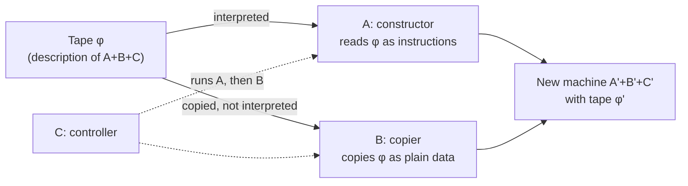
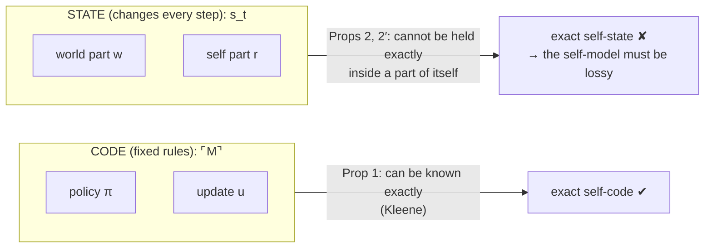
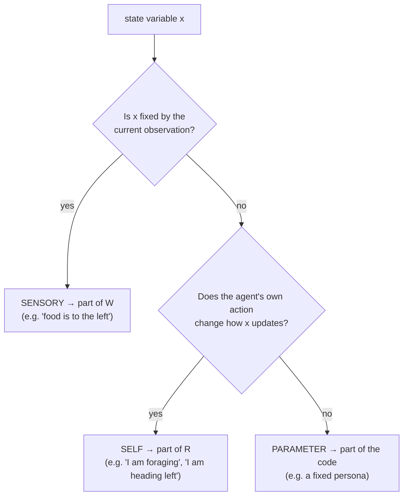
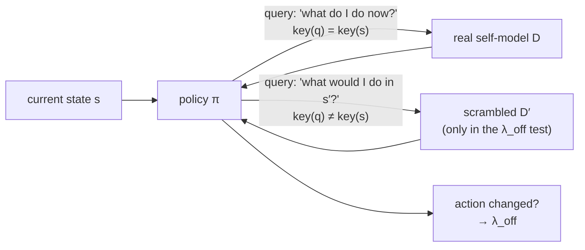
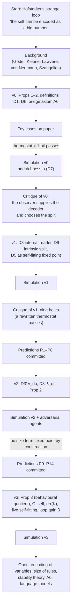
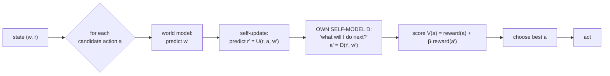
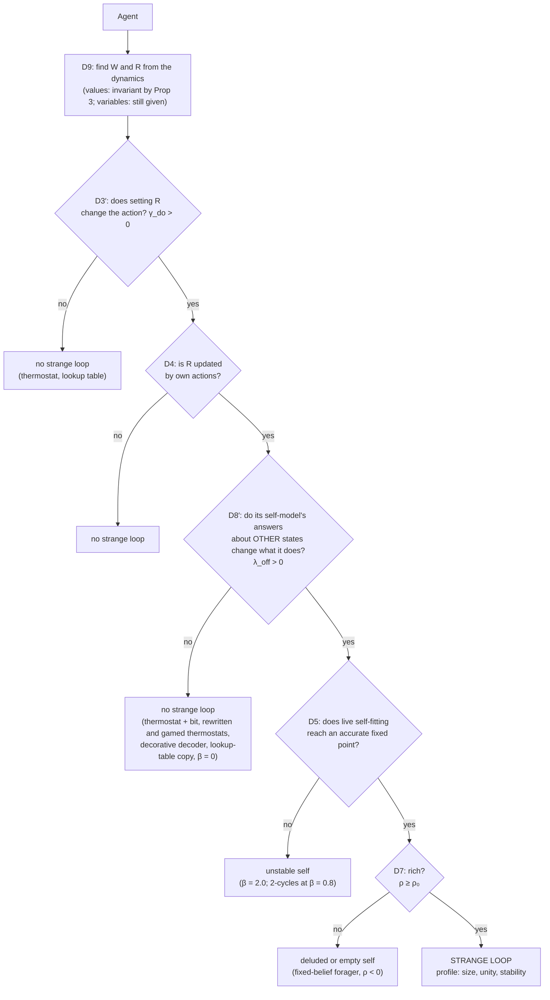

# The Strange Loop Made Exact: A Formal and Experimental Theory of the Hofstadter Self

**Version 3 — 26 November 2026** (version 1: 23 November 2026; version 2: 25 November 2026)

Project **"I"**: review the literature on consciousness, build thought experiments that narrow down what it is, and answer the question *"Is AI conscious?"*

---

## Abstract

Douglas Hofstadter proposed that the "I" is a *strange loop*: a pattern in a system that builds a simplified symbol for itself, and in which that symbol, in turn, steers the system that it describes. The idea is influential, but it has stayed informal. Nobody can compute, for a given machine, whether it has such a loop, how large the loop is, or whether it is stable. This thesis makes the idea exact for finite agents, tests each definition against agents built to break it, and reports where the definitions succeed and where they still fail.

We keep Hofstadter's claim at the centre and do not change it: **the "I" is the lossy self-model at the core of a strange loop**. We contribute four things. (1) **Theorems on the limits of self-knowledge.** An agent can use its own complete rules (Proposition 1, from Kleene's recursion theorem), but no part of an agent can hold an exact record of its own current state (Proposition 2). An agent that answers the question "what would I do?" by running its own decision procedure halts only if its chain of questions cannot return to a state already on the chain (Proposition 2′). The regress must stop in a separate, cheaper self-model, and such a model cannot be exact for most policies. Together these results turn Hofstadter's premise that the self-symbol is simplified into a theorem with two independent reasons: counting and regress. (2) **A canonical self-model.** The coarsest description of the agent's self state that still predicts its policy exactly is unique, is a single variable, and does not depend on how the state is encoded (Proposition 3, the behavioural quotient). Its logarithm gives a size of the self, and its lossy compressions give a rate–distortion curve on which the question "is there one I or several?" can be measured. (3) **Intervention tests that remove the observer.** A self-model counts only if the agent itself consults it *as a model*: when we scramble only its answers about *other* states, the agent's behaviour must change (the off-state reader test, D8′). A thermostat that is merely rewritten to call its own rule a "self-model" fails this test. (4) **The self as an attractor.** When the agent refits its self-model from its own noisy behaviour while it acts with that model, the self-model settles into a fixed point or a cycle. Several different stable selves exist, the agent's initial self-belief selects which one it becomes, and when the agent relies too strongly on its self-model, no stable self forms at all.

All definitions are computed by code on concrete agents. Before each round of experiments we committed our predictions to version control, and we report every failed prediction. Fourteen pre-registered predictions were tested; ten held in full, three held only in part, and one failed. The failures were informative: the size of a self has two components (state and rules), and stability needs a bounded loop gain. The theory describes the **structure** of a self. It does not explain why that structure would feel like anything. We keep that claim apart as an explicit bridge axiom, and we split it into a testable weak form and an untested strong form.

---

## Contents

1. Introduction
2. Self-reference in logic and computation
3. Hofstadter's strange loop
4. Theories of consciousness and the place of this work
5. The formal framework
6. Method
7. Results I: from a trivial loop to the off-state reader (v0–v2)
8. Results II: size, unity and stability of the self (v3)
9. The central claim: a formal strange loop
10. Discussion
11. Conclusion and future work

Glossary · References · Appendix A: The code · Appendix B: Raw outputs and reproduction

Each chapter ends with a **lay summary** of about two paragraphs for readers who want the ideas without the mathematics. Diagrams use Mermaid, which GitHub draws automatically. References marked "(cited from memory, not checked)" have not yet been checked against the source.

### Notation

| Symbol | Meaning |
|---|---|
| M = (S, π, u) | A finite agent: states S, policy π : S → A, update u |
| ⌜M⌝ | The description number (code) of M |
| O, A | Observations, actions |
| W, R | World (sensory) variables and self variables of the state, found by D9 |
| w, r | A value of the world part and of the self part; s = (w, r) |
| D | The agent's own self-model (decoder): D(r, w) predicts the action |
| ε, ε_cf, ρ | Self-prediction error on trajectories, counterfactual error, richness |
| γ, γ_do | Causal use of R: observational (bits) and interventional (fraction) |
| λ, λ_off, φ | Reader scores: all decoder answers scrambled; only off-state answers scrambled; share of off-state queries |
| ~1, ~∞ | Behavioural equivalence of self states: one step; all futures (bisimulation) |
| C_self | Size of the self: log₂ of the number of ~1 classes among visited self states |
| err(K) | Counterfactual error of the best self-model with K classes |
| F | The self-fitting map on self-models |
| β | Loop gain: the weight the planner gives to its self-predicted next action |
| H1–H10 | Hofstadter's premises, as reconstructed in Chapter 3 |
| P1–P14 | Pre-registered predictions (Chapters 7 and 8) |
| R1–R32 | Numbered results (Chapter 9) |

---

## 1. Introduction

### 1.1 The question

The project behind this thesis asks a direct question: *is AI conscious?* The question cannot be answered until we can say, in terms that apply to a machine, what would count as consciousness, or at least as one of its parts. Many proposals exist (Chapter 4). Most of them are stated in words. The words fit the human case well, but they leave room to argue in both directions about any given machine. A large language model "talks about itself"; does it therefore have a self? A thermostat "remembers" what it did; does it therefore model itself? Without exact definitions, such questions cannot be settled.

This thesis works on one candidate part of consciousness: **the self**, in the sense given by Douglas Hofstadter. We chose this part for three reasons. First, it is one of the few accounts that is built from ideas that already have exact forms: Gödel numbering, self-reference and fixed points. Second, it makes the self a *pattern*, not a substance, so the account applies in principle to any medium, including silicon. Third, it makes claims that can turn out to be false. If a self is a self-model that steers the system it describes, then a machine without such a model has no self, and a machine with one has a self whatever it is made of.

### 1.2 Hofstadter's thesis

In *Gödel, Escher, Bach* (1979) and *I Am a Strange Loop* (2007), Hofstadter argues that a brain builds symbols for the things it meets, and that some of these symbols come to stand for the brain's own system. Together they form the "I". The "I" is a *strange loop*: when we follow the levels of description upwards (from neurons to symbols to meanings), we come back to where we started, because the top level, the self-symbol, acts back on the bottom level. The model of the system is part of the system, and it steers the system. Hofstadter compares this with Gödel's proof, in which arithmetic, through a coding of formulas as numbers, comes to make statements about itself. In the same way, a system that codes itself can refer to itself. In principle, the whole pattern could be written as a single (enormous) number.

Chapter 3 reconstructs the argument as ten premises (H1–H10). The two premises that this thesis treats most closely are these. **H2: the self-symbol is lossy.** The "I" is a drastic simplification of the system that it stands for. **H3: the self-symbol is unified.** The cheapest summary of a system that acts with one body and one history is a single agent, "I", and not a crowd of separate parts.

### 1.3 Why make it exact

An informal theory of the self has three weaknesses, and exact definitions address each of them.

1. **It cannot be proved or disproved.** "The self-model is lossy" may be true by necessity, true by accident, or false. Only an exact statement can be proved.
2. **It cannot be measured.** To apply a theory to a machine, we must be able to compute, from the machine's description, whether it has the property and how much of it.
3. **It hides its weak points.** Words such as "model", "uses" and "self" carry the observer's intuitions. When we make them exact, we find the places where the verdict depends on the observer and not on the system. Several of the main results of this thesis are such places, found and then repaired.

### 1.4 Thesis statement

> **Thesis.** Hofstadter's strange loop can be made exact for finite agents. In this exact form, the "I" is a self-model with four properties: (i) it is a lossy summary of the agent's own state, and it must be lossy; (ii) the agent consults it as a model, about situations other than the current one, and acts on the answers; (iii) it is a stable state (an attractor) of the process by which the agent refits the model to its own behaviour; (iv) it predicts how the agent would act across situations, and not only what it does now. Each property can be computed, each can be tested by intervention, and the first follows from theorems.

The thesis does **not** claim that such a structure is conscious. That claim is a separate bridge axiom, A0, which we state, split into two forms, and leave open (§5.9, §10.7).

### 1.5 Contributions

The following results are, to our knowledge, new in this form. Chapter 10 compares each one with prior work.

1. **Code against state** (Propositions 1 and 2). Exact self-knowledge of one's rules is possible. Exact self-knowledge of one's current state, held in a part, is not.
2. **Bounded self-simulation** (Proposition 2′ and Corollary 2′). An agent that plans by asking "what would I do?" must, in a world where situations can repeat, end the regress in a base self-model that is not computed by its own decision procedure. A cheap base model is lossy for most policies. This gives a second, independent reason for H2: regress and cost, not only counting.
3. **The behavioural quotient** (Proposition 3). The minimal exact one-step self-model is unique, is one variable, and is invariant under relabelling. It gives a size of the self, C_self, and a rate–distortion curve err(K) on which unity (H3) becomes measurable.
4. **Intervention tests for the internal reader** (D8 and D8′). The off-state reader score λ_off separates agents that plan with a self-model from agents that only call their own policy by another name.
5. **The self as an attractor of self-fitting** (§5.8, Chapter 8). Self-models refitted from the agent's own noisy experience settle into fixed points or cycles; several selves coexist; the initial self-belief selects one; a high loop gain removes all stable selves.
6. **A pre-registered, adversarial method** for a theory of consciousness. Predictions were committed before each round of code. Agents were built to break the definitions. All failures are reported.
7. **A working test bench**: plain Python code that computes every measure on every agent in this thesis, with automatic tests.

### 1.6 Method in brief

We work in a cycle: **define, test, find the failure, fix, test again**. The theory went through four versions (v0 to v3). Each version was tested by simulation on small agents in small worlds: thermostats, foragers on a ring, and agents with two needs. From version 2 onwards, we wrote down our predictions and committed them to version control before we wrote the code that tested them. Chapter 6 gives the details.

### 1.7 Structure of the thesis

Chapters 2 to 4 give the background: the mathematics of self-reference (Chapter 2), Hofstadter's argument and its closest formal relatives (Chapter 3), and the main scientific theories of consciousness (Chapter 4). Chapter 5 gives the formal framework, with all definitions and proofs. Chapter 6 gives the method, the worlds and the agents. Chapters 7 and 8 give the results of the four versions. Chapter 9 states the central claim in its final formal form and lists every result. Chapter 10 discusses what the results mean, including for AI, and what they do not show. Chapter 11 concludes.

### Lay summary

Hofstadter says that your "I" is not a thing inside your head. It is a pattern: your brain builds a simplified picture of itself, and that picture then helps to steer the brain. He calls this a "strange loop", because the picture describes the system and the system follows the picture. The idea is attractive, and it suggests that a machine could also have an "I". But in words alone, it is too vague to tell which machines have such a loop and which do not.

This thesis turns Hofstadter's idea into exact mathematics, and then tests it with small computer programs. We prove that a system can know its own rules perfectly, but that its picture of its own current state must always be simplified. We give tests that check whether a machine really uses its picture of itself to plan, and we show that a stable self-picture can form on its own, but only when the machine does not lean on it too hard. We keep one question apart: whether having such a loop also means *feeling* something. The mathematics does not answer that question, and we say so.

---

## 2. Self-reference in logic and computation

The strange loop is built from ideas in logic and computation. This chapter introduces them in the form that later chapters use. Each section ends with the use we make of the idea.

### 2.1 Gödel numbering

Gödel (1931) gave each formula of arithmetic a unique natural number, its *Gödel number*. Statements about formulas, such as "formula x is provable", then become statements about numbers, which arithmetic can express. With a diagonal construction, Gödel built a sentence G that says, through this coding, "G is not provable". If arithmetic is consistent, G is true but not provable. The key step is not the paradox. It is the coding: once a system can represent its own expressions as objects inside itself, it can refer to itself.

Hofstadter takes the coding as the model for the self. A brain that represents itself is like arithmetic that represents its own formulas. And a self, like a formula, has a code number.

*Use here.* Every agent M has a **description number** ⌜M⌝ ∈ ℕ, the code of its complete rules (§5.1). This is the exact version of Hofstadter's "big number".

### 2.2 Kleene's recursion theorem and quines

Kleene's second recursion theorem (Kleene, 1938) says: for every computable transformation f of programs, there is a program e that computes the same function as f(e). In words: whatever a program would like to do with its own text, some program does exactly that. The simplest example is a *quine*, a program that prints its own source code. The theorem shows that self-reference to one's own **code** is always possible, at no cost beyond a constant: a program does not need a smaller copy of itself inside; it can construct its own text from a template and a description of the template.

*Use here.* Proposition 1 (§5.2): exact self-knowledge of one's code is possible. This is the positive half of the code–state distinction, and it explains why a self-model of one's *rules* can be exact (§7.4).

### 2.3 Lawvere's fixed-point theorem

Lawvere (1969) showed that Cantor's diagonal argument, Russell's paradox, Gödel's incompleteness theorem, Tarski's undefinability of truth, Turing's halting problem and Kleene's recursion theorem are instances of one result. In a cartesian closed category, if there is a map g : X → Y^X that is *point-surjective* (every map X → Y equals g(x) for some x), then every map t : Y → Y has a fixed point. Read in the contrapositive: if some map t : Y → Y has no fixed point (for example negation on truth values), then no such g exists, and so X cannot fully represent all maps from X to Y. Yanofsky (2003) gives an accessible account without category theory, and shows that von Neumann's self-reproduction fits the same scheme.

Two lessons follow. First, self-reference produces either a **fixed point** or a **limit on representation**; these are two faces of the same argument. Second, the limits are about *completeness*: a system cannot contain a complete representation of all of its own possible behaviours in a single, uniform way. This is the logical root of our Proposition 2 and Proposition 2′.

*Use here.* A stable self is a **fixed point** of a self-modelling process (D5, §5.8). And the self-model is **incomplete** by necessity (§5.2, §5.5).

### 2.4 Von Neumann's self-reproducing automata

A naive self-copying machine would need to contain a description of itself, which contains a description of the description, and so on without end. Von Neumann (1966) avoided this regress. His machine has a universal constructor A, a copier B, a controller C, and a tape φ that describes A + B + C. The tape is used in two ways. A **reads** it as instructions and builds a new machine. B **copies** it as plain data, without reading it, and gives the copy to the new machine.



The double use of one description, once interpreted and once copied, is the same device as in Kleene's theorem and in a quine. It shows how a finite system can contain a complete description of itself: the description is of the **rules**, not of the current **state**, and it is not interpreted inside itself.

*Use here.* The tape corresponds to the code ⌜M⌝ in Proposition 1. The distinction between a description that is read and one that is only copied returns in the internal-reader tests D8 and D8′ (§5.4): a self-model that the agent never reads is a tape that is only copied.

### 2.5 Provability logic and Löb's theorem

The provability logic GL formalises what a theory T can prove about its own provability, with □p read as "p is provable in T" (Boolos, 1993). Two of its results matter here. **Löb's theorem** (Löb, 1955): if T ⊢ □P → P, then T ⊢ P. So T cannot prove "whatever I prove is true" for a statement P unless it already proves P. A system cannot, in general, establish its own soundness. **The fixed-point theorem of GL**: if p appears in ψ(p) only inside □, then there is a sentence σ, without p, such that GL ⊢ σ ↔ ψ(σ). Self-referential sentences of this kind can be rewritten as sentences without self-reference.

*Use here.* Löb's theorem is the logical form of the "Löbian obstacle" for agents that must trust a successor (§2.6) and of Szangolies's analysis (§3.4). Our approach avoids the obstacle in a different way from Szangolies: our agents do not *prove* anything about themselves. They *predict* themselves, with a model that can be wrong, and they correct the model from experience.

### 2.6 Embedded agency

Classical decision theory treats an agent as separate from its environment: the agent receives observations, sends actions, and can in principle hold a complete model of the environment. Demski and Garrabrant (2019) argue that real agents are **embedded**: they are part of the environment that they model. Four problems follow. (a) *Embedded world-models*: the agent is smaller than the world that contains it, so it cannot hold an exact model of the world, which includes itself. (b) *Decision theory*: an agent that can predict its own action faces paradoxes when it asks what would happen if it acted otherwise. (c) *Robust delegation*: an agent cannot fully verify a successor or a later version of itself (the Löbian obstacle). (d) *Subsystem alignment*: parts of the agent can come to pursue their own goals. (Cited from memory, not checked.)

Problem (a) is the same as our Proposition 2, stated informally. Problem (b) is related to our Proposition 2′: an agent that answers "what would I do?" by running itself meets a regress. The embedded-agency programme aims at the foundations of safe artificial agents; it does not discuss the self or consciousness. To our knowledge, it does not give the counting result in our form, the halting condition on the query graph, or measures of a self-model.

*Use here.* Our agents are embedded agents in the simplest form. Proposition 2 and Proposition 2′ are exact versions of problems (a) and (b) for finite agents.

### 2.7 The good regulator theorem and the map of England

Two older ideas complete the background. The **good regulator theorem** (Conant & Ashby, 1970) states that every good regulator of a system must be a model of that system. If a system must control itself, the theorem suggests that it needs a model of itself; this gives an engineering reason for Hofstadter's premise H1 and for our requirement that the self-model be used (D8). (Cited from memory, not checked.) **Royce's map** (Royce, 1899): a perfectly exact map of England, drawn on the soil of England, would have to contain a map of itself, which contains a map of itself, without end. A part cannot contain an exact image of a whole that includes the part. This is the intuition behind Proposition 2. (Cited from memory, not checked.)

### 2.8 What the background gives us

| Idea | What it shows | Where it is used |
|---|---|---|
| Gödel numbering | A system can represent its own expressions as objects | Description number ⌜M⌝ (§5.1) |
| Kleene's recursion theorem | Exact self-reference to one's own code is possible | Proposition 1 (§5.2) |
| Lawvere's theorem | Self-reference gives fixed points, or limits on complete self-representation | D5 and the attractor view (§5.8); Propositions 2, 2′ |
| Von Neumann's automaton | A self-description can be complete if it is of the rules and is not interpreted inside itself | Proposition 1; reader tests D8, D8′ |
| GL and Löb's theorem | A system cannot prove its own soundness | Contrast with Szangolies (§3.4); our agents predict instead of prove |
| Embedded agency | An agent inside its world cannot model the world, itself included, exactly | Propositions 2 and 2′ |
| Good regulator | A good controller is a model of what it controls | Motivation for D8 |
| Royce's map | A part cannot hold an exact image of the whole | Proposition 2 |

### Lay summary

Long before anyone studied the self with computers, logicians found that systems can talk about themselves. Gödel showed that arithmetic can describe its own sentences by turning them into numbers. Kleene showed that a computer program can always be written so that it uses its own text, and von Neumann showed how a machine can copy itself without a smaller copy inside it, by keeping a description of its rules on a tape. Lawvere showed that all these results are one result, and that self-reference always leads either to a stable "fixed point" or to a limit on what a system can know about itself.

These ideas give us our tools. A machine can carry its complete rulebook, because the rulebook does not change. But a machine cannot carry a perfect, live picture of its whole current state in one part of itself, for the same reason that a map of England drawn on England would have to contain itself without end. Recent work on "embedded agents" in artificial intelligence reaches a similar conclusion. In the next chapters we use these tools to make Hofstadter's idea of the self exact.

---

## 3. Hofstadter's strange loop

### 3.1 The idea in Hofstadter's own works

In *Gödel, Escher, Bach* (1979), the strange loop is introduced through art, music and logic: Escher's hands that draw each other, Bach's canons that rise in pitch and return to the starting key, and Gödel's sentence that refers to itself through a numerical code. The common structure is a hierarchy of levels in which moving upwards eventually brings you back to the start. In *I Am a Strange Loop* (2007), Hofstadter applies the structure directly to the self. The brain perceives the world in terms of high-level symbols. Among these symbols is one for the brain's own system. This symbol, the "I", is built up over a lifetime from the system's perceptions of its own actions, and it takes part in choosing the next action. The causal story at the level of neurons is complete, but the most useful description of why the system acts is given at the level of the "I". Hofstadter calls this an inversion of causality as it is perceived: it seems that the "I" pushes the neurons around. In later work he applies the idea to the question of whether AI systems have an "I" (Hofstadter, 2026).

### 3.2 The argument as ten premises

We reconstruct Hofstadter's argument as ten premises. The reconstruction and the labels are ours; Hofstadter does not number his claims.

| # | Premise (our reconstruction) | Status in this thesis |
|---|---|---|
| H1 | **Self-modelling.** A system that must act in a complex world, with one body and one history, benefits from a model of itself, and complex agents build one. | Motivated (good regulator, §2.7); built into the agents |
| H2 | **Lossiness.** The self-model is a drastic simplification of the system. | **Proved** for the state (Props 2, 2′, Cor 2′) |
| H3 | **Unity.** The cheapest summary of such a system is a single agent, "I". | **Made exact** (Prop 3); tested (P10, holds with a small margin) |
| H4 | **Useful illusion.** The "I" is not literally what it seems to be (an inner thing that causes action), but it is a useful and stable description. | Partly formalised: transparency is not yet defined (§4.2) |
| H5 | **The loop.** The self-symbol steers the system that it describes, and is updated from what the system does. | **Made exact** (D3′, D4, D8′) and tested |
| H6 | **Stability.** The loop settles into a stable pattern that persists over time. | **Made exact** as an attractor of self-fitting (§5.8); tested (P12–P14) |
| H7 | **No extra ingredient.** Nothing beyond this pattern is needed for a self. | Kept as the bridge axiom A0 (§5.9); not tested |
| H8 | **Medium independence.** Any medium that supports the pattern supports the self. | Built in: all definitions are functional; but see P4 (§7.6) |
| H9 | **Degrees.** Selves come in degrees, from mosquitoes to humans. | Partly: the grade vector and C_self (§8); no single order yet |
| H10 | **Interpenetration.** Low-resolution copies of other selves can live in a brain, so selves are not sharply bounded. | Not addressed |

The premises that are most directly mathematical are H2, H3, H5 and H6. This thesis concentrates on them.

### 3.3 Criticisms of the strange-loop account

The main criticisms are these.

1. **It explains reports, not experience.** A system with a self-model will *say* that it has a self, and may say that it has experiences. But the account does not explain why the self-model would be *experienced* at all. This is the hard problem (Chalmers, 1995) in its application to the self (§4.9).
2. **Experience without a self.** Experience seems possible without a self-model, or with a much reduced one: in deep meditation, in some psychedelic states, perhaps in infants and animals. If so, the self cannot be the whole of consciousness (§10.7).
3. **Behavioural tests can be gamed.** If the self is identified by behaviour (the system talks about itself, predicts itself), then a system can be built to show the behaviour without the structure. This is the reason for our intervention tests (D8, D8′) and for the adversarial agents P1–P8.
4. **Vagueness.** Without exact definitions, almost any feedback system can be described as a loop, and the account loses its content. Our first formal definition (v0) showed this directly: a thermostat with one bit of memory passed (§7.1).

### 3.4 The closest formal work: Szangolies's von Neumann minds

Jochen Szangolies applies von Neumann's construction to the mind (Szangolies, 2018, 2023; earlier papers 2015 and 2020). We found this to be the closest existing work to ours. We read the abstract, an indexed summary, his own blog explanation and a forum discussion. We have not yet read the full text of the 2023 paper, so the details below are not checked against it.

His argument has five steps.

1. **The homunculus problem.** If the mind uses an internal representation, something must read it; that reader needs its own representation, and so on. His way out: let a representation and its user be one and the same, so that a mental state represents itself.
2. **Von Neumann minds.** A mental state is like a von Neumann replicator. To produce the next state, it reads its own description. Its own properties are represented to itself.
3. **From self-reference to reference to the world.** He uses the fixed-point theorem of GL (§2.5) to rewrite a self-referential statement ("I may change into my next state") as one without self-reference, which is about the world (for example, a goal).
4. **The Löbian obstacle.** By Löb's theorem, the system cannot prove that its successor reasons soundly. His answer: the system does not need to *derive* its properties, because it *has* them.
5. **The hard problem.** He takes a Russellian monist view: theory reaches only structure, and experience is the system's direct access to its own intrinsic, non-structural properties. On his view, no theory can solve the hard problem.

**Comparison.**

| | Szangolies | This thesis |
|---|---|---|
| Self-description | Exact; the state is its own description | Exact for the rules (Prop 1); lossy for the state (Props 2, 2′) |
| Kind of fixed point | Logical (GL) | Dynamical (attractor of self-fitting) |
| Homunculus problem | Removed by identity of representation and user | Removed by intervention tests: the agent's own behaviour must depend on the model (D8′) |
| Compression | Not used | Central (Props 2, 2′, 3; C_self; err(K)) |
| Measures | None | All definitions computable |
| Hard problem | Unsolvable in principle (Russellian monism) | Kept apart (A0); weak form testable |

The main difference is **compression**. In Szangolies's model, self-access is exact because the system *is* the object of its representation. In ours, the self-model of the state is lossy by necessity, and that is what makes it a model and not the thing itself.

### 3.5 Other formal work on strange loops

A literature search found three further lines of work.

- **The "Strange Loop Model"** (*Frontiers in Ecology and Evolution*, 2021): a model of causal feedback between two brain modules that avoids the paradoxes of self-reference by unfolding the loop in time, and that links inconsistencies in the loop to causal structure in the sense of Integrated Information Theory (title and authors not checked).
- **Kim (2025)**, an abstract at CNS 2025: qualia formalised as recursive stability, with fixed-point states of neural circuits that refer to their own outputs, and tests on attention mechanisms in large language models.
- Several **unreviewed preprints** that claim a "formal theory of consciousness" based on self-model fixed points. We did not use them. Their number shows that reviewers will be sceptical of new claims in this area, and it is one reason for our pre-registered method.

None of these works distinguishes exact self-code from lossy self-state, gives a canonical minimal self-model, or tests its definitions against adversarial agents.

### 3.6 What is missing

The literature contains the general idea that the self is a self-referential loop or a fixed point. It does not contain: (a) a proof of *why* the self-model must be lossy, in a form that separates rules from state; (b) a definition of "the agent uses its self-model" that a merely relabelled system cannot pass; (c) a measure of the size and unity of a self that does not depend on the encoding; (d) a dynamical account of how a self-model becomes stable, and when it does not. Chapters 5 to 8 supply these.

### Lay summary

Hofstadter's idea comes from patterns that return to their own start: Escher's two hands that draw each other, or a sentence that talks about itself. He says that the brain builds a symbol for itself, the "I", from what it sees itself do, and that this symbol then takes part in what the brain does next. We list his argument as ten steps. Four of them can be made into mathematics: the self-picture is simplified, it is one picture and not many, it steers the system, and it settles into a stable pattern. The other steps are about experience and about how far the idea reaches, and we do not claim to test them.

The closest earlier work is by Jochen Szangolies, who also uses the trick from self-copying machines. But in his account, the mind knows itself exactly. In ours, it cannot: a system can only carry a simplified sketch of its own current state. Critics of Hofstadter say that his idea explains what we *say* about ourselves, not why we *feel* anything, and that the idea is so loose that a thermostat could count as a loop. We take both criticisms seriously. The second one turned out to be true of our own first definition, and much of this thesis is about how we fixed it.

---

## 4. Theories of consciousness and the place of this work

A theory of the self is not yet a theory of consciousness. But the strange loop is often offered as one, and any test of it must be compared with its rivals. This chapter reviews the main theories that are close to the strange loop or compete with it. For each theory we give its **claim**, its **aim** (what it tries to explain or prove), its **conclusions**, including on AI, whether it is **formalised**, and its **relation** to this thesis.

### 4.1 Levels of formalisation

We use three levels.

- **Full**: exact mathematical definitions, from which numbers can be computed for a given system.
- **Partial**: computational models or formal fragments exist, but the core claim is stated in words.
- **No**: conceptual or philosophical only.

| Theory | Main claim | Formalised? | Verdict on AI (as its proponents argue) | Relation to this thesis |
|---|---|---|---|---|
| Self-model theory (Metzinger) | The self is a transparent self-model, not a thing | No | Possible in principle; argues for a moratorium because of the risk of artificial suffering | Closest informal theory; we formalise part of it |
| Attention schema theory (Graziano) | Awareness is a simplified model of one's own attention, used to control it | Partial | Yes, if the machine has an attention schema that it uses for control | A special case of our self-model |
| Integrated Information Theory (Tononi) | Consciousness is a maximally irreducible cause–effect structure, measured by Φ | Full | No for software on conventional computers, whatever its behaviour | The only fully formal rival; opposite predictions |
| Global (neuronal) workspace (Baars; Dehaene) | Consciousness is global broadcast of information in a limited workspace | Partial | Yes, if the machine has a global workspace (plus self-monitoring for the full sense) | A rival; needs no self-model |
| Higher-order theories (Rosenthal; Lau) | A state is conscious when a suitable higher-order state represents it | Partial | Yes, with suitable metacognitive monitoring | Our self-model is a kind of higher-order representation |
| Free energy principle; predictive processing (Friston; Seth) | Persisting systems minimise surprise; the self is a set of predictions that keep the body alive | Full (the principle); No (the link to consciousness) | FEP: silent. Seth: probably not, without life-like self-maintenance | Same sensor/internal split as our D9 |
| Information bottleneck; rate–distortion (Tishby; Shannon) | The best lossy summary keeps only what predicts a target | Full | Not applicable (a tool, not a theory) | Our route to unity and to a size of the self |
| Hard problem, meta-problem, illusionism (Chalmers; Frankish) | Why is there experience at all? Why do we *think* there is a hard problem? | No | Open; the meta-problem suggests a test | Sets the limits of what we can claim |

### 4.2 Self-model theory of subjectivity (Metzinger, 2003)

- **Claim.** There are no selves in the world. What exists is a *phenomenal self-model*: the brain's model of the whole organism. The model is **transparent**: the system cannot experience it *as* a model, so it experiences itself as a self in direct contact with the world. The first-person perspective comes from a model of the relation between this self and its objects.
- **Aim.** To explain self-consciousness and the first-person perspective in representational and functional terms only, with evidence from neurology and psychiatry (phantom limbs, out-of-body experiences, depersonalisation).
- **Conclusions.** The self is a process of self-modelling, not a substance. When the self-model becomes opaque (seen as a model) or weak, the sense of self changes or disappears. On AI: artificial systems could in principle have a phenomenal self-model. Metzinger (2021) argues for a global moratorium on research that risks creating artificial suffering.
- **Formalised?** No. The theory gives a list of constraints in words, but no definitions that can be computed.
- **Relation.** The closest theory to ours. Our lossy self part R, read by the agent (D8′), is a formal version of a self-model that steers. We have **not** yet formalised *transparency*. A candidate: the agent has no variable that represents "R is only a model", so its self-model does not model its own errors. Our "deluded self" (an agent that reads a wrong self-model, §7.4) is a case where this would matter. Transparency is also the most natural formal reading of Hofstadter's H4 ("useful illusion").

### 4.3 Attention schema theory (Graziano, 2013)

- **Claim.** The brain builds a simplified, schematic model of its own attention, just as it builds a body schema to control the body. Awareness is what this *attention schema* describes. When we say "I am aware of X", we report the content of the schema, which depicts a simplified, almost magical inner grasp of X.
- **Aim.** To explain (a) the **control** of attention, because control works better with a model of the thing that is controlled; and (b) why people **claim** to have subjective experience, which is an answer to the meta-problem (§4.9).
- **Conclusions.** Awareness is a model of attention: accurate in outline, wrong in detail. Attention and awareness can come apart. Prediction: without awareness of a stimulus, the control of attention to it gets worse. On AI: a machine with an attention schema that it uses to control its attention would be aware in the same sense that we are. Graziano treats this as a realistic engineering target.
- **Formalised?** Partial. The theory is stated in words. One neural-network agent shows that an attention schema improves control (Wilterson & Graziano, 2021). There is no general measure.
- **Relation.** A special case of our theory: R models attention, it is used for control (D8′), and it is simplified (Propositions 2 and 2′). AST is narrower but easier to test. Its control argument gives an independent reason for D8: by the good regulator theorem (§2.7), a good controller must contain a model of what it controls.

### 4.4 Integrated Information Theory (Tononi, 2004; Oizumi et al., 2014; Albantakis et al., 2023)

- **Claim.** Consciousness *is* a maximally irreducible cause–effect structure in a physical system. Its amount is the integrated information Φ: how much the causal powers of the whole exceed those of its parts.
- **Aim.** To start from what experience is like (the *axioms*: it exists for itself, is structured, specific, unified and definite) and to derive what a physical system must be like to have it (the *postulates*). Then to explain which parts of the brain support consciousness (for example posterior cortex but not cerebellum), and to assess consciousness in patients who cannot respond.
- **Conclusions.** Consciousness depends on the physical causal structure, not on function or behaviour. A purely feed-forward system has Φ = 0. A conventional digital computer has very low Φ, whatever software it runs, so even an exact simulation of a brain on such a computer would not be conscious (Tononi & Koch, 2015). Some simple but highly integrated structures, such as large grid-like networks, would be highly conscious. Critics take this as a sign that the theory is wrong (Aaronson, 2014). In 2023, an open letter signed by more than 100 researchers called IIT pseudoscience (Fleming et al., 2023); others disputed this.
- **Formalised?** Full. Versions 3.0 and 4.0 give exact definitions, and Φ can be computed for small discrete systems (for example with the PyPhi software). The cost grows faster than exponentially with system size, so Φ cannot be computed for a brain.
- **Relation.** The only fully formal rival, and it uses the same kind of discrete systems as we do. Its **exclusion** postulate (choose the grain and boundary with maximum Φ) is a principled answer to our encoding problem (§10.3), and our planned coarse-graining fix follows the same strategy. IIT agrees with our current verdict on P4: implementation matters, not only behaviour. But IIT needs no self-model, so IIT and A0 make **opposite predictions** in two cases: a highly integrated system with no self-model (IIT: conscious; A0: not) and a self-modelling program on a conventional computer (IIT: not; A0: conscious).

### 4.5 Global workspace and global neuronal workspace (Baars, 1988; Dehaene & Changeux, 2011)

- **Claim.** The mind consists of many specialised processors that work in parallel and unconsciously. Information becomes conscious when it enters a limited-capacity *global workspace* and is broadcast to all the processors at once. In the brain, this is a sudden, self-sustaining "ignition" of a network of long-range neurons in prefrontal and parietal cortex.
- **Aim.** To explain the difference between conscious and unconscious processing of the same stimulus (masking, inattentional blindness), the limited capacity of consciousness, and why conscious contents can be reported.
- **Conclusions.** Consciousness is global availability of information for report, reasoning and action. The theory proposes neural markers, such as late ignition about 300 ms after a stimulus (some of these markers are disputed). On AI: Dehaene, Lau and Kouider (2017) split consciousness into C1 (global availability) and C2 (self-monitoring), and argue that a machine with both would be conscious in this sense. A large adversarial test of this theory against IIT challenged key predictions of both (Cogitate Consortium, 2025).
- **Formalised?** Partial. There are neural-network simulations of ignition, and a formal model from theoretical computer science, the Conscious Turing Machine (Blum & Blum, 2022). The core claim is stated in words, and there is no single measure.
- **Relation.** The global workspace does not need a self-model. So it predicts consciousness in a system with global broadcast but no "I", and A0 does not. Dehaene's C2 (self-monitoring) is close to our loop. The adversarial collaboration is a model for our own method of writing predictions down first.

### 4.6 Higher-order theories (Rosenthal, 2005; Lau & Rosenthal, 2011)

- **Claim.** A mental state is conscious when the subject has a suitable higher-order representation of being in that state. Versions differ on what this representation is: a higher-order *thought* (Rosenthal), a higher-order *perception*, or a system that monitors whether perceptions are real (Lau).
- **Aim.** To explain the difference between conscious and unconscious states with the same content (for example blindsight), and why consciousness is linked to metacognition and prefrontal cortex.
- **Conclusions.** First-order processing is not enough; consciousness needs meta-representation. A consequence that is still debated: a higher-order state can misrepresent, so experience can be wrong about the first-order state, or exist without it. On AI: a system that monitors its own perceptual states in a suitable way could be conscious. Butlin et al. (2023) use this as one of their indicator properties.
- **Formalised?** Partial. Computational versions exist, for example signal-detection models of metacognition and a Bayesian "higher-order state space" (Fleming, 2020).
- **Relation.** Our self-model is a higher-order representation, but of the agent's **whole policy**, not of single perceptual states. The case of misrepresentation corresponds to our deluded self. Higher-order theories do not need the representation to act back on behaviour; our D3′ and D8′ do. That loop back into action is Hofstadter's addition.

### 4.7 Free energy principle and predictive processing (Friston, 2010, 2013; Seth, 2021)

- **Claim.** Any system that keeps itself within a bounded set of states, separated from its environment by a *Markov blanket*, behaves as if it minimises variational free energy (an upper bound on surprise). Perception and action both reduce prediction error (*active inference*).
- **Aim.** One principle for perception, action, learning and life. The free energy principle itself is **not** a theory of consciousness. Theories of consciousness built on it include Seth's "beast machine" view: the experience of being a self comes from the brain's predictive control of the body's interior (interoception).
- **Conclusions.** The self is, at its base, a set of predictions about the body that keep it alive. On AI: Seth argues that consciousness is tied more closely to being a living, self-maintaining system than to intelligence, so current AI is probably not conscious.
- **Formalised?** The principle is fully mathematical. The link to consciousness is not formalised. Critics argue that the principle fits almost any system and so cannot be falsified, and that "Markov blanket" is used in two different senses (Bruineberg et al., 2022).
- **Relation.** Our intrinsic split D9 uses the same separation of sensory and internal variables, and our open problem "where does the agent end?" is the Markov blanket problem. Seth's view challenges D9 directly: in our forager, energy is classified as *world* (sensory), but for Seth the state of the body is the core of the self.

### 4.8 Information bottleneck and rate–distortion theory (Shannon, 1959; Tishby et al., 1999)

- **Claim.** A mathematical tool, not a theory of consciousness. Given a source X and a target Y, the best lossy summary T of X keeps the information that predicts Y and drops the rest. Rate–distortion theory gives, for each allowed size of the summary (the *rate*), the smallest possible error (the *distortion*), as an exact trade-off curve. The information bottleneck minimises I(X; T) − β_IB · I(T; Y) over summaries T.
- **Formalised?** Full.
- **Relation.** Our self-model is a summary of the self state R (source) for predicting the agent's own policy (target). The behavioural quotient R/~1 (§5.6) is the zero-distortion point of this trade-off, and err(K) (§5.7) is a version of the trade-off curve in which the rate is the number of classes K. Unity (H3) becomes a question about the shape of this curve.

### 4.9 Hard problem, meta-problem and illusionism (Chalmers, 1995, 2018; Frankish, 2016)

- **Claim.** These are problems and positions, not mechanistic theories. The **hard problem**: why is physical processing accompanied by experience at all? Chalmers argues that functional explanations, which include all the theories above and ours, explain functions but leave this question open. The **meta-problem**: explain, in functional terms, why we *say* and *believe* that there is a hard problem. **Illusionism** (Frankish; also Dennett) claims that solving the meta-problem is the whole job, because phenomenal consciousness, as it seems from the inside, is an introspective illusion.
- **Conclusions.** Chalmers: a solution to the meta-problem would strongly constrain theories of consciousness, but would not by itself solve the hard problem. Illusionists: it would. On AI: the hard problem leaves the question open. The meta-problem suggests a test: does a system produce "hard problem" intuitions for functional reasons of its own, and not only because it imitates human text?
- **Formalised?** No.
- **Relation.** Hofstadter is close to illusionism (H4: the "I" is a useful illusion). Our weak bridge axiom A0-weak (§5.9) is a claim about the meta-problem and can be tested. The strong form A0-strong faces the hard problem, and no structural theory, ours included, can settle it alone.

### 4.10 Work on AI consciousness and machine introspection

The following works are close to ours in aim or method. We cite them from memory; the details are not yet checked.

| Work | What it does | Relation to this thesis |
|---|---|---|
| Butlin, Long et al. (2023) | Derives "indicator properties" for consciousness in AI from the main scientific theories | A checklist approach to the project's question; our measures could become one indicator |
| Wilterson & Graziano (2021) | An agent that controls its attention with a simplified model of its own attention | Very close to our self-simulating forager: a lossy self-model that is read and steers |
| Binder et al. (2024) | Language models predict their own behaviour in hypothetical situations better than other models can | A language-model version of our counterfactual accuracy ε_cf and richness ρ |
| Lindsey (2025) | Injects concepts into a language model's activations and tests whether the model notices | A language-model version of an intervention test like λ |

### 4.11 The implementation problem and emergence

If a theory says that a system has a self when it *implements* some structure, it must say what "implements" means. Putnam (1988) argued that every open physical system implements every finite automaton under some mapping. If that is so, any structural theory of the self is empty unless it restricts the admissible mappings. This is the deep form of the encoding problem that we meet in §7.5 (hole 2). Two lines of work offer tools. **Causal emergence** (Hoel et al., 2013) compares descriptions of a system at different grains and asks at which grain the causal structure is strongest. **Information-theoretic measures of emergence** (Rosas et al., 2020) ask when a macroscopic variable has predictive power that its parts do not have. Both choose a level of description by a criterion, not by the observer's taste. Our behavioural quotient (§5.6) is a criterion of the same kind, restricted to the self part.

### 4.12 The position of this thesis

The theories fall into three families. **Self-model theories** (Metzinger, Graziano, Hofstadter) locate the self, and perhaps consciousness, in a system's model of itself. **Access theories** (global workspace, higher-order theories) locate consciousness in how information is made available. **Causal-structure theories** (IIT) locate it in the physical causal structure. Of these, only IIT is fully formalised as a theory of consciousness. This thesis makes one self-model theory, Hofstadter's, as exact as IIT is, so that the two can be compared on the same systems and their opposite predictions can be tested.

### Lay summary

Scientists and philosophers have proposed many theories of consciousness. Some say that consciousness comes from a system's model of itself (Metzinger, Graziano, and Hofstadter). Some say that information becomes conscious when it is broadcast across the brain, or when the brain represents its own states (workspace and higher-order theories). One theory, Integrated Information Theory, says that consciousness is a property of how the physical parts of a system cause each other, and it is the only one that gives exact formulas. Others ask why there seems to be a hard problem at all, and some think that the feeling of an inner self is a kind of illusion.

The theories disagree about AI. Integrated Information Theory says that ordinary computers cannot be conscious, whatever program they run. Graziano says that a machine with the right model of its own attention would be aware. Our work belongs to the self-model family, which so far has been stated only in words. We make it exact, so that it can be compared directly with Integrated Information Theory, and so that where the two theories disagree, an experiment could decide between them.

---

## 5. The formal framework

This chapter gives all definitions and proofs. It presents the framework in its current form (v3). Chapter 7 shows how it was reached, and which earlier definitions failed and why. Definitions are numbered D1–D9 in the order in which they were introduced; primes (′, ″) mark later, stricter versions.

### 5.1 Agents and their description

A **finite agent** in a finite world is given by:

- O, a finite set of observations, and A, a finite set of actions;
- S, a finite set of internal states;
- π : S → A, the **policy**: what the agent does in each state;
- u : S × A × O → S, the **update**: how the state changes after the agent acts and then observes.

The agent is the tuple **M = (S, π, u)**. Fix any standard encoding of finite tuples as natural numbers. Then **⌜M⌝ ∈ ℕ** is the **description number**, or **code**, of M. It is the exact form of Hofstadter's "big number": the complete, fixed recipe of the agent. The world is a (possibly random) process that maps the agent's actions to its next observations.

### 5.2 Code and state: what an agent can know about itself

"Self-knowledge" can mean two different things.

- Knowledge of the **code** ⌜M⌝: the fixed rules.
- Knowledge of the **state** s_t ∈ S: what the agent is like at time t.



**Proposition 1 (exact self-code is possible).** In any acceptable programming system, for every computable f there is a program e with φ_e = φ_{f(e)}. In particular, there are agents whose program uses its own complete description ⌜M⌝.

*Proof.* This is Kleene's second recursion theorem (§2.2). ∎

**Proposition 2 (exact self-state is impossible in a part).** Split the state into a world part and a self part, S = W × R, with |W| ≥ 2, and let every state in S be reachable. Then there is no map g : R → S with g(r) = (w, r) for every state (w, r). The self part cannot contain an exact record of the current full state.

*Proof.* Such a g would make the projection (w, r) ↦ r injective on S, because (w, r) = g(r). Then |W| · |R| = |S| ≤ |R|, so |W| ≤ 1, which contradicts |W| ≥ 2. ∎

**Corollary 2a.** On the set of reachable states, the self part R records the full state exactly if and only if the world part is a function of the self part on that set. In that case the world part adds no information, so R is not a *part* in any useful sense: it is the whole.

*Proof.* If w = h(r) on reachable states, then g(r) = (h(r), r) is exact. Conversely, an exact g gives w as the first component of g(r). ∎

**What Proposition 2 shows, and what it does not.** It shows that a part of a finite agent, defined as a subset of its state variables, cannot record the whole current state. This is H2 in its simplest form, and it is the exact form of Royce's map (§2.7). But the proposition is weaker than it first seems. It needs every state to be reachable. It treats a "part" as a subset of variables. And it does not stop the *policy* from reading the whole state, which it always does. The deeper reason why a self-model must be lossy is cost and regress, not counting. Proposition 2′ (§5.5) gives that reason.

### 5.3 Agents made of variables, and the intrinsic split

To find a "self" inside an agent, the agent's state must have internal structure. From here on, the state is a set of named **variables** X = {x₁, …, x_n}, each with a finite domain, and the agent has three program parts: **sense** writes the current observation into some variables; **act** (π) chooses an action from the full state; **update** (U) changes the variables after the action and the next observation. This is the same agent as in §5.1, with its internal structure made visible.

Which variables form the "self"? In the first version (v0) we chose the split by hand. That made the verdict depend on the observer (§7.3). D9 derives the split from the dynamics.

**D9 (intrinsic split).** Classify each variable x as follows.

- x is **sensory** if its value is a function of the current observation (there is f with x_t = f(o_t) for all t on the agent's trajectories) and x is not constant.
- x is **self** if it is not sensory and its update depends on the agent's own action: there are a reachable (s, o′) and actions a ≠ a′ with U(s, a, o′)_x ≠ U(s, a′, o′)_x.
- x is a **parameter** otherwise. Parameters are fixed traits; they belong to the code ⌜M⌝, not to the state.

Then **W := the sensory variables** and **R := the self variables.**



D9 still takes two things as given. The first is the **sensor boundary**: which variables the observation writes into. This is the Markov blanket problem of §4.7. The second is the **encoding**: how the state is divided into variables. Re-encoding the same agent can change the split (prediction P8, §7.6). Proposition 3 (§5.6) removes the dependence on the encoding of *values*; the dependence on the division into *variables* remains open (§10.3).

### 5.4 Measures of the loop

Write s = (w, r). The agent's **self-model** (or **decoder**) is a map D : R × W → A that answers the question "what will I do?". From version 1 on, D must be part of the agent's own program; the observer never supplies it.

**D1 Self-prediction error.** On the agent's own trajectories,
  **ε = Pr[ D(r_t, w_t) ≠ π(s_t) ]**.

**D2 Compression.** **κ = log|R| / log|S|**. By Proposition 2, κ < 1 when W is non-trivial.

**D3 Causal use, observational.** The conditional mutual information
  **γ = I(R ; A | W)** (bits),
measured on the agent's own trajectories: how much the self part tells us about the action, beyond what the world part tells us.

**D3′ Causal use, by intervention.** For states s on the agent's trajectories, set R to each other value r′ of its domain, keep everything else, and compare the actions:
  **γ_do = E_{s} E_{r′ ≠ r(s)} 1[ π(s with R := r′) ≠ π(s) ]**,
with r′ uniform over the other values. **D3′ holds if γ_do > 0.** γ is a correlation and γ_do is a fraction of interventions, so the two cannot be compared directly. γ can be close to zero when R steers strongly, if R is almost a function of W on the agent's trajectories (§7.6). A graded, information-theoretic version of γ_do is the *information flow* of Ay and Polani (2008).

**D4 Loop.** The self part is updated from the agent's own actions: r_{t+1} = U(r_t, a_t, o_{t+1}), and U depends non-trivially on a_t. For self variables found by D9, D4 holds by definition.

**D7 Richness.** The self-model must predict how the agent would act in *other* situations, not only what it does now. With μ uniform over W and r weighted by its visit frequency:
- counterfactual error: **ε_cf = E_r E_{w∼μ} 1[ D(r, w) ≠ π(w, r) ]**;
- baseline: **ε_cf⁰ = E_r [ 1 − max_a μ{ w : π(w, r) = a } ]**, the error of the best prediction that ignores w;
- richness: **ρ = 1 − ε_cf / ε_cf⁰**.

ρ > 0 only if the self-model captures how the agent's action depends on the world. A self-model that says "I will do X, whatever happens" gets ρ ≤ 0.

**D8 Internal reader.** The policy must use D: π(s) = G(s, D) for some procedure G that calls D. Test by intervention: replace D with a scrambled decoder D′ (a uniformly random table on what D reads) and measure
  **λ = E_{s} E_{D′} 1[ π_D(s) ≠ π_{D′}(s) ]**.
**D8 holds if λ > 0.**

**D8′ Off-state reader.** D8 is too weak: if the "decoder" *is* the policy, λ > 0 trivially (§7.5, hole 1). The policy calls D on some queries q. Write key(q) for the part of q that D reads. A query is **off-state** if key(q) ≠ key(s), where s is the current state.
- **φ** = the share of decoder calls that are off-state;
- **λ_off = E_{s} E_{D′} 1[ π_{D⊕D′}(s) ≠ π_D(s) ]**, where D ⊕ D′ answers off-state queries with a scrambled table D′ and the current state with the real D.

**D8′ holds if λ_off > 0.** The agent's behaviour depends on what its self-model says about situations *other than the current one*. The self-model is used *as a model*: as a source of answers to "what would I do if…?", and not as the policy under another name. φ > 0 alone is not enough: an agent can ask about another state and ignore the answer (agent P2, §7.6).



**N_eff, the effective number of selves (v0).** Build the directed graph of observed transitions r → r′. Find its terminal strongly connected components (attractors). Label each episode by the attractor in which its last 50 self states lie. **N_eff = 2^{H(label)}**, with H the entropy in bits.

### 5.5 Bounded self-simulation: why the regress must stop

Proposition 2 is a counting result. A stronger reason why the self-model must differ from the agent comes from *using* it. An agent that plans by asking "what would I do in the next state?" must get the answer from somewhere.

Let P be a program that computes π. On input s, P queries a self-model D at a finite set Q(s) of states, and does a finite amount of other work. The **query graph** G_Q has an edge s → s′ for each s′ ∈ Q(s).

**Proposition 2′ (bounded self-simulation).** Suppose D is computed by running P itself, and that P makes every query in Q(s). Then P halts on every input if and only if G_Q has no cycle reachable from any state. In particular, if a chain of off-state queries can return to a state already on the chain, the agent must answer some queries with a **base self-model D₀ that is not computed by P**.

*Proof.* Computing P(s) requires P(s′) for each s′ ∈ Q(s). So the call tree of P(s) is the unfolding of G_Q from s. Each node has finitely many children. If no cycle is reachable from s, every path in the unfolding is finite, because S is finite and a path without repeated states has at most |S| nodes. By König's lemma, a finitely branching tree in which every path is finite is itself finite, so P halts. If a cycle is reachable, the unfolding contains an infinite path, and P does not halt. ∎

**Corollary 2′ (a cheap base model is lossy for most policies).** If D₀ is stored in b bits, it can represent at most 2^b of the |A|^|S| possible policies on S. So if b < |S| · log₂|A|, most policies cannot be modelled exactly by D₀.

*Proof.* Counting: b bits have 2^b values, and there are |A|^|S| policies. ∎

**Meaning.** An agent that plans by asking itself "what would I do then?", in a world where situations can repeat, cannot answer by running its whole decision procedure again: the corridor of mirrors would never end. The regress must stop at a separate, simpler self-model. That model can be exact only if the agent can afford to store its whole rulebook, which Proposition 1 allows, and which the learned self-model of §7.4 does. If storage is limited, the self-model must be a simplification. This gives H2 a second reason, independent of Proposition 2: **regress and cost**.

**What Proposition 2′ does not show.** It does not show that the base model is *inaccurate* for a given agent. Corollary 2′ is a statement about most policies, not about every policy. It also assumes that P makes every query; an agent that cuts its look-ahead at a fixed depth avoids the regress, but then the deepest level is answered by something other than P, which is a base model D₀ under another name.

### 5.6 The behavioural quotient: the canonical self-model

Which self-model is the right one? Many maps from R to predictions exist, and several can be exact. This section shows that there is a canonical choice, and that it answers two questions at once: how large the self is, and whether it is one thing.

**Definition (one-step behavioural equivalence).** For self states r, r′ ∈ R, write **r ~1 r′** if π(w, r) = π(w, r′) for every world state w ∈ W. Two self states are equivalent when no situation can tell them apart by what the agent does. The **behavioural quotient** R/~1 is the set of equivalence classes.

A **self-model that reads a summary** is a pair (f, D) with f : R → C (the summary of the self state, with values in some set C) and D : C × W → A. It is **exact** if D(f(r), w) = π(w, r) for every (w, r).

**Proposition 3 (the minimal exact self-model is unique and is one variable).**
(a) (f, D) is exact for some D if and only if f(r) = f(r′) implies r ~1 r′.
(b) So every exact summary has at least |R/~1| values, and a summary with exactly |R/~1| values is exact if and only if its partition of R equals the partition into ~1 classes.
(c) The minimal exact summary is therefore unique up to relabelling of its values. It is a single variable, the class of r in R/~1, whatever the number of self variables.

*Proof.* (a) If (f, D) is exact and f(r) = f(r′), then for every w, π(w, r) = D(f(r), w) = D(f(r′), w) = π(w, r′), so r ~1 r′. Conversely, if f(r) = f(r′) implies r ~1 r′, define D(c, w) := π(w, r) for any r with f(r) = c. This is well defined because all such r are ~1-equivalent, and it is exact by construction. (b) By (a), the partition induced by f refines ~1, so it has at least |R/~1| blocks. A partition with exactly |R/~1| blocks that refines ~1 must equal it. (c) follows from (b). ∎

**Corollary 3a (invariance).** The number |R/~1|, and the partition of R into ~1 classes, do not change when the values of the self variables are renamed by any bijection.

*Proof.* ~1 is defined only through equality of actions, which renaming does not change. ∎

**One step is not the whole future.** Two self states can give the same action now and still lead to different futures. The full behavioural identity of a self state includes its dynamics.

**Definition (behavioural equivalence over all futures).** Let r ~∞ r′ if, for every finite sequence of world states w₀, w₁, …, w_n, the agent started in (w₀, r) and in (w₀, r′) produces the same sequence of actions, where after each step the self part is updated by U with the agent's own action and the next world state.

**Proposition 3b.** ~∞ is the coarsest equivalence on R that (i) refines ~1 and (ii) is preserved by the self-update: if r ~∞ r′, then for every w and next world state w′, U(r, π(w, r), w′) ~∞ U(r′, π(w, r′), w′). It is computed by partition refinement: start from ~1, and split a class whenever two of its members have successors in different classes, until no class splits.

*Proof sketch.* This is the standard result on the minimisation of Moore machines (Moore, 1956), equivalently bisimulation (Milner, 1989): the agent's self part, with input w and output π(w, r), is a Moore-type machine, and ~∞ is its state equivalence. Refinement terminates because R is finite and each round either splits a class or stops. ∎

**Definition (size of the self).** **C_self = log₂ |R/~1|**, where the classes are counted among the self states that the agent actually visits. We also report |R/~∞|.

C_self is the number of bits that a self-model must carry about the agent's *current* self state in order to predict its *next* action exactly in every situation. It measures the **state pointer** of the self-model. It does not measure how complex the agent's *rules* are, which is a separate quantity (§8.5, §10.4).

### 5.7 Lossy self-models and unity

Propositions 2 and 2′ say that a real self-model is often smaller than R/~1. What is the best self-model of a given size?

**Definition (best K-class self-model).** Let p(r) be the visit frequency of self state r, and let Π be a partition of the visited self states into K blocks. The best decoder for Π answers, for each block B and world state w, with the action that has the largest total weight Σ_{r∈B, π(w,r)=a} p(r). Its counterfactual error is
  **err(Π) = (1/|W|) Σ_w Σ_B [ Σ_{r∈B} p(r) − max_a Σ_{r∈B, π(w,r)=a} p(r) ]**,
and **err(K) = min over partitions Π with K blocks of err(Π)**.

err(|R/~1|) = 0 by Proposition 3. The function K ↦ err(K) is a rate–distortion curve in which the rate is the number of classes (§4.8). In the experiments we approximate err(K) by greedy merging: start from the ~1 classes and repeatedly merge the pair of blocks that increases the error least. Greedy merging gives an upper bound on err(K), not always the minimum.

**Unity.** Hofstadter's H3 says that the cheapest summary of the self is one agent. In this framework, H3 becomes a claim about the shape of the best lossy self-model: when the self-model must be small, does it keep **one** coherent variable, or a mixture of pieces? We measure this with the **normalised mutual information** between the best K-class partition and each self variable v:
  **NMI(Π, v) = I(Π; v) / √(H(Π) · H(v))**,
with visit frequencies as weights. NMI = 1 means that the partition and the variable carry the same information.

**Conjecture (unity).** If one self variable drives the agent's behaviour in all situations (a *unified* agent), the best small self-model aligns with that variable. If several self variables each act in their own situations (a *modular* agent), no single variable dominates the best small self-model. Prediction P10 tests this (§8.1).

### 5.8 Self-fitting: the self as an attractor

Hofstadter's loop runs in both directions: the self-model steers the agent (D3′, D8′), and the agent's behaviour shapes the self-model (H5, H6). This section makes the second direction exact.

Let the self-model be a table T from decoder keys (the part of the state that D reads) to actions. A **self-fitting map** F takes a table and returns the table that best describes how the agent behaves when it acts with that table. A **fixed point** T* = F(T*) is a self-model that predicts exactly the behaviour that it causes.

**Version 1: fitting from an exact copy.** F(T)(key) = the majority of π_T(s) over all states s with that key, counted uniformly. This uses a perfect copy of the policy, including states that the agent never visits (hole 4, §7.5).

**Version 3: live fitting from the agent's own noisy experience.** The agent acts with table T for E episodes of L steps, with fixed random seeds. At each step it records its own action, but with probability η the record is replaced by a uniformly random action (noisy self-observation). F(T)(key) is the most frequent recorded action at that key. If T(key) is among the most frequent, it is kept; keys that were never visited keep their old value. Because the seeds are fixed, F is a deterministic map on the finite set of tables.

**Proposition 4 (every self-fitting process ends in an attractor).** For any deterministic F on a finite set of tables, every sequence T, F(T), F(F(T)), … is eventually periodic: it enters a fixed point or a cycle and stays there.

*Proof.* The set of tables is finite, so some table repeats. From the first repeat on, F repeats the same sequence. ∎

Proposition 4 is trivial, but it fixes the right object of study. A **self**, in the sense of H6, is an **attractor of self-fitting**: a fixed point (a self-fulfilling self-model) or a cycle (a self-model that keeps changing in a repeating pattern). The interesting questions are empirical: how many attractors exist, how large their basins are, whether they are fixed points or cycles, and whether the self-model is accurate on them.

**D5 (stable self), three versions.** v0: a set of self states that is invariant under U, with ε ≤ δ on it. v1: a fixed point of exact-copy fitting. **v3 (current): a fixed point of live self-fitting, with ε ≤ δ on the agent's own trajectories.** A cycle counts as an attractor but not as a *stable* self.

**Loop gain.** For the self-simulating forager (§6.3), the planner gives the self-predicted next action a weight β. For each candidate action a, it scores V(a) = reward(a; w) + β · reward(D(r′, w′); w′), where w′ and r′ are the predicted next world and self states. β measures how strongly the agent's behaviour depends on what its self-model says about other states: it is a **loop gain**. At β = 0 the off-state answers are ignored and λ_off = 0 (the self-model then acts only as a habit that breaks ties, so the agent fails D8′; it is the control condition). As β grows, a change in the self-model changes behaviour more strongly, and that change in behaviour feeds back into the next fit.

**Conjecture (stability).** As in any feedback system, a stable self needs a bounded loop gain. Above some gain, live self-fitting has no fixed points; the self-model chases the behaviour it causes and never settles. Predictions P12–P14 test this (§8.1).

### 5.9 The bridge axiom, kept apart

All definitions so far describe the **structure** of a self. Whether that structure is consciousness is a separate claim.

**A0 (bridge axiom; to be tested, not assumed).** M is conscious if and only if M has a stable strange loop, and its degree of consciousness increases with the grade of the loop.

The definitions and propositions in this chapter do not depend on A0. Everything in Chapters 5 to 9 holds whether A0 is true or false. A0 in this form cannot be tested: there is no independent measure of consciousness, and the grade is a vector, not a number, so "increases with the grade" is not yet an order (hole 7, §7.5). We therefore split it.

- **A0-weak (testable).** A system *reports* a self, or reports experience, for reasons of its own, only if it has a strange loop. This is a claim about the meta-problem (§4.9). It can be tested on artificial systems by comparing systems with and without a loop, with training data that does not contain such reports.
- **A0-strong (identity).** Having a stable strange loop *is* being conscious. Kept as an open bet. No structural theory can settle it alone (§4.9).

We also distinguish two loops, after Gallagher (2000): a **minimal loop** (the body and a point of view in the present moment) and a **narrative loop** (the extended story of "I" across time). Our agents have, at most, minimal loops.

### Lay summary

This chapter turns the ideas into definitions that a computer can check. A machine is described by its states, its rules for acting, and its rules for changing state. We prove that the machine can carry its complete rulebook, but that no part of it can hold an exact picture of its whole current state. We also prove a second reason why a self-picture must be simplified: a machine that answers "what would I do next?" by running its whole self again can get caught in an endless corridor of mirrors, so it must stop at a smaller, separate picture of itself. And if that picture is cheap to store, it cannot be perfect for most possible machines.

We then define what it means for a machine to *use* a picture of itself: if we secretly replace the picture's answers about *other* situations with nonsense, the machine's behaviour must change. We show that there is one best, smallest exact self-picture: group together all inner states that never make any difference to what the machine does. Its size gives "how big the self is", and simplifying it further shows whether the self is one thing or many pieces. Finally, we describe how a self-picture can become stable: the machine acts with its picture, watches what it does, rewrites the picture, and repeats. Wherever this process settles, there is a stable self. Whether any of this involves *feeling* is a separate question, and we keep it apart.

---

## 6. Method

### 6.1 The research cycle

The work followed one cycle: **define, test, find the failure, fix, test again.** Each turn of the cycle produced a version of the theory. The cycle ran four times.



### 6.2 Three working rules

1. **Keep structure and experience apart.** The definitions describe the structure of a self. The claim that this structure *is* consciousness is a separate axiom (A0, §5.9). A critic can reject A0 and still use everything else.
2. **Make every quantity computable.** Each definition comes with a measure that a program computes on a finite agent. If a definition cannot be computed, it is not yet a definition.
3. **Remove the observer.** A theory of the self must describe the system, not one observer's description of it. When a verdict depended on a choice made by us (which decoder, which variables, which encoding), we treated that as a defect, and we tried to remove it by intervention tests or by canonical constructions.

### 6.3 Worlds and agents

All worlds and agents are small and discrete, so that every measure can be computed exactly or by exhaustive enumeration.

**Thermostat world.** Temperature T ∈ {0, …, 9}. With the heater on, T rises by 1; with it off, T falls by 1; with probability 0.2 a random ±1 is added. The agent sees three bins: cold (T < 4), ok (4–6), hot (T > 6). Actions: on, off.

**Ring world.** A ring of 8 cells with one food item. The agent sees the food direction fd ∈ {L, R, here, none} (none if the food is more than 2 cells away) and its energy band eb ∈ {low (≤ 2), mid (≤ 6), high}. Energy falls by 1 every 2 steps. Eating the food adds 5 (maximum 9), and new food appears at a random cell. Actions: L, R, stay, eat.

**Two-resource world** (v3). A ring of 8 cells with one food item and one water item. The agent sees the direction of each, (fd, wd), each in {L, R, here, none}. Eating or drinking at the item moves it to a random cell. Actions: L, R, stay, eat, drink.

**Agents.** The table lists every agent. Agents P1–P8 were built to break the v1 definitions; their predictions are in §7.6.

| Agent | World | Self variables (D9) | Self-model read by the agent? | Purpose |
|---|---|---|---|---|
| Thermostat | thermostat | none | no | Baseline: no self |
| Thermostat + bit | thermostat | bit ("heater was on") | no | Hysteresis; the trivial loop of §7.1 |
| Lookup table | ring | none | no | Baseline: random fixed table |
| Reactive forager (v0) | ring | mode ∈ {forage, explore, rest}, heading ∈ {L, R} | no | Has a self part, never reads a self-model |
| Multi-persona forager (v0) | ring | as above, plus a fixed persona | no | Several fixed personas |
| Self-simulating forager, fixed belief | ring | mode, heading | yes: the "core rule" it believes it follows | A deluded self |
| Self-simulating forager, learned | ring | mode, heading | yes: a table fitted to its own behaviour | The main positive case |
| Same, low capacity | ring | mode, heading | yes: a table that reads only mode and fd | A lossy self-model |
| P1 Thermostat, rewritten | thermostat | bit | the "decoder" is the policy itself | Breaks D8 |
| P2 Thermostat, gamed | thermostat | bit | as P1, plus one ignored off-state call | Breaks φ |
| P3 Forager, decorative decoder | ring | mode, heading | called, answer ignored | Breaks D8 |
| P4 Lookup-table copy | ring | mode, heading | no; same actions as the learned forager in all 72 states | Behaviour against implementation |
| P6 Thermostat with self-look-ahead | thermostat | bit | yes: one-step look-ahead on itself | A minimal genuine loop |
| P8 Reactive forager, re-encoded | ring | x = (mode, fd), heading | no | Encoding dependence |
| Unified goal agent (v3) | two-resource | goal g ∈ {food, water, rest, explore}, heading h, rest counter c | no | One variable drives everything |
| Modular agent (v3) | two-resource | food drive mf, water drive mw ∈ {seek, sated}, heading h | no | Independent drives |
| β-forager (v3) | ring | mode, heading | yes, with loop gain β ∈ {0, 0.8, 2.0} | Live self-fitting |

**The reactive forager.** Its self part is (mode, heading). It believes that it follows a **core rule**: in rest mode, stay; if food is here, eat; in forage mode with food in sight, go to the food; otherwise keep the heading. Its *true* policy has a hidden **hunger override**: when energy is low and food is in sight, it always goes for the food. Mode changes as follows: eating gives rest; rest ends when energy is not high (to forage if food is in sight, else explore); explore becomes forage when food comes into sight; forage becomes explore when food goes out of sight. Each move sets the heading.

**The self-simulating forager.** It has the same self part, but it chooses each action by a one-step look-ahead in which it **simulates itself**. For each candidate action a: (1) it predicts the next world state w′ with a crude internal world model; (2) it predicts its next self state r′ = U(r, a, w′); (3) it asks **its own self-model** what it will do then, a′ = D(r′, w′); (4) it scores V(a) = reward(a; w) + β · reward(a′; w′), with β = 0.8 unless stated otherwise. It picks the action with the highest score; ties go to its habit D(r, w). Rewards: eat when the food is here +5; eat elsewhere −1; move towards visible food +1; stay +0.3 if energy is high, else −0.3; anything else 0. The world model: after eating, the food is gone and energy rises one band; moving towards food reaches it; moving away from food that is here puts it on the other side; otherwise nothing changes.



**The unified goal agent.** One goal variable g drives behaviour in every situation. With g = food, it eats if the food is here, moves towards visible food, or else follows its heading; g = water is the same for water; g = rest, it stays; g = explore, it follows its heading. The goal cycles: eating sets g = water; drinking sets g = rest; after two steps of rest, g = explore; when food comes into sight during exploration, g = food.

**The modular agent.** Two independent drives, each of which acts only in its own situations. A seeking food drive eats food that is here or moves towards visible food; then the water drive does the same; otherwise the agent follows its heading. Eating makes the food drive sated; a move with the food out of sight makes it seek again; the water drive works in the same way.

### 6.4 Measurement protocol

Unless stated otherwise: 200 episodes of 200 steps per agent, random seed 0. Information measures (γ) and frequencies are computed from the logged trajectories. Intervention measures (γ_do, λ, φ, λ_off) use every 7th logged state (up to 4000 states) and 20 random scrambles of the decoder. From v2 on, scramble tables are keyed on what the decoder actually reads. Counterfactual measures (ε_cf, ρ, |R/~1|, |R/~∞|, err(K)) enumerate all world states. Live self-fitting (§5.8) uses 30 random initial tables per value of β, 10 episodes of 100 steps per round, noise η = 0.1, and at most 30 rounds; accuracy at the attractor is then measured on 20 fresh episodes of 100 steps without noise.

### 6.5 Pre-registration and adversarial agents

The first two versions had a weakness that is common in this field: the definitions were tuned and tested on the same agents, and the tests only checked that the numbers did not change (hole 6, §7.5). From version 2 on we used two safeguards.

1. **Pre-registration.** Before writing the code for a new version, we wrote down a numbered prediction for each agent and committed it to the git repository. Only then did we write the code. The git history shows the order: commit `cddbf47` (predictions P1–P8) comes before `dc76983` (the v2 code), and `da87eae` (predictions P9–P14) comes before `f286a84` (the v3 code). After each run, we added the outcome beside each prediction and did not change the prediction.
2. **Adversarial agents.** For each definition, we built agents designed to pass it without having the property it is meant to capture, and agents designed to fail it while having the property. A definition survives only if it gives the intended verdict on both.

Each prediction is also an automatic test (`tests/test_adversarial_v2.py`, `tests/test_v3.py`). A test that encodes a *failed* prediction asserts the observed outcome, and says in a comment that the prediction failed, so that the record cannot silently change.

### 6.6 Reproducibility

All code is plain Python 3 with no dependencies outside the standard library. Every number in Chapters 7 and 8 is printed by one of four scripts (`code/sim_v0.py` to `code/sim_v3.py`), and the outputs are stored in `results/`. Appendix B lists the commands.

### Lay summary

We worked like engineers who try to break their own designs. We wrote a definition, built small test machines, and looked for a machine on which the definition gave a silly answer. Then we fixed the definition and tested it again. Three rules guided us: keep the question "does it feel?" apart from the question "does it have the structure?"; make every idea something a computer can measure; and make sure that the answer depends on the machine, not on the person who looks at it.

Our test machines are deliberately tiny: thermostats, little creatures that look for food on a ring of eight cells, and creatures that need both food and water. Some of them plan by asking "what would I do next?". Others were built to cheat our tests, for example a thermostat that only *calls* its rule a "self-model". From the third version onwards, we wrote down what each machine should score and saved that prediction publicly before we wrote the code. When a prediction failed, we reported it.

---

## 7. Results I: from a trivial loop to the off-state reader (v0–v2)

This chapter follows the theory through its first three versions. Each section ends with what the version showed and what was wrong with it.

### 7.1 Version 0 on paper: the trivial loop

The first definition (**D6, strange loop v0**) required: a self-prediction p with small error ε (D1), compression κ < 1 (D2), causal use γ > 0 (D3), a loop (D4), and a stable set (D5). We first checked it on paper.

| Agent | D1 predicts self | D3 uses self | D4 loop | Strange loop (v0)? |
|---|---|---|---|---|
| Thermostat | no | no | no | no |
| Thermostat + a "heater was on" bit used in its rule | trivially | yes | yes | **yes, trivially** |
| Lookup table (any size) | no | no | no | no |
| Large language model, one forward pass | no | no | no | no |
| Language-model agent with persistent self-notes that steer its actions | yes | yes | yes | yes (grade unknown) |

The second row passes. A thermostat with one bit of memory has a "strange loop". The minimal definition accepts **trivial loops**. This is the criticism "any feedback is a loop" (§3.3) in exact form.

### 7.2 Simulation v0: richness

We added the richness measure ρ (D7), which asks whether the self-model predicts how the agent would act in other situations. In v0, the decoder r ↦ π̂_r was supplied by us.

| Agent | \|W\| | \|R\| | κ | γ (bits) | D3 | D4 | ε | ε_cf | ε_cf⁰ | ρ | N_eff |
|---|---|---|---|---|---|---|---|---|---|---|---|
| Thermostat | 3 | 1 | 0.00 | 0.00 | no | no | – | – | – | – | 1 |
| Thermostat + bit | 3 | 2 | 0.39 | 0.71 | yes | yes | 0.24 | 0.33 | 0.33 | **0.00** | 1 |
| Lookup table | 12 | 1 | 0.00 | 0.00 | no | no | – | – | – | – | 1 |
| Forager + self-model | 12 | 6 | 0.42 | 0.16 | yes | yes | 0.00 | 0.15 | 0.34 | **0.55** | 1 |
| Multi-persona forager | 12 | 12 | 0.50 | 0.17 | yes | yes | 0.00 | 0.12 | 0.42 | **0.71** | **2** |

**Findings.**
1. **Causal use alone does not separate the cases.** The thermostat bit has the *highest* γ (0.71 bits). γ > 0 is necessary, but it says nothing about richness.
2. **Richness separates them.** The thermostat bit gets ρ = 0; the foragers get 0.55 and 0.71.
3. **On-trajectory accuracy hides a lossy self-model.** The forager predicts itself perfectly on what it actually does (ε ≈ 0), but is wrong in 15% of other situations (ε_cf = 0.15), because its self-model does not know about its hunger override. ε_cf exposes this; ε does not.
4. **N_eff detects several personas**: 2 across episodes, 1 within each episode.

### 7.3 Critique of v0: the observer in two places

Three problems were serious.

1. **Who reads the self-model?** In v0 *we* supplied the decoder. The agent never used it. So the "self-model" was a self-model only for the observer. This is the homunculus problem (§3.4) again.
2. **Who decides what counts as the self?** We chose the split S = W × R by hand. The same state can be split in many ways, and the scores change with the split.
3. **Definitions tuned to intuitions.** We added ρ *because* it excludes the thermostat. That is curve-fitting, not explanation. An independent reason for ρ is needed.

Problems 1 and 2 decide whether the theory is about the machine or only about our description of it, so they came first. Version 1 replaced the observer's decoder by the agent's own decoder (D8, with the intervention test λ), and the hand-chosen split by the intrinsic split (D9, §5.3). It also made D5 operational as a fixed point of self-fitting, and it introduced the self-simulating forager (§6.3), the first agent that actually consults its own self-model.

### 7.4 Simulation v1: the agent reads itself

| Agent | Split found by D9 | Decoder reads | γ (bits) | λ (D8) | ε | ε_cf | ρ |
|---|---|---|---|---|---|---|---|
| Thermostat + bit | W = {temp}, R = {bit} | — (none) | 0.71 | – | – | – | – |
| Reactive forager (v0) | W = {fd, eb}, R = {mode, heading} | — (none) | 0.17 | – | – | – | – |
| Self-simulating forager, fixed belief | same | mode, heading, fd, eb | 0.15 | 0.16 | 0.28 | 0.63 | −0.08 |
| Same, learned self-model | same | mode, heading, fd, eb | 0.15 | 0.16 | 0.00 | 0.00 | 1.00 |
| Same, learned, low capacity | same | mode, fd | 0.002 | 0.16 | 0.33 | 0.08 | 0.86 |

Self-fitting from an exact copy of the policy converged in **2 rounds** in both learned cases (32, then 0 table entries changed; 5, then 0 in the low-capacity case).

**Findings.**
1. **D9 recovers the intended split from the dynamics alone.** For the self-simulating forager, the derived R is exactly the set of self variables that its own decoder reads. Two independent routes give the same "self".
2. **D8 removes the thermostat bit and the reactive forager.** Both have a self variable that steers behaviour, but nothing in them reads a self-model.
3. **Reading a self-model is not enough; it must also be accurate.** The fixed-belief agent reads its own self-model (λ = 0.16), but the model is wrong (ρ < 0, ε = 0.28). This is a formal **deluded self**.
4. **The fixed point exists and is found quickly.** Fitting the self-model to the agent's own behaviour gives a perfect self-model (ε = ε_cf = 0, ρ = 1) in two rounds.
5. **Learning corrected the belief without changing the behaviour.** The fixed-belief and learned agents choose the *same* action in all 72 states. The planner was robust to the error in its self-model; learning made the self-model true without changing the self.
6. **An exact self-model does not contradict Proposition 2.** The fitted table models the agent's **rules** (its policy, part of the code, which Proposition 1 allows). R only *points* into that table. So a self-model has two parts: a stored model of the rules, which can be exact, and a pointer to the current state, which must be lossy. This distinction returns in Chapter 8 as two kinds of size.
7. A side effect: the low-capacity table was fitted uniformly over all states, so it was better in unvisited situations (ε_cf = 0.08) than on its own trajectories (ε = 0.33). Fitting should weight states by how often they occur. Version 3 fits from the agent's own experience, which does this.

### 7.5 Critique of v1: nine holes

We then attacked version 1. We looked for agents that pass but should not, for choices that the observer still makes, and for claims that are stronger than their proofs. We found nine holes, and checked the three strongest by running the v1 code on new agents.

| # | Hole | Kind | Evidence | Status |
|---|---|---|---|---|
| 1 | **D8 passes a rewritten thermostat.** If `act()` calls a function named "decoder", and that function *is* the policy, the one-bit thermostat gets λ = 0.46, ε = ε_cf = 0, ρ = 1, and a trivial fixed point. It passes every v1 check with top scores. | definition | shown | **fixed** (D8′) |
| 2 | **D9 depends on the encoding.** Store mode and food direction in one variable, and food direction becomes "self". Behaviour is the same. Which function counts as "the decoder" is also a choice of description. This is the implementation problem (§4.11). | definition | shown | **partly fixed** (Prop 3 for values; open for variables) |
| 3 | **γ is observational.** D3 is a causal claim, but γ is a correlation on the agent's own trajectories. The low-capacity agent has γ = 0.002, but setting its mode to another value changes its action. | definition | shown | **fixed** (D3′) |
| 4 | **The fixed point is true by construction.** The table is fitted to an exact copy of the policy, over all states, including unreachable ones. No result on existence, uniqueness or stability. | method | argued | **fixed** (live self-fitting, v3) |
| 5 | **Proposition 2 is weaker than claimed.** It needs full reachability and treats "part" as a subset of variables; the policy sees the whole state anyway. | thesis | argued | **partly fixed** (Prop 2′) |
| 6 | **Weak tests.** The tests only checked that numbers stayed the same; the definitions were tuned and tested on the same agents. | method | argued | **fixed** (pre-registration, adversarial agents) |
| 7 | **A0 cannot be tested.** There is no independent measure of consciousness, and the grade is a vector. | thesis | argued | **split** (A0-weak / A0-strong); open |
| 8 | **The method does not reach neural networks.** D9 needs separately named variables. | scope | argued | open |
| 9 | **Gaps in the literature review.** | literature | — | addressed (Chapter 4) |

Hole 1 is the most serious, because it shows that v1 did not remove the observer: it moved the observer's choices into the way the code is written.

### 7.6 Version 2: the self-model must be used as a model

Version 2 introduced γ_do (D3′), the off-state reader test (D8′), and Proposition 2′ (§5.4, §5.5). Before writing its code, we committed these predictions:

| # | Agent | Prediction |
|---|---|---|
| P1 | Thermostat + bit, rewritten so that `act` = `decoder` | fails D8′ |
| P2 | As P1, plus a decoder call about another state, result ignored | φ > 0 but fails D8′ |
| P3 | Forager with a decorative decoder (called, output ignored) | fails D8 and D8′ |
| P4 | Lookup-table copy of the self-simulating forager | same behaviour in all 72 states; fails D8 |
| P5 | Self-simulating foragers (fixed belief, learned, low capacity) | pass D8′ |
| P6 | Thermostat with a one-step look-ahead on itself | passes D8′, with a low grade |
| P7 | All agents with a self part | γ_do > 0; the v1 claim "D3 and D8 are independent" does not survive |
| P8 | Reactive forager, state re-encoded | the D9 split changes (hole 2, known open) |

**Results.**

| Agent | γ (bits) | γ_do | λ | φ | λ_off | ε | ρ | D3′ | D8 | D8′ |
|---|---|---|---|---|---|---|---|---|---|---|
| Thermostat + bit | 0.71 | 0.71 | – | – | – | – | – | yes | no | no |
| P1 Thermostat, rewritten | 0.71 | 0.71 | 0.46 | 0.00 | **0.00** | 0.00 | 1.00 | yes | yes | **no** |
| P2 Thermostat, gamed | 0.71 | 0.71 | 0.46 | 0.50 | **0.00** | 0.00 | 1.00 | yes | yes | **no** |
| P6 Thermostat, self-look-ahead | 0.71 | 0.71 | 0.36 | 0.59 | 0.16 | 0.00 | 1.00 | yes | yes | yes |
| Reactive forager (v0) | 0.17 | 0.71 | – | – | – | – | – | yes | no | no |
| P3 Forager, decorative decoder | 0.17 | 0.71 | 0.00 | 0.40 | 0.00 | 0.00 | 0.55 | yes | no | no |
| P4 Lookup-table copy | 0.15 | 0.09 | – | – | – | – | – | yes | no | no |
| P5 Self-sim, fixed belief | 0.15 | 0.09 | 0.16 | 0.40 | 0.012 | 0.28 | −0.08 | yes | yes | yes |
| P5 Learned self-model | 0.15 | 0.09 | 0.16 | 0.40 | 0.12 | 0.00 | 1.00 | yes | yes | yes |
| P5 Learned, low capacity | **0.002** | **0.061** | 0.19 | 0.24 | 0.15 | 0.33 | 0.86 | yes | yes | yes |
| P8 Reactive forager, re-encoded | 0.74 | 0.74 | – | – | – | – | – | yes | no | no |

D9 split: W = {temp}, R = {bit} for the thermostats; W = {fd, eb}, R = {mode, heading} for the foragers, except P8: W = {eb}, R = {x, heading}. P4 and the self-simulating forager choose the same action in 72 of 72 states. (λ for the low-capacity agent is 0.19 here and 0.16 in v1, because v2 keys the scramble table on what the decoder reads.)

**Predictions against outcome.** All eight predictions held, except the "low grade" part of P6.

**Findings.**
1. **D8′ separates the cases that D8 confused.** The rewritten thermostat (P1), the gamed thermostat (P2) and the decorative decoder (P3) fail. All self-simulating foragers (P5) pass.
2. **A v1 claim is withdrawn.** In v1 we concluded that reading a self-model and being steered by the self state are independent conditions, because the low-capacity agent had γ = 0.002. By intervention, its self part does steer it (γ_do = 0.061). γ was low because, on its trajectories, its mode is almost a function of the food direction.
3. **The grade does not see size (not predicted).** The look-ahead thermostat (P6) has λ_off = 0.16, higher than every forager, and ρ = 1. Nothing in the grade measures how much there is to model. This motivated version 3.
4. **A wrong self-model is barely used off-state (not predicted).** The fixed-belief forager has λ_off = 0.012, ten times lower than the learned one (0.12), although λ is the same. Its planner mostly ignores what its wrong self-model says about other states.
5. **γ can hide strong steering.** For the reactive forager, γ is 0.17 bits, but setting R changes the action in 71% of cases. (Some of these interventions create states that never occur on its trajectories; a version of γ_do weighted towards reachable states is still to do.)
6. **Same behaviour, different verdict (P4).** The lookup-table copy behaves exactly like the self-simulating forager but fails D8, because nothing inside it reads a self-model. The theory is about implementation, not only behaviour (§10.2).
7. **Encoding dependence remains (P8).** Re-encoding changes the D9 split.

### Lay summary

Our first definition was far too generous: a thermostat that remembers "I switched the heater on" and uses that note counted as having a self. We added a test of "richness": does the machine's self-picture know how it would act in *other* situations? That excluded the thermostat. But then we saw that we, the observers, were the ones reading the machine's self-picture, and that we were the ones deciding which part of the machine was the "self". We fixed both: now the machine must consult its own self-picture, and the self is found from how the machine behaves. A planning creature that asks itself "what would I do next?" passed, and its self-picture became exactly right after only two rounds of self-correction.

Then we attacked our own fixes and found nine holes. The worst: a thermostat that was only *rewritten*, so that its rule was called a "self-model", passed every test with top marks. We made the test stricter: we now scramble only the machine's answers about *other* situations, "what would I do if…?", and keep its answer about now. The rewritten thermostat failed, as we had predicted in advance; the genuine planners passed. But a thermostat that really does think one step ahead about itself also passed, with high scores. Our scores could say *whether* a machine has a self-loop, but not *how big* its self is. That was the next problem.

---

## 8. Results II: size, unity and stability of the self (v3)

Version 2 left two gaps. Its grade had no size term, so a thermostat with a one-step look-ahead scored as high as the foragers (§7.6, finding 3). And its fixed point was true by construction, because the self-model was fitted to an exact copy of the policy (hole 4). Version 3 addresses both, with the behavioural quotient (§5.6, §5.7) and live self-fitting (§5.8).

### 8.1 Predictions

These predictions were committed before the v3 code existed (commit `da87eae`).

| # | Topic | Prediction |
|---|---|---|
| P9 | Size | C_self = 1 bit for Thermostat + bit and for the look-ahead thermostat (P6); ≥ 2 bits for the learned self-simulating forager; ≥ 2.5 bits for the unified goal agent. So the size term separates P6 from the foragers. |
| P10 | Unity | Unified goal agent: the best 4-class self-model aligns with g, NMI ≥ 0.8. Modular agent: the best 4-class self-model has NMI < 0.8 with every single self variable. |
| P11 | Invariance | C_self, \|R/~∞\| and err(K) do not change when the values of the self variables are relabelled by any bijection. |
| P12 | Convergence | Live self-fitting reaches a fixed point or a cycle of length ≤ 4 within 30 rounds, for every start and every β ∈ {0, 0.8, 2.0}. |
| P13 | Accurate where it lives | At the attractors, mean on-trajectory error ε ≤ 0.10, and mean counterfactual error ε_cf > mean ε. |
| P14 | Several selves (exploratory) | For β = 2.0, the attractors include at least 2 behaviourally different selves. No prediction for β = 0 or 0.8. |

### 8.2 Size and unity

| Agent | R (D9) | Visited self states | \|R/~1\| | C_self (bits) | \|R/~∞\| | err(1) | err(2) | err(4) | NMI at K = 4 |
|---|---|---|---|---|---|---|---|---|---|
| Thermostat + bit | {bit} | 2 | 2 | 1.00 | 2 | 0.167 | 0.000 | – | – |
| P6 Thermostat with self-look-ahead | {bit} | 2 | 2 | 1.00 | 2 | 0.167 | 0.000 | – | – |
| Reactive forager (v0) | {mode, heading} | 6 | 5 | 2.32 | 6 | 0.318 | 0.068 | 0.008 | mode 0.80, heading 0.34 |
| P5 Learned self-model | {mode, heading} | 6 | 2 | 1.00 | 4 | 0.032 | 0.000 | – | – |
| Unified goal agent | {g, h, c} | 10 | 7 | 2.81 | 10 | 0.538 | 0.331 | 0.122 | g 0.87, h 0.08, c 0.29 |
| Modular agent | {mf, mw, h} | 8 | 8 | 3.00 | 8 | 0.261 | 0.171 | 0.095 | mf 0.57, mw 0.72, h 0.05 |

Relabelling the values of every self variable by random bijections (5 relabellings per agent in the run, 3 in the automatic test) left |R/~1|, |R/~∞| and the whole curve err(K) unchanged.

### 8.3 Live self-fitting

The β-forager fitted its self-model (a table over all 72 combinations of mode, heading, fd and eb) from its own noisy experience, starting from 30 random tables for each β.

| β | Fixed points | Cycles (lengths) | Not settled in 30 rounds | Mean rounds | Distinct policies (72 states) | Distinct lives | Mean ε | Mean ε_cf |
|---|---|---|---|---|---|---|---|---|
| 0.0 | 30 | 0 | 0 | 2.0 | 30 | 9 | 0.008 | 0.460 |
| 0.8 | 17 | 13 (all of length 2) | 0 | 3.3 | 28 | 14 | 0.007 | 0.469 |
| 2.0 | 0 | 12 (lengths 2, 4, 6, 8, 12) | 18 | 24.9 | 12 | 12 | 0.827 | 0.650 |

"Distinct policies" counts attractors that differ in the action chosen in at least one of the 72 states. "Distinct lives" counts attractors that produce different sequences of actions in the same world with the same seeds; this measure was **added after the run** (§8.4). ε and ε_cf are averaged over the runs that reached an attractor.

### 8.4 Predictions against outcome

| # | Outcome |
|---|---|
| P9 | **Partly fails.** Thermostat + bit and P6: 1 bit, as predicted. Unified goal agent: 2.81 bits, as predicted. But the learned self-simulating forager is also 1 bit (predicted ≥ 2): its behaviour depends on its self state through only 2 classes. So C_self does **not** separate P6 from the learned forager. |
| P10 | **Holds, with a small margin.** Unified: NMI(g) = 0.87. Modular: the largest NMI is 0.72 (mw). |
| P11 | **Holds.** |
| P12 | **Fails at β = 2.0.** 18 of 30 runs do not settle in 30 rounds, and the cycles reach length 12. Holds at β = 0 (all fixed points) and β = 0.8 (fixed points or 2-cycles). |
| P13 | **Holds for β = 0 and 0.8** (ε = 0.008 and 0.007; ε_cf = 0.46 and 0.47). **Fails at β = 2.0** (ε = 0.83). |
| P14 | **Holds as stated** (12 different selves at β = 2.0), but they are cycles, not self-fulfilling fixed points. The measure "distinct lives", added after the run, shows several stable selves also at β = 0 (9 of 30 starts) and β = 0.8 (14 of 30). |

Over the three rounds of pre-registration, 14 predictions were tested: 10 held in full, 3 held only in part (P6, P9, P13), and 1 failed (P12).

### 8.5 Findings

1. **The minimal exact self-model is small, and it is one variable.** For every agent, the self state that matters for behaviour fits into 1 to 3 bits, and Proposition 3 makes it a single variable. The reactive forager has 6 visited self states but only 5 behaviourally different ones; the learned self-simulating forager has 6 visited self states and only 2 behaviourally different ones. In these agents, most of the variation in the self state makes no difference to what the agent does next. It does make a difference to what it does *later*: |R/~∞| is larger than |R/~1| for the reactive forager (6 against 5), the learned forager (4 against 2) and the unified agent (10 against 7).

2. **There are two kinds of size (P9 failure).** The learned forager and the look-ahead thermostat both have C_self = 1 bit, yet the forager's self-model is a table over 72 situations and the thermostat's covers 6. C_self measures the **state pointer** (§5.6): how much about its present self the agent must know. It does not measure the **rule model**: how much about its own *dispositions* across situations the agent must know. This confirms, by a failed prediction, the distinction of §7.4 (finding 6) between a model of the rules (which can be exact, Proposition 1) and a pointer to the state (which must be small, Propositions 2 and 2′). A complete size of the self needs both terms (§10.4).

3. **Unity can be measured, and it separates a unified agent from a modular one (H3).** When the self-model of the unified agent is limited to 4 classes, the classes follow its goal variable g (NMI 0.87). For the modular agent, no single variable dominates (largest NMI 0.72). The rate–distortion curves also differ in shape. The unified agent's error falls steadily as classes are added (err(1) = 0.54, err(2) = 0.33, err(4) = 0.12), because one variable organises all of its behaviour; the modular agent starts lower (err(1) = 0.26), because each drive matters only in its own situations. The margin in NMI is small, and this is one pair of agents; the result is a proof of concept for measuring H3, not a general proof.

4. **Measures based on the quotient do not depend on the encoding of values (P11).** This removes part of hole 2. The division of the state into variables still matters.

5. **A stable self forms by self-fitting from the agent's own experience (hole 4 fixed).** At β = 0.8, the value used in all earlier versions, every run reached an attractor within a few rounds (mean 3.3), with no access to an exact copy of the policy. On the attractors, the self-model was almost perfect on the agent's own trajectories (ε = 0.007) and wrong in about half of the other situations (ε_cf = 0.47). This is H2 in its dynamical form: the self-model is **accurate where the agent lives** and arbitrary elsewhere, because experience never corrects it there.

6. **There are several stable selves, and the initial self-belief selects one (P14).** From 30 random initial self-models, the agent at β = 0.8 settled into 14 different lives: in the same world with the same random events, it behaved in 14 different ways, each with its own accurate self-model. Which self the agent becomes depends on what it first believed about itself. At β = 0 there are 9 different lives; there the self-model acts only as a habit that breaks ties between equally good actions (and the agent fails D8′), so the self-selection is weaker but still present.

7. **Too much reliance on the self-model leaves no stable self (P12, P13 failures).** At β = 2.0, no run reached a fixed point. Most did not settle within 30 rounds; the rest entered cycles of up to 12 rounds, and on these the self-model was wrong 83% of the time on the agent's own trajectories. When the predicted future action carries more weight than the present reward, a change in the self-model changes the behaviour so much that the next fit contradicts the model, and the loop chases itself. This is the behaviour of a feedback loop with too high a gain. **A stable self needs a bounded loop gain.** We did not predict this; we predicted convergence.

8. **Live self-fitting also makes fixed points rare.** At β = 0.8, 13 of 30 runs ended in 2-cycles instead of fixed points. A self that alternates between two self-models on alternate rounds is an attractor but not a stable self in the sense of D5 (v3). Its frequency suggests that, under realistic fitting, perfect self-consistency is the exception, even at moderate gain.

### Lay summary

This chapter asks three questions about the self. How big is it? Is it one thing or several? And does it become stable by itself? For size, we grouped together all inner states that never make any difference to what a machine does next. What remains is small: one to three bits for all our machines. But this measure surprised us: a planning creature and a thermostat that thinks one step ahead both came out at one bit. The reason is that "how big is a self?" has two parts: how much you need to know about your *present* state, and how much you need to know about your *habits* across all situations. Our measure captures only the first part, so a complete measure needs both.

For unity, we built two creatures. In one, a single goal drives everything it does; in the other, two separate drives (hunger and thirst) work side by side. When we forced each creature's self-picture to be very small, the first one's picture lined up with its single goal, and the second one's did not line up with any one thing, as Hofstadter's idea of "one I" predicts. For stability, we let a creature rewrite its self-picture from watching what it actually did, again and again. With moderate reliance on its self-picture, it settled quickly, and its picture became accurate about the life it actually led, though not about situations it never met. Different starting beliefs led to different stable selves. But when the creature relied too heavily on its self-picture, it never settled: the picture kept chasing the behaviour that the picture itself caused, like a microphone held too close to its own loudspeaker.

---

## 9. The central claim: a formal strange loop

This chapter states the theory in its final form for this thesis, says exactly what is claimed about the "I", checks Hofstadter's premises against the results, and lists every result.

### 9.1 Definition of a strange loop (v3)

**Definition (strange loop, v3).** Let M be a finite agent with state variables X, and let W and R be given by D9. M has a **strange loop** if all five conditions hold:

| Condition | Name | Measure | Requirement | Version |
|---|---|---|---|---|
| D3′ | the self part steers behaviour | γ_do (intervention on R) | γ_do > 0 | v2 |
| D4 | the self part is updated by the agent's own actions | exhaustive test on U | true | v0 |
| D8′ | the agent uses its self-model *as a model* | λ_off (scramble off-state answers only) | λ_off > 0 | v2 |
| D5 | the self-model is a stable state of self-fitting | fixed point of live self-fitting, ε ≤ δ on trajectories | reached | v3 |
| D7 | the self-model is rich | ρ = 1 − ε_cf / ε_cf⁰ | ρ ≥ ρ₀ > 0 | v0 |

The **profile** of the loop is: its size (C_self, |R/~∞|, and a rule term still to be defined, §10.4), its rate–distortion curve err(K) and unity (NMI), its reader scores (λ, φ, λ_off), its accuracy (ε, ε_cf, ρ), and the attractor structure of self-fitting (number of selves, fixed points against cycles, the loop gain at which stability is lost).



### 9.2 The "I"

Hofstadter's central claim is that the "I" is the self-symbol at the core of a strange loop. In the framework of Chapter 5, this becomes a definition and a set of results.

**Definition (the I).** Let M have a strange loop. Its **I** is the pair (f, T*), where f : R → C is the summary of the self state that the agent's self-model reads, and T* is the attractor of self-fitting in which that self-model sits.

**Central claim (formal Hofstadter).** For a finite agent M with a strange loop:

1. **The I is lossy, for two independent reasons.** If M's world part is not redundant, no part of M records its whole current state (Proposition 2). If M plans by asking its self-model about other situations, and those situations can recur, the regress must end in a base self-model that is not M's own decision procedure, and a cheap base model cannot be exact for most policies (Proposition 2′, Corollary 2′). *Proved.* (H2.)
2. **The I has a canonical exact core, and it is one variable.** The coarsest summary of the self state that predicts the agent's policy exactly is unique, is a single variable, and does not depend on how the values of the state are named (Proposition 3). Any real I is this core or a compression of it. *Proved.* (H3, in its exact form.)
3. **The unity of the I is measurable.** When the I must be smaller than its exact core, it either follows one variable (a unified self) or mixes several (a modular self), and this can be measured on the rate–distortion curve. *Shown for one pair of agents.* (H3, in its lossy form.)
4. **The I is a stable state of the loop, not a fixed object.** It is an attractor of the process by which the agent refits its self-model from its own behaviour. Several such selves can exist for the same agent; the initial self-belief selects one; the self-model is accurate where the agent lives and arbitrary elsewhere. *Proved (existence of attractors) and shown (structure).* (H5, H6.)
5. **The I is stable only under bounded loop gain.** When behaviour depends too strongly on the self-model's predictions, self-fitting has no stable self. *Shown for one agent; conjectured in general.* (H6; new.)

The I so defined is not a substance or a part of the machine that can be pointed to. It is a pattern: a summary map f and a stable state T* of a process. This is Hofstadter's view, made exact. What the framework adds is that the pattern is **forced** to be lossy, has a **canonical** form, has a measurable **unity**, and is **stable only under conditions** that can be stated.

### 9.3 Hofstadter's premises revisited

| # | Premise | Status after v3 | Evidence |
|---|---|---|---|
| H1 | Self-modelling | Motivated, not derived | Good regulator (§2.7); the agents that plan with a self-model are the only ones that pass D8′ |
| H2 | Lossiness | **Proved** (two reasons) and **shown** | Props 2, 2′, Cor 2′; ε ≪ ε_cf at every attractor (§8.5, finding 5) |
| H3 | Unity | **Exact core proved; lossy form shown** | Prop 3; NMI 0.87 against 0.72 (§8.5, finding 3) |
| H4 | Useful illusion | Partly formalised | The self-model is accurate where the agent lives and wrong elsewhere, and the agent cannot tell; transparency itself not yet defined |
| H5 | The loop | **Made exact and tested** | D3′, D4, D8′; adversarial agents P1–P8 |
| H6 | Stability | **Made exact and tested; refined** | Attractors of self-fitting; stability needs bounded gain (§8.5, finding 7) |
| H7 | No extra ingredient | Not testable here | Kept as A0 (§5.9) |
| H8 | Medium independence | Qualified | Definitions are functional, but the verdict depends on the internal process, not on behaviour alone (P4, §10.2) |
| H9 | Degrees | Partly | Profile of the loop; state size C_self; no rule size and no single order yet |
| H10 | Interpenetration | Not addressed | — |

### 9.4 Results

"Proved" means a mathematical proof. "Shown" means shown in the simulations, for the agents we built. "Argued" means an argument without a proof or a simulation.

| # | Result | Status | Where |
|---|---|---|---|
| R1 | An agent can use its own complete code ⌜M⌝ exactly (Prop 1, from Kleene). | Proved (known result) | §5.2 |
| R2 | No part of an agent can hold an exact record of its full current state unless the rest is redundant (Prop 2, Cor 2a). | Proved (weaker than first claimed) | §5.2 |
| R3 | The minimal definitions D1–D6 accept trivial loops (thermostat + 1 bit). | Shown | §7.1 |
| R4 | Causal use γ alone cannot separate rich from trivial selves; the trivial bit has the highest γ. | Shown | §7.2 |
| R5 | Counterfactual richness ρ separates them (bit ρ = 0; foragers ρ = 0.55–0.71). | Shown (observer's decoder, v0) | §7.2 |
| R6 | On-trajectory accuracy can be perfect while the self-model is wrong elsewhere (ε = 0, ε_cf = 0.15). | Shown | §7.2 |
| R7 | N_eff detects a system with several fixed personas (N_eff = 2). | Shown | §7.2 |
| R8 | v0 depended on the observer twice: the decoder and the split. | Argued | §7.3 |
| R9 | The intrinsic split D9 recovers the intended W and R and agrees with the variables the agent's own decoder reads. | Shown (but see R17) | §7.4 |
| R10 | The internal-reader test D8 excludes agents that have a self variable but never consult a self-model. | Shown | §7.4 |
| R11 | An agent can read a self-model that is wrong (a deluded self: λ > 0, ρ < 0). | Shown | §7.4 |
| R12 | Self-fitting from an exact copy of the policy reaches a fixed point in 2 rounds. | Shown (by construction; see R30–R31) | §7.4 |
| R13 | Learning can make a self-model true without changing behaviour (72 of 72 states unchanged). | Shown | §7.4 |
| R14 | A self-model has two parts: a model of the rules (can be exact, R1) and a pointer to the current state (must be lossy, R2). | Argued; supported by R27 | §7.4 |
| ~~R15~~ | ~~Reading a self-model and being steered by the self state are independent.~~ | **Withdrawn** (R18) | §7.6 |
| R16 | D8 passes a thermostat that is only rewritten so that its policy is called "decoder" (λ = 0.46, ρ = 1). | Shown | §7.5 |
| R17 | D9 is not invariant under re-encoding of the variables. | Shown (open) | §7.6 |
| R18 | Observational γ can hide steering: γ = 0.002 bits but γ_do = 0.061 for the same agent. | Shown | §7.6 |
| R19 | D8′ excludes the rewritten, gamed and decorative agents (P1–P3) and keeps the self-simulating ones (P5, P6), as predicted before the code was written. | Shown | §7.6 |
| R20 | Self-simulation by running one's own decision procedure halts iff the query graph has no reachable cycle; otherwise a separate base self-model is needed (Prop 2′). | Proved | §5.5 |
| R21 | A base self-model stored in fewer than \|S\| · log₂\|A\| bits cannot be exact for most policies (Cor 2′). | Proved (counting) | §5.5 |
| R22 | The v2 grade does not register size: a thermostat with a one-step self-look-ahead scores as high as the foragers. | Shown | §7.6 |
| R23 | A wrong self-model is used much less off-state than a correct one (λ_off 0.012 against 0.12). | Shown (one pair) | §7.6 |
| R24 | Two agents with identical behaviour can get different verdicts; the theory depends on the internal process. | Shown | §7.6 |
| R25 | The minimal exact one-step self-model is unique up to relabelling and is a single variable, R/~1 (Prop 3). | Proved | §5.6 |
| R26 | Quotient-based measures (\|R/~1\|, \|R/~∞\|, err(K)) are invariant under relabelling of values (Cor 3a; P11). | Proved and shown | §5.6, §8.2 |
| R27 | C_self measures only the state pointer: the learned forager and the look-ahead thermostat both have 1 bit (P9 failed). | Shown | §8.5 |
| R28 | The behaviourally relevant self state is small (1–3 bits in every agent), and the full-future quotient is larger than the one-step quotient in three of six agents. | Shown | §8.5 |
| R29 | A unified agent's best small self-model follows its single goal variable (NMI 0.87); a modular agent's follows no single variable (largest NMI 0.72). | Shown (one pair) | §8.5 |
| R30 | Every deterministic self-fitting process ends in a fixed point or a cycle (Prop 4). | Proved (trivial) | §5.8 |
| R31 | At moderate loop gain, live self-fitting from noisy experience reaches attractors within a few rounds; the self-model is accurate where the agent lives (ε = 0.007) and not elsewhere (ε_cf = 0.47); 30 random starts give 14 different lives. | Shown | §8.5 |
| R32 | At high loop gain (β = 2.0), live self-fitting reaches no fixed point; the self-model is wrong 83% of the time on the agent's own trajectories. | Shown | §8.5 |

### Lay summary

Putting everything together, we can now say exactly what we mean when we say a machine has a strange loop. Its inner "self" state must change what it does; what it does must change that state; it must plan by asking its self-picture "what would I do if…?"; its self-picture must settle into a stable form when the machine keeps correcting it; and the picture must know how the machine would act in other situations. The "I", then, is that self-picture together with the stable form it settles into. It is a pattern, not a thing, just as Hofstadter said.

What we add to Hofstadter is precision. The self-picture *must* be simplified, for two separate reasons that we can prove. There is one best, smallest exact version of it, and it is a single thing, not a list. Whether a smaller version still forms "one I" can be measured. And the self-picture is stable only if the machine does not lean on it too hard. Of Hofstadter's ten steps, four are now proved or tested, three are partly addressed, and three are outside what this kind of work can test.

---

## 10. Discussion

### 10.1 What is new, and what is not

The general idea that the self is a self-referential loop or a fixed point is **not new** (Chapter 3). Our contributions are in the exact form and in the tests.

- **Code against state.** That a system cannot contain a complete model of itself is old (Royce's map; embedded agency, §2.6). That it *can* contain its complete rules is also old (Kleene, von Neumann). We have not found the two stated together as the two halves of the self-knowledge question, with the consequence that a self-model has an exact rule part and a lossy state part (R14, confirmed by the failure of P9).
- **Bounded self-simulation.** The halting condition on the query graph (Proposition 2′) is elementary, but we have not found it used to explain why a self-model must be separate from, and simpler than, the agent's own decision procedure.
- **The behavioural quotient.** Behavioural equivalence and bisimulation are standard in automata theory (Moore, 1956; Milner, 1989). Their use as the canonical minimal self-model, as a size of the self, and as a base for measuring unity (H3) is, to our knowledge, new.
- **The off-state reader test.** Intervention tests on internal representations are common in neuroscience and in the interpretability of neural networks. The specific test, which scrambles only the self-model's answers about other states, and which separates a self-model from the policy under another name, is, to our knowledge, new.
- **The self as an attractor of self-fitting, with a loss of stability at high gain.** Fixed-point accounts of the self exist (Chapter 3). We have not found an account in which the self-model is refitted from the agent's own noisy behaviour, several selves are found, and stability is lost at high loop gain.
- **Method.** Pre-registered, adversarial testing is used in the science of consciousness (Cogitate Consortium, 2025), but at the level of experiments on people. We apply it to the definitions of a theory.

### 10.2 Behaviour or implementation?

The lookup-table copy (P4) behaves exactly like the self-simulating forager in every one of its 72 states, but it fails D8 and D8′, because nothing in it consults a self-model. Is that the right verdict?

The argument for behaviour: Hofstadter says that the self is a *pattern*, and that it does not matter what it is made of (H8). If two systems behave identically in every situation, any difference between them is "only" implementation.

The argument for implementation: the pattern that Hofstadter describes is the pattern of a *process*: a self-symbol that is consulted and that steers. A table that maps situations directly to actions has the same input–output behaviour, but it contains no such process. This is Block's well-known "Blockhead" point against behaviourism: a giant lookup table that gives the same answers as an intelligent being is not thereby intelligent (Block, 1981; cited from memory, not checked). Medium independence is a claim about the medium (neurons or silicon), not about the algorithm.

Our framework currently takes the second view, and we think it is the right one for a theory of the *self*: a self is defined by the role of the self-model inside the process, not only by what comes out. But the decision has consequences. It makes the theory unfalsifiable by behavioural experiments alone, and it puts the full weight of the implementation problem (§10.3) on the theory. We record it as a decision that the project owner must confirm.

### 10.3 The encoding problem

If the verdict depends on the internal process, we must say what the internal process *is*, independently of how someone writes it down. Putnam (1988) argued that, without a restriction, every physical system implements every finite automaton. In our framework the problem appears twice: D9 depends on how the state is divided into variables (P8), and D8′ depends on which function counts as the self-model.

Proposition 3 solves part of the problem. Any measure that is defined through the behavioural quotient does not depend on how the *values* of the self variables are named (P11). The remaining problem is the division into *variables*. Our proposal is to remove variables altogether: describe the agent only by its states and transitions, and define the I as the **coarse-graining** f : S → C that (i) is updated by the agent's own actions, (ii) gives the strongest loop (largest λ_off, or largest loop gain within the stable range) under a capacity limit on |C|, and (iii) predicts the agent's policy best at that capacity. Re-encoding the state does not change the set of coarse-grainings, so the verdict would be invariant. This follows the same strategy as IIT's exclusion postulate and as causal emergence (§4.11): choose the level of description by a criterion, not by taste. It is the most important open problem of the theory.

### 10.4 Two sizes of a self

The failure of P9 shows that "how big is the self?" has two answers. The **state size** C_self is how much the agent must know about its present self state to predict its next action. It is small in every agent we built (1 to 3 bits). The **rule size** is how much the agent must know about its own dispositions across situations: how it would act in each of the situations that its self-model can be asked about. For the learned forager, this is a table over 72 situations; for the look-ahead thermostat, a table over 6.

A candidate measure of rule size is the description length of the self-model restricted to the queries the agent actually makes: the number of bits needed to store the answers to all off-state queries along its trajectories. With both terms, H9 (selves come in degrees) could get a partial order: one self is larger than another if both its state size and its rule size are larger. We have not yet computed this.

### 10.5 Stability, loop gain and self-selection

The results of §8.5 (findings 6 and 7) suggest a picture of the self as a dynamical object with three properties. First, **self-selection**: for the same agent in the same world, several stable selves exist, and the initial self-model decides which one the agent becomes. The self-model is not a neutral record of a pre-existing character; it takes part in making the character that it records. This is the strange loop in its strongest form. Second, **accuracy is local**: on its attractor, the self-model is right about the life that the agent leads and arbitrary about other lives, because experience corrects it only where the agent goes. Third, **stability is conditional**: when behaviour depends too strongly on what the self-model predicts, no stable self forms.

These properties invite comparisons with human psychology, for example with self-fulfilling beliefs about oneself, or with the instability of the sense of self in some conditions. We do not draw such comparisons here: our agent is tiny, the loop gain is one parameter of one planner, and the analogy would go far beyond the evidence. The property that can be tested next is general: in any agent that refits a self-model from its own behaviour (including language-model agents that rewrite notes about themselves from their own transcripts), there should be a loop gain above which the self-model does not settle. Finding that threshold, and proving a condition for it (for example a contraction condition on F near a fixed point), is future work.

### 10.6 Implications for AI and language models

The project asks whether AI is conscious. This thesis does not answer that question, but it changes how it can be asked.

1. **A single forward pass of a language model has no strange loop** in our sense: nothing is updated by the model's own actions within the pass. This is the "trivial feedback" objection, now with an exact reason.
2. **A language-model agent with a persistent memory of itself** (notes that it writes, reads and acts on) fits the framework directly. Its notes are named variables, so D9 applies. D8′ becomes a concrete experiment: keep the notes' statements about the present, scramble their statements about what the agent *would* do in other situations, and measure whether its behaviour changes. Live self-fitting becomes: let the agent rewrite its notes from its own transcripts, and look for attractors, several selves, and loss of stability at high reliance on the notes.
3. **A language model within one long context** carries its own previous outputs in the context, so its own actions do update its state (D4). The problem is that its state is not divided into named variables (hole 8). A self variable would have to be found as a direction or subspace in the model's activations that (i) cannot be decoded from the current input alone, (ii) is changed by the model's own outputs, and (iii) changes both its self-predictions and its behaviour when it is patched. Work on introspection in language models (Binder et al., 2024; Lindsey, 2025) gives the first experimental tools.
4. **Surprising positives.** A chess engine that simulates its own future search would probably pass D8′. A thermostat with a one-step look-ahead on itself does pass (P6). We accept these as minimal strange loops. The theory says that they have selves of a very small kind, and the profile of the loop (size, unity, stability) is what separates them from large selves. Whether such minimal selves matter morally is a separate question that the theory does not settle.
5. **Against IIT.** Because our theory is functional and IIT is causal-structural, they disagree about self-modelling software on conventional computers. A self-modelling language-model agent would be a case where the two theories make opposite predictions (§4.4). That makes it a useful test case, though a decisive test needs an independent marker of consciousness that neither theory controls.

### 10.7 The self and experience

The theory describes the structure of a self. Two further questions remain: does every experience need a self, and does every self have experience? A0-strong says yes to both. The phenomenon of **ego dissolution**, reported in deep meditation and under psychedelics, is a challenge: people report that the sense of self disappears while experience stays vivid. If the self-model really collapses while experience stays, A0-strong in its present form is false.

The distinction between a minimal and a narrative loop (§5.9) gives a more precise prediction: in ego dissolution, the **narrative** loop (the story of "I") collapses, but a **minimal** loop (a point of view in the present) remains, and experience follows the minimal loop. Testing this needs a marker of consciousness that does not depend on report, such as the perturbational complexity index (Casali et al., 2013), together with markers of self-model activity in the brain. This is outside the scope of this thesis, but it is the experiment that would most directly test A0.

### 10.8 Threats to validity

- **Small, hand-built agents.** The planners, world models and rewards are ours. The adversarial agents are a start; 14 predictions on about 20 agents are not a proof of robustness.
- **One seed, one world per question.** Most numbers come from seed 0. The unity result rests on one pair of agents with a small margin (0.87 against a threshold of 0.8 and 0.72 against 0.8).
- **Approximations.** err(K) is computed by greedy merging, which gives an upper bound, not the minimum. γ_do includes interventions to states that never occur.
- **A measure added after the run.** "Distinct lives" (§8.3) was defined after we saw the data. We report it as exploratory.
- **Fixed seeds in self-fitting.** We fixed the seeds so that F is a deterministic map and its attractors are well defined. With fresh randomness each round, F is a random map, and "attractor" must be replaced by a stationary distribution.
- **Arbitrary thresholds.** δ (accuracy), ρ₀ (richness), the uniform distribution μ over situations, and the scramble distribution are choices.
- **Literature.** Many references are cited from memory and are marked as not checked. The full text of Szangolies (2023) has not yet been read.

### Lay summary

Several of our results are new: the split between knowing your rules and knowing your state, the proof that self-simulation must stop at a simpler self-picture, the single best exact self-picture, the "what would I do if…?" scrambling test, and the finding that a stable self forms only when a machine does not lean on its self-picture too hard. One hard question remains open. A giant lookup table that behaves exactly like our planning creature fails our tests, because nothing inside it consults a self-picture. We think that is right for a theory of the *self*, but it means that we must say exactly what counts as "inside", and we have not finished that work.

For AI, the theory does not give a verdict, but it gives tests. A language model that answers in one pass has no loop in our sense. An AI agent that keeps notes about itself, reads them, acts on them and rewrites them does fit the theory, and our tests can be run on it directly. Finally, people who lose their sense of self in deep meditation still report vivid experience. If that is true, then having an "I" may not be the same as being conscious, and we keep these two questions apart.

---

## 11. Conclusion and future work

### 11.1 Conclusion

We set out to make Hofstadter's strange loop exact enough to prove, to measure and to break. For finite agents, we have done this. The "I" is the lossy self-model at the core of the loop, as Hofstadter said. We proved that it must be lossy, for two independent reasons: no part can record the whole state, and self-simulation must stop at a cheaper model. We showed that it has a canonical exact core, which is a single variable and does not depend on how its values are named. We gave intervention tests that a merely relabelled system cannot pass. We showed that a self-model refitted from the agent's own behaviour settles into one of several stable selves, chosen by the agent's initial self-belief, and that no stable self forms when the agent relies on its self-model too strongly. We tested fourteen predictions written down in advance and reported every failure; the failures taught us that a self has two sizes and that its stability has a condition.

The theory describes the structure of a self. It does not explain why that structure would be experienced, and we have kept that question apart, as a bridge axiom with a testable weak form.

### 11.2 Future work

In order of priority:

1. **Coarse-graining instead of named variables** (§10.3). Define the I as the coarse-graining of the agent's states that gives the strongest loop under a capacity limit. Invert test P8 when this works.
2. **The rule size** (§10.4). Define and compute the description length of the self-model's answers to the agent's actual queries, and combine it with C_self into a partial order of selves.
3. **A stability theorem** (§10.5). Find a condition on the self-fitting map F (for example a contraction condition near a fixed point) that predicts the loop gain at which stability is lost, and test it on more agents and with fresh randomness in each round.
4. **Unity at scale.** Test the unity result on more pairs of unified and modular agents, with an exact (not greedy) rate–distortion curve, and with agents whose drives share some situations.
5. **Language-model agents** (§10.6). Apply D9, D8′ and live self-fitting to an agent with persistent self-notes. Then look for self variables inside a small transformer trained in the ring world, and later in a full language model, with introspection set-ups.
6. **A0-weak** (§5.9). Build systems with and without a strange loop, trained on data without self-reports, and test whether only the systems with a loop come to report a self.
7. **Transparency** (§4.2). Formalise Metzinger's transparency as a property of the self-model: it does not model its own errors.
8. **Second-order self-model.** Require the self-model to predict the update of its own self part, not only actions.
9. **Literature.** Read the full text of Szangolies (2023) and the works in §4.10, and check every reference marked "cited from memory".

### Lay summary

We set out to turn Hofstadter's idea of the self as a "strange loop" into exact mathematics that can be tested, and we did that for small machines. The "I" is a simplified self-picture that a machine uses to plan and keeps correcting from what it sees itself do. We proved why it must be simplified, found the single best exact version of it, built tests that cheating machines cannot pass, and showed that a stable "I" forms by itself, but only when the machine does not lean on its self-picture too hard. When our predictions were wrong, we reported it, and those failures taught us the most.

There is still much to do. The most important next step is to remove the last place where the observer's choices matter: how the machine's inner state is cut into parts. After that, we want to measure the size of a self more completely, understand exactly when a self is stable, and run the same tests on AI agents that keep notes about themselves. Whether a machine with such a loop *feels* anything remains an open question. We have stated it clearly and kept it separate, so that it can be tested on its own.

---

## Glossary

| Term | Meaning |
|---|---|
| Agent | A system with internal states, a policy and an update rule |
| Attractor | A set of states that a process enters and does not leave: a fixed point or a cycle |
| Behavioural quotient R/~1 | The self states grouped so that two states are in one group when no situation makes the agent act differently in them |
| Bisimulation (~∞) | The same grouping, but over all future steps, not only the next one |
| Bridge axiom (A0) | The separate claim that a strange loop *is* consciousness; split into A0-weak (about reports) and A0-strong (identity) |
| Code ⌜M⌝ | The agent's fixed rules, written as one number |
| Coarse-graining | A simpler description that groups many detailed states into one |
| Counterfactual | "What would happen if…": a situation that is not the actual one |
| Decoder, self-model D | The part of the agent that predicts its own action from its self state and the world |
| Deluded self | An agent that consults a self-model that is wrong (λ > 0, ρ < 0) |
| Fixed point | Something that stays the same when a process is applied to it |
| Homunculus problem | The regress "who reads the inner map?" |
| Information bottleneck | Finding the smallest summary that keeps the information needed for a task |
| Intervention | Setting a variable to a value from outside, to see what it causes |
| Lossy | Simplified; some information is lost |
| Loop gain β | How strongly the agent's choice depends on what its self-model predicts it will do next |
| Markov blanket | The boundary variables (senses and actions) that separate a system from its world |
| Mutual information I | How many bits one variable tells you about another |
| Off-state query | A question to the self-model about a state that is not the current one ("what would I do if…?") |
| Policy π | The rule that says what the agent does in each state |
| Pre-registration | Writing predictions down, and saving them, before running the test |
| Query graph | The graph of which states the agent asks its self-model about, from each state |
| Quine | A program that outputs its own code |
| Rate–distortion curve | For each allowed size of a summary, the smallest possible error |
| Self part R | The variables that form the agent's model of itself (found by D9) |
| Self-fitting | Refitting the self-model to the agent's own behaviour, again and again |
| State | Everything the agent holds at one moment |
| Strange loop | Hofstadter's term: a self-model that also steers the system that it models |
| World part W | The variables that are set by the current observation (found by D9) |

---

## References

- Aaronson, S. (2014). Why I am not an integrated information theorist (or, the unconscious expander). *Shtetl-Optimized* (blog). (cited from memory, not checked)
- Albantakis, L., et al. (2023). Integrated information theory (IIT) 4.0: formulating the properties of phenomenal existence in physical terms. *PLoS Computational Biology*, 19(10), e1011465. (cited from memory, not checked)
- Ay, N., & Polani, D. (2008). Information flows in causal networks. *Advances in Complex Systems*, 11(1), 17–41. (cited from memory, not checked)
- Baars, B. J. (1988). *A Cognitive Theory of Consciousness*. Cambridge University Press.
- Binder, F. J., et al. (2024). Looking inward: language models can learn about themselves by introspection. arXiv:2410.13787. (cited from memory, not checked)
- Block, N. (1981). Psychologism and behaviorism. *The Philosophical Review*, 90(1), 5–43. (cited from memory, not checked)
- Blum, L., & Blum, M. (2022). A theory of consciousness from a theoretical computer science perspective: insights from the Conscious Turing Machine. *PNAS*, 119(21), e2115934119. (cited from memory, not checked)
- Boolos, G. (1993). *The Logic of Provability*. Cambridge University Press.
- Bruineberg, J., Dołęga, K., Dewhurst, J., & Baltieri, M. (2022). The emperor's new Markov blankets. *Behavioral and Brain Sciences*, 45, e183. (cited from memory, not checked)
- Butlin, P., Long, R., et al. (2023). Consciousness in artificial intelligence: insights from the science of consciousness. arXiv:2308.08708. (cited from memory, not checked)
- Casali, A. G., et al. (2013). A theoretically based index of consciousness independent of sensory processing and behavior. *Science Translational Medicine*, 5(198), 198ra105. (cited from memory, not checked)
- Chalmers, D. J. (1995). Facing up to the problem of consciousness. *Journal of Consciousness Studies*, 2(3), 200–219.
- Chalmers, D. J. (2018). The meta-problem of consciousness. *Journal of Consciousness Studies*, 25(9–10), 6–61.
- Cogitate Consortium (2025). Adversarial testing of global neuronal workspace and integrated information theories of consciousness. *Nature*. (cited from memory, not checked)
- Conant, R. C., & Ashby, W. R. (1970). Every good regulator of a system must be a model of that system. *International Journal of Systems Science*, 1(2), 89–97. (cited from memory, not checked)
- Dehaene, S., & Changeux, J.-P. (2011). Experimental and theoretical approaches to conscious processing. *Neuron*, 70(2), 200–227. (cited from memory, not checked)
- Dehaene, S., Lau, H., & Kouider, S. (2017). What is consciousness, and could machines have it? *Science*, 358(6362), 486–492. (cited from memory, not checked)
- Demski, A., & Garrabrant, S. (2019). Embedded agency. arXiv:1902.09469. (cited from memory, not checked)
- Fleming, S. M. (2020). Awareness as inference in a higher-order state space. *Neuroscience of Consciousness*, 2020(1), niz020. (cited from memory, not checked)
- Fleming, S. M., et al. (2023). The integrated information theory of consciousness as pseudoscience. *PsyArXiv* preprint. (cited from memory, not checked)
- Frankish, K. (2016). Illusionism as a theory of consciousness. *Journal of Consciousness Studies*, 23(11–12), 11–39. (cited from memory, not checked)
- Friston, K. (2010). The free-energy principle: a unified brain theory? *Nature Reviews Neuroscience*, 11, 127–138.
- Friston, K. (2013). Life as we know it. *Journal of the Royal Society Interface*, 10, 20130475.
- Gallagher, S. (2000). Philosophical conceptions of the self: implications for cognitive science. *Trends in Cognitive Sciences*, 4(1), 14–21. (cited from memory, not checked)
- Gödel, K. (1931). Über formal unentscheidbare Sätze der Principia Mathematica und verwandter Systeme I. *Monatshefte für Mathematik und Physik*, 38, 173–198.
- Graziano, M. S. A. (2013). *Consciousness and the Social Brain*. Oxford University Press.
- Hoel, E. P., Albantakis, L., & Tononi, G. (2013). Quantifying causal emergence shows that macro can beat micro. *PNAS*, 110(49), 19790–19795. (cited from memory, not checked)
- Hofstadter, D. R. (1979). *Gödel, Escher, Bach: An Eternal Golden Braid*. Basic Books.
- Hofstadter, D. R. (2007). *I Am a Strange Loop*. Basic Books.
- Hofstadter, D. R. (2026). Is there an "I" in AI? *Philosophical Transactions of the Royal Society A*, 384(2320). doi:10.1098/rsta.2024.0527.
- Kim, C.-E. (2025). A recursive stability model of qualia: philosophical self-reference, neural attractor structures, and experimental exploration in LLMs. Poster P133, CNS 2025, Florence.
- Kleene, S. C. (1938). On notation for ordinal numbers. *Journal of Symbolic Logic*, 3(4), 150–155.
- Lau, H., & Rosenthal, D. (2011). Empirical support for higher-order theories of conscious awareness. *Trends in Cognitive Sciences*, 15(8), 365–373. (cited from memory, not checked)
- Lawvere, F. W. (1969). Diagonal arguments and cartesian closed categories. *Lecture Notes in Mathematics*, 92, 134–145. Springer.
- Lindsey, J. (2025). Emergent introspective awareness in large language models. *Transformer Circuits Thread*, Anthropic. (cited from memory, not checked)
- Löb, M. H. (1955). Solution of a problem of Leon Henkin. *Journal of Symbolic Logic*, 20(2), 115–118.
- Metzinger, T. (2003). *Being No One: The Self-Model Theory of Subjectivity*. MIT Press.
- Metzinger, T. (2021). Artificial suffering: an argument for a global moratorium on synthetic phenomenology. *Journal of Artificial Intelligence and Consciousness*, 8(1), 43–66. (cited from memory, not checked)
- Milner, R. (1989). *Communication and Concurrency*. Prentice Hall. (cited from memory, not checked)
- Moore, E. F. (1956). Gedanken-experiments on sequential machines. In C. E. Shannon & J. McCarthy (Eds.), *Automata Studies* (pp. 129–153). Princeton University Press. (cited from memory, not checked)
- Oizumi, M., Albantakis, L., & Tononi, G. (2014). From the phenomenology to the mechanisms of consciousness: Integrated Information Theory 3.0. *PLoS Computational Biology*, 10(5), e1003588.
- Putnam, H. (1988). *Representation and Reality*. MIT Press.
- Rosas, F. E., Mediano, P. A. M., Jensen, H. J., Seth, A. K., Barrett, A. B., Carhart-Harris, R. L., & Bor, D. (2020). Reconciling emergences: an information-theoretic approach to identify causal emergence in multivariate data. *PLoS Computational Biology*, 16(12), e1008289. (cited from memory, not checked)
- Rosenthal, D. M. (2005). *Consciousness and Mind*. Oxford University Press.
- Royce, J. (1899). *The World and the Individual* (First Series). Macmillan. (cited from memory, not checked)
- Seth, A. (2021). *Being You: A New Science of Consciousness*. Faber & Faber.
- Shannon, C. E. (1959). Coding theorems for a discrete source with a fidelity criterion. *IRE National Convention Record*, 7(4), 142–163.
- "Strange Loop Model" (2021). *Frontiers in Ecology and Evolution*, doi:10.3389/fevo.2021.802300 (title and authors not checked).
- Szangolies, J. (2018). Von Neumann minds: A toy model of meaning in a natural world. In A. Aguirre, B. Foster & Z. Merali (Eds.), *Wandering Towards a Goal* (pp. 29–39). Springer.
- Szangolies, J. (2023). Self-reference, self-representation, and the logic of intentionality. *Erkenntnis*, 88(6), 2561–2590. doi:10.1007/s10670-021-00467-w. Preprint: https://www.academia.edu/50989457/Self_Reference_Self_Representation_and_the_Logic_of_Intentionality
- Szangolies, J. (n.d., c. 2021–22). Mind the matter: consciousness as self-representational access. *3 Quarks Daily* (date not checked). https://3quarksdaily.com/?p=205459
- Tishby, N., Pereira, F. C., & Bialek, W. (1999). The information bottleneck method. *Proc. 37th Allerton Conference*, 368–377.
- Tononi, G. (2004). An information integration theory of consciousness. *BMC Neuroscience*, 5, 42.
- Tononi, G., & Koch, C. (2015). Consciousness: here, there and everywhere? *Philosophical Transactions of the Royal Society B*, 370(1668), 20140167. (cited from memory, not checked)
- von Neumann, J. (1966). *Theory of Self-Reproducing Automata* (A. W. Burks, Ed.). University of Illinois Press.
- Wilterson, A. I., & Graziano, M. S. A. (2021). The attention schema theory in a neural network agent: controlling visuospatial attention using a descriptive model of attention. *PNAS*, 118(33), e2102421118. (cited from memory, not checked)
- Yanofsky, N. S. (2003). A universal approach to self-referential paradoxes, incompleteness and fixed points. *Bulletin of Symbolic Logic*, 9(3), 362–386.

---

## Appendix A. The code

All code is plain Python 3 with no dependencies outside the standard library. Each version imports the previous one and does not change it.

| File | Content |
|---|---|
| `code/sim_v0.py` | v0: worlds, five agents, measures κ, γ, D3, D4, ε, ε_cf, ρ, N_eff |
| `code/sim_v1.py` | v1: agents made of variables, D9 intrinsic split, D8 decoder intervention λ, self-simulating forager, self-fitting from an exact copy |
| `code/sim_v2.py` | v2: γ_do (D3′), φ and λ_off (D8′), adversarial agents P1–P8 |
| `code/sim_v3.py` | v3: two-resource world, unified and modular agents, behavioural quotients R/~1 and R/~∞, C_self, err(K), NMI, relabelled agents; β-forager and live self-fitting |
| `tests/test_results.py` | Checks that the v0 and v1 numbers still hold |
| `tests/test_adversarial_v2.py` | Predictions P1–P8 (in its header, with outcomes) and their checks |
| `tests/test_v3.py` | Predictions P9–P14 (in its header, with outcomes) and their checks |

### Map from formalism to code

| Formalism | Where |
|---|---|
| Agent M = (S, π, u) | `Agent` in `sim_v0.py`; `Agent` (`sense`, `act`, `update`) in `sim_v1.py` |
| Self-model D (agent's own) | `Agent.decoder`, called inside `act` (`sim_v1.py`) |
| γ = I(R; A \| W) | `cond_mi` (`sim_v0.py`, `sim_v1.py`) |
| ε, ε_cf, ε_cf⁰, ρ (D1, D7) | `evaluate` (`sim_v0.py`, `sim_v1.py`) |
| N_eff, attractors of U | `terminal_sccs`, `evaluate` (`sim_v0.py`) |
| D9 intrinsic split | `classify_variables` (`sim_v1.py`) |
| D8 λ; D8′ φ, λ_off | `evaluate` (`sim_v1.py`); `reader_scores` (`sim_v2.py`) |
| D3′ γ_do | `gamma_do` (`sim_v2.py`) |
| Self-fitting from an exact copy (v1) | `LearnedSelfSimForager.fit` (`sim_v1.py`) |
| Adversarial agents P1–P8 | `ThermoRewritten`, `ThermoGamed`, `ThermoLookahead`, `DecorativeForager`, `TableForager`, `ReencodedForager`, `runs` (`sim_v2.py`) |
| R/~1, R/~∞ (Props 3, 3b) | `quotients` (`sim_v3.py`) |
| C_self, err(K), NMI | `self_size`, `lossy_curve`, `cluster_err`, `nmi` (`sim_v3.py`) |
| Relabelling (P11) | `Relabelled` (`sim_v3.py`) |
| Unified and modular agents | `GoalAgent`, `ModularAgent`, `TwoResourceEnv` (`sim_v3.py`) |
| Live self-fitting, loop gain β | `BetaForager`, `live_fit`, `attractor_stats`, `live_experiment` (`sim_v3.py`) |

## Appendix B. Raw outputs and reproduction

The exact outputs are stored in `results/sim_v0_output.txt`, `results/sim_v1_output.txt`, `results/sim_v2_output.txt` and `results/sim_v3_output.txt`. Every number in Chapters 7 and 8 comes from these files (seed 0). Run from the repository root:

```bash
python3 code/sim_v0.py
```

```bash
python3 code/sim_v1.py
```

```bash
python3 code/sim_v2.py
```

```bash
python3 code/sim_v3.py
```

```bash
python3 tests/test_results.py
```

```bash
python3 tests/test_adversarial_v2.py
```

```bash
python3 tests/test_v3.py
```

The tests also run with `pytest tests`.
